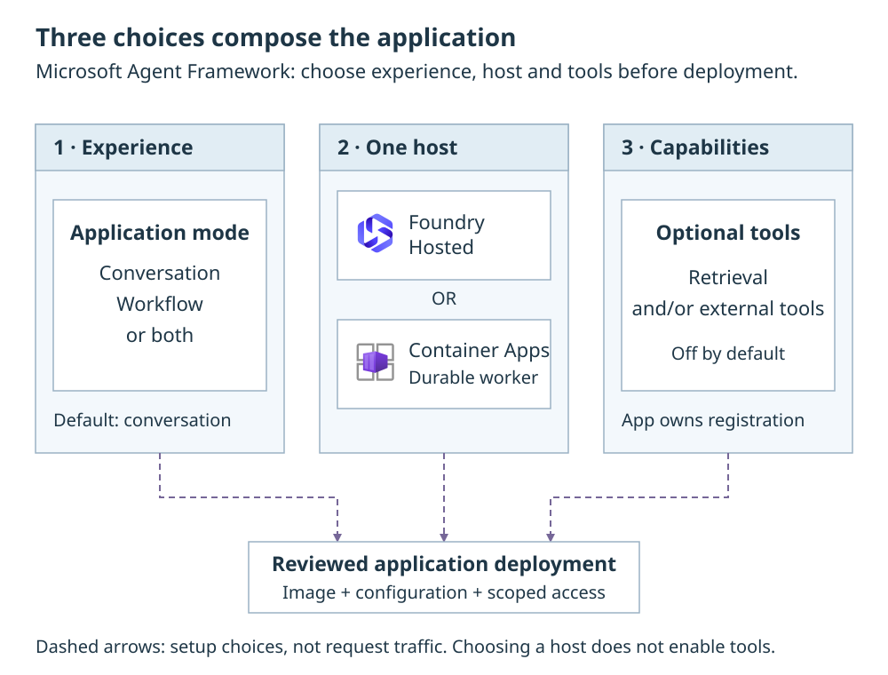

# Agents & prompts

Microsoft Agent Framework (MAF) provides two application building blocks:
an **Agent** for a conversation and a **Workflow** for a process with explicit
steps, conditions and human input. Hosting and tools are separate choices.
Creating a prompt agent in the Foundry portal does not replace the application
code, its instructions or its registered tools.

**Make three independent choices before deployment:** the experience
(`conversational`, `workflow` or `both`), one native host, and optional
capabilities. Reviewed application code composes them; selecting a host does
not automatically enable retrieval or MCP tools.

{: .runbook-diagram__image aria-label="Open full-size application choices diagram"}

[Open full-size diagram](../media/runbooks/agent-strategies.svg){: .runbook-diagram__open}

## Before you start

Use the compatible platform manifest and orchestrator source. To change
instructions, you need a reviewed source checkout and permission to build and
publish its image. To enable a capability, first prepare its source,
connection, network path and authorized runtime identity. Start with
[Agent hosting](hosted-agents.md#select-and-activate-a-host) if the application
is not deployed.

## Choose the application experience

`APPLICATION_MODE` selects the experience. The default is `conversational`.
Use the [deployment configuration](configuration.md#native-execution-selection)
to change the selection; this is not a per-message switch.

| Value | Experience |
| --- | --- |
| `conversational` | A MAF Agent answers questions and uses authorized tools. |
| `workflow` | A published MAF Workflow executes a named process and can wait for human input. |
| `both` | The UI offers conversation and a named process. On Hosted, these are two separate publications. |

`ORCHESTRATION_HOST` selects `hosted` or `container_apps`.
[Agent hosting](hosted-agents.md) explains the distinct native integrations
and their state ownership. Neither mode selects a retrieval strategy.
The UI presents the task, not a hosting or strategy picker.

## Choose capabilities independently

MCP, Foundry IQ and Azure AI Search are tools or retrieval capabilities, not
alternative agent implementations. An agent and a workflow can use the same
authorized capability when it is registered in their definitions.

- Use [Foundry IQ](foundry-iq.md) for a knowledge base over native or
  independently indexed sources.
- Use [Tools & MCP](agent-tools.md) for reviewed operations and downstream
  identity requirements.
- Use [Agent App MCP Server](agent-app-mcp.md) for explicitly selected toolsets
  on either host. Its default `MCP_TOOLSETS=[]` registers zero tools;
  `["nl2sql"]` selects the supplied [NL2SQL](nl2sql.md) tools, a distinct execution path
  from a remote Fabric data agent.
- Use [Document formats & images](multimodality.md) to distinguish document
  processing from direct image input in chat.

A source, model or MCP endpoint in configuration does not automatically make
that capability available. Its definition, permissions and network path must
all be present. Instructions cannot grant document access or turn a retrieval
source into a model-callable operation.

## Configure instructions

In the **orchestrator repository**, edit `src/native/prompts/main.txt` for the
shared agent instructions. `src/native/agent.py` loads that packaged file.
Both conversation and the workflow's draft step use this definition.
`src/native/workflow.py` owns the reference graph; `src/native/contracts.py`
owns its typed inputs, result and registration names.

1. Change instructions in the reviewed source, keeping task, grounding,
   citation and tool-use requirements explicit.
2. Test the changed behavior against synthetic inputs and existing native
   tests. Prompt text cannot grant source access or register new tools.
3. Build and publish the reviewed image through
   [Customize components](customize-components.md) and the matching
   [deployment procedure](deploy-full-stack.md#procedure).
   A portal prompt edit or App Configuration key does not replace the file.
4. Start a new interaction on the new publication/revision. Check a grounded
   answer, a denied source and required-tool failure before admitting users.
   Record the image/version with the result.

Graph, executor-ID and registration-name changes also require a compatible
publication and a recovery plan for waiting runs. Do not replace their
definition while assuming every pending native checkpoint remains compatible.

For a supported functional change such as `CHAT_TEMPERATURE` or
`CHAT_OUTPUT_TOKENS`, use the
[runtime-setting procedure](deploy-full-stack.md#change-a-runtime-setting)
under label `agent-lz`. These are functional values, not packaged instructions.
A running workflow retains its functional configuration snapshot; a new
configuration value does not rewrite a process that is already waiting.
Current authorization is checked separately on every interaction.

## Configure and test behavior

1. **Before provision**, select mode and host using
   [Agent hosting](hosted-agents.md#select-and-activate-a-host).
   For optional retrieval/tool flags, use the exact
   [agent capability declaration](application-settings.md#configure-an-agent-capability);
   do not assume a same-named azd environment variable is mapped.
2. Keep instructions focused on task, grounding, citations and tool use.
   Never include user tokens, credentials or private configuration in prompts.
3. Test a representative answer, required-source failure, denied user and
   cancellation. For workflows, also test pending human input, reconnect,
   rejection and a stale or duplicate reply.
4. Follow [Customize components](customize-components.md) and the
   [deployment guide](deploy-full-stack.md) for reviewed source and image
   deployment.

For process operation, see [Workflows & human input](workflows.md).
For caller boundaries, see [Sign-in & access](application-auth.md) and
the [API reference](application-api.md).
