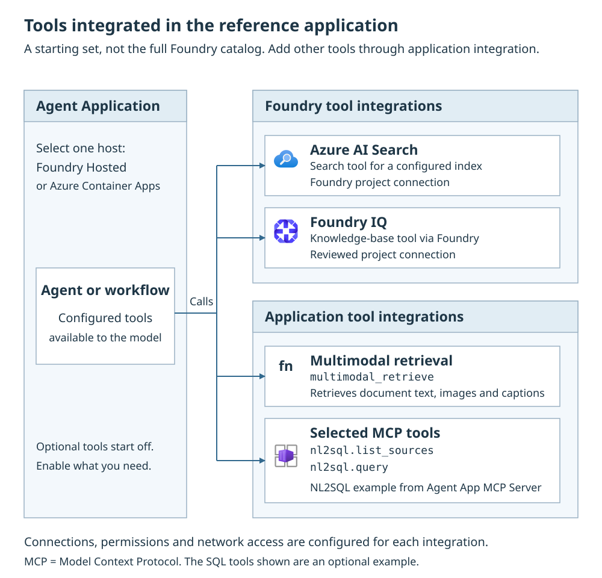

# Tools & MCP

Tools are approved operations that a MAF Agent or Workflow can call.
Model Context Protocol (MCP) exposes operations through a tool server.
Foundry IQ and Azure AI Search provide knowledge/retrieval capabilities.
These are not competing orchestration strategies.

Select the application experience and host through
[Agents & prompts](agent-strategies.md) and
[Agent hosting](hosted-agents.md), then register the required capabilities.
A portal connection or endpoint string alone does not attach a tool to
the running application.

**A registered capability is not a permission grant.** The application can
call configured retrieval capabilities and/or an authenticated MCP server.
Each path needs its own connection, network access and authorization.
All optional native capabilities start disabled.

{: .runbook-diagram__image aria-label="Open full-size tool capability boundaries diagram"}

[Open full-size diagram](../media/runbooks/agent-tools.svg){: .runbook-diagram__open}

## Before you start

Have a working authenticated application and decide which operation or source
it should expose. The deployer prepares connections and scoped grants; the
runtime identity invokes services. Source owners approve the accessible data,
including any delegated-user requirements. Test with synthetic data before
giving the model access to a production tool.

Native capabilities are **off by default**: `SEARCH_RETRIEVAL_ENABLED`,
`FOUNDRY_IQ_ENABLED`, `MCP_ENABLED` and
`MULTIMODAL_ENABLED`. Select only the capabilities whose source, identity,
network and tool contracts are configured.

The multimodal tool flag is
different from custom ingestion `MULTIMODAL` and inline private attachments.
See [Application settings](application-settings.md#native-application-contract).

For the integrated server, select `DEPLOY_AGENT_APP_MCP=true` before provision.
The lifecycle derives MCP connection and caller authorization settings.
Select tools separately with `MCP_TOOLSETS`: default `[]` registers zero tools;
`["nl2sql"]` selects the current SQL toolset. This application/runtime setting
uses label `agent-lz`, not new tool-specific foundation parameters.

## Enable a supported capability

1. **Before provision**, prepare the chosen source/tool and its network path.
    For integrated MCP, use the [server selection procedure](agent-app-mcp.md#select-and-deploy);
    do not manually invent its endpoint, scope or caller allowlist.
2. For native retrieval capabilities, edit the platform root
    `main.parameters.json` at
    `parameters.additionalAppConfigurationSettings.value`, preserving existing
    entries. Use `name`, string `value` and `label: "agent-lz"` as shown in the
    canonical [agent capability procedure](application-settings.md#configure-an-agent-capability).
    These flags are not implicitly mapped azd environment variables.
3. Use only a capability with its required bindings:

    | Capability flag | Required runtime bindings | Preparation |
    | --- | --- | --- |
    | `SEARCH_RETRIEVAL_ENABLED` | `SEARCH_CONNECTION_ID`, `SEARCH_RAG_INDEX_NAME`; optional `SEARCH_RAGINDEX_TOP_K` | An authorized Foundry Search connection and populated index |
    | `FOUNDRY_IQ_ENABLED` | `KNOWLEDGE_BASE_CONNECTION_ID`, `KNOWLEDGE_BASE_NAME` | [Foundry IQ source and connection](foundry-iq.md#how-to-connect-a-knowledge-base) |
    | `MULTIMODAL_ENABLED` | The [multimodal retrieval bindings](multimodality.md#extract-and-retrieve-figures) | Compatible index, models and invocation-local delegated Search authorization |

4. **Provision/deploy** with the matching
    [Bicep](deploy-full-stack.md#procedure) or
    [Terraform](deploy-terraform-full-stack.md#procedure) lifecycle.
    Changing these capability flags requires a new publication/worker restart:
    their composition is structural, not a functional hot reload.
5. **At runtime**, ask a question that needs the chosen source/tool. Verify
    an actual call, a grounded result and an unauthorized-user/source denial.
    A missing binding or required-tool outage must fail explicitly, not return
    a fabricated answer. Use safe trace correlation, not secret/argument dumps.

The shared native implementation composes these capabilities in the
orchestrator's `src/native/tools.py`. New tool implementations or changed
registration schemas need reviewed code and a compatible image, not just
another configuration key.

## Tools, Toolbox and knowledge

| Need | Integration boundary |
| --- | --- |
| Call an operation | A reviewed tool with a narrow schema and explicit authorization |
| Connect an MCP server | Registered MCP tools, authenticated transport and approved destination |
| Ground an answer | A configured Foundry IQ source or Search capability |
| Query approved Azure SQL or SQL Server data | NL2SQL tools hosted by Agent App MCP Server, with a Cosmos metadata catalog and read-only SQL principal |
| Wait for a person's decision | Native workflow human input, not a blocking tool socket |
| Change a process graph | Reviewed workflow definition and compatible publication |

A Foundry IQ `mcpServer` source is retrieval configuration, not automatically
a model-callable MCP tool. Its
[knowledge-source settings](foundry-iq.md#generic-mcp-knowledge-sources)
control source planning, output parsing and query credentials.

### Optional Agent App MCP Server

Agent App MCP Server exposes explicitly selected toolsets for Agents and
Workflows. Its available NL2SQL toolset provides `nl2sql.list_sources()` and
`nl2sql.query(source_id, question)`.

`DEPLOY_AGENT_APP_MCP=true` selects server compute and authentication.
`MCP_TOOLSETS=["nl2sql"]` selects the application Cosmos catalog and
model/declared-secret access. Search and document ingestion remain independent.

The operator still approves SQL destinations, read permissions and metadata.
The server's NL2SQL implementation—not the orchestrator—owns SQL connectivity,
metadata retrieval and generated-query validation. Operators import approved
metadata through the separate administrative importer.

The configured read-only principal queries the application's approved dataset,
without automatic per-user SQL delegation. This differs from a Foundry IQ
`fabricDataAgent` source, where Fabric owns execution.
Follow [Agent App MCP Server](agent-app-mcp.md) for deployment and
[NL2SQL](nl2sql.md) for source contracts, result limits and denial checks.

## Application-owned registration

Native host integrations run the application's agent/workflow definitions.
Code defines the model, instructions, tools and retrieval behavior. Foundry
hosting does not automatically consume a portal-managed prompt agent's tool
list, and a durable worker does not infer a process from App Configuration.

Use the registered capabilities for the selected application. Keep naturally
shared agent definitions and tools common where appropriate, but use explicit
Hosted and durable integrations rather than a universal host/state wrapper.

## Authorize and connect MCP safely

Agent App MCP Server uses a dedicated Entra API audience. The actual Hosted
or Container Apps caller must have the `MCP.Invoke` application role and an
allowed client ID. The platform coordinates that connection and authorization.
An API key, Foundry call ID, Cosmos/SQL token or browser user-context JSON does
not authenticate this server. SQL access is application-level, not delegated
end-user access.

For other reviewed MCP integrations, use their own supported authentication
and source-authorization contracts. A Foundry Toolbox connection and a
Foundry IQ MCP knowledge source do not replace the integrated server's contract.

Review the destination, transport, timeout, data handling and permissions
before enabling an MCP connection. Use HTTPS outside controlled local
development and approved egress from the actual application host.
Credentials belong in Key Vault only when the selected tool really needs
a secret; prefer managed identity where supported.

Authenticate the tool client and preserve the tool's verified end-user
context when user authorization is required. User-context JSON, caller-supplied
groups, an opaque call ID or a shared managed identity is not proof of the
user's entitlement. Keep credentials request-local and out of prompts,
history, functional snapshots and telemetry.

### Authenticated Toolbox contract

Foundry's [hosted Toolbox integration](https://learn.microsoft.com/azure/foundry/agents/how-to/tools/use-toolbox-hosted-agent)
uses an authenticated SDK client and trusted platform invocation context.
The application must actually invoke that supported integration.
Do not fabricate platform context or assume the browser's Authorization
header arrives unchanged inside a Hosted container.

The durable host uses its own explicit authenticated client/tool boundary.
Foundry invocation context must not be simulated on Container Apps.
Source-specific OBO and document permissions remain independently required;
a Search token is not a generic MCP user assertion.
See [Sign-in & access](application-auth.md).

## Application extension boundary

Keep integrations in the owning application's tool/connector modules:

- Validate typed inputs and bound results, timeouts and cancellation.
- Preserve source denial as denial; do not retry under a broader identity.
- Register a capability explicitly for the agent and/or workflow using it.
- Require tool authorization and a native human decision where the process
  calls for approval. A prompt instruction is not an approval control.
- For external writes, implement the target system's idempotency and recovery
  contract. Native durable execution does not guarantee exactly-once writes.

Grant only the required model, source, scheduler and secret access.
App Configuration Reader does not grant Key Vault secret access.

`NATIVE_TOOL_SECRET_NAMES` (default `[]`) is the platform's scoped-grant
declaration of actual names, not values. The native runtime does not consume
that setting to load secrets or enable tools.

Provision resources and grants before activation; startup must not repair
infrastructure. [Customize components](customize-components.md) and
[Bring your own app](build-your-own-app.md) describe ownership and adoption.

## Deployment and evidence

Changes to code, graph, tool registration or identity require a reviewed image
and compatible publication. Supported functional parameters refresh through
the official provider; workflow runs keep their functional snapshot.
Current source/tool authorization is rechecked rather than frozen in that
snapshot. See [Application settings](application-settings.md).

Verify actual tool calls, denied-user isolation, timeout/outage handling and
the absence of invented results when a required tool fails. A successful
deployment or portal registration is not this evidence.
Correlate operations without retaining secrets or sensitive tool arguments.
See [Monitoring & audit](application-monitoring.md).

Toolset selection is startup-scoped: provision matching dependencies and
restart/redeploy after a change. See the [server selection and lifecycle](agent-app-mcp.md#select-and-deploy)
for validation, extension and retention requirements.

## Failure boundaries

Missing tools can mean the application never registered them.
Authentication failures concern the client, connection and source separately.
Retain the authenticated caller boundary during recovery rather than
substituting service identity or silently dropping a required capability.
