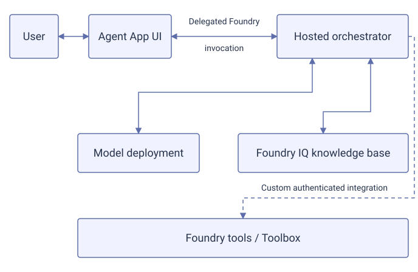

# Agent Application

Agent Application is the customizable reference app supplied by Agent Landing Zone.
The supplied `app-definition.json` identifies its UI, orchestrator and optional
ingestion components. Deployment composition applies the selected topology to
that definition. A fresh environment uses `hosted-no-panel`: Agent App UI runs
in Azure Container Apps and Agent App Orchestrator runs as a container in
Foundry Agent Service. Its default strategy is `maf_lite`.

These pages explain the components and their integration boundaries.
The [Deploy full stack runbook](deploy-full-stack.md) contains the deployment
procedure. [Bring your own app](build-your-own-app.md) covers customer-owned
applications.

## Capability readiness

Use this matrix to distinguish supplied behavior from work your team must do.
It describes the default **hosted Agent Application**, not every feature
offered by the underlying Foundry service.

**Default** means supplied in the selected topology after normal deployment,
network, sign-in and permission setup. **Configuration** needs operator changes
but no new application code for that capability. **Development** means settings
alone are insufficient. Preview status is stated separately; a service preview
does not make an application integration ready.

| Capability | Readiness | What is supplied or still needed |
| --- | --- | --- |
| Basic chat and active-session context | Default, without retrieval | The frontend calls the hosted `maf_lite` runtime and configured model for non-retrieval turns. Questions that trigger retrieval have the separate gate below. Context is not durable across browser reloads. [Hosting](hosted-agents.md#protocol-and-caller-access). |
| Entra login and delegated Foundry invocation | Configuration | Registration, two API consent boundaries, Key Vault references, callback and caller grants. Follow the [login sequence](application-auth.md#configure-login-in-order). |
| Native Blob source ingestion | Default | Foundry IQ manages the configured source pipeline without Agent App Ingestion. Source/service permissions and successful indexing are still required. [Ingestion](ingestion.md#1-standard-ingestion-with-foundry-iq). |
| Protected knowledge-base retrieval | Development | The hosted entry point does not supply trusted user context or a retrieval bearer. Implement authenticated retrieval and prove document allow/deny behavior; UI OBO alone does not do this. [Identity boundary](application-auth.md#3-verify-the-retrieval-identity-boundary). |
| Foundry tools, Toolbox and MCP operations | Development | Portal registration is not consumed automatically by `maf_lite`; add an authenticated invocation integration. MCP knowledge sources are not automatically model-callable tools. [Tools](agent-tools.md). |
| Work IQ, Fabric IQ and native SharePoint integrations | Development; service previews apply | Source-specific templates, consent, trusted delegation and, where applicable, response handling still need integration. See [Work IQ](work-iq.md), [Fabric IQ](fabric-iq.md) and [SharePoint](sharepoint.md). |
| Custom ingestion and SharePoint indexing | Configuration | Select Agent App Ingestion and configure its source, Graph permissions and schedule where needed. Processing/ACL synchronization does not close the hosted retrieval identity gap. [Custom ingestion](ingestion.md#3-custom-ingestion-only-when-needed). |
| Conversation PDF attachments | Development | Optional ingestion enables processing, but hosted retrieval also needs source binding, owner identity and delegated authorization. Uploads are off by default. [Conversation uploads](ingestion.md#2-conversation-file-uploads). |
| Text descriptions of document images | Configuration | Native extraction needs a supported model/region and source binding; the default chat model does not establish image verbalization. Protected retrieval still needs the integration above. [Document images](multimodality.md#document-image-grounding). |
| Direct screenshot, image or voice input | Not supplied | Requires an application extension; document image extraction is not direct multimodal input. [Extensions](multimodality.md#direct-image-and-voice-extensions). |
| Durable conversation continuity and history | Configuration and authorization validation | Off by default. Requires reviewed delegated permissions, owner isolation and evidence gates; panel history also needs the optional panel. Enabling one flag is insufficient. [Continuity](hosted-agents.md#continuity-history-and-the-administrative-panel). |
| Hosted ratings/comments and feedback administration | Development | The default layout has no feedback collection. Optional panel APIs still need a custom chat control/adapter and validated ownership. [Feedback](user-feedback.md). |
| Embedding chat in an existing portal | Development | The UI adapter is supplied; the host portal must implement trusted token acquisition, origin/CSP and lifecycle integration. [Embed chat](embed-chat.md). |
| Teams/M365 or Copilot Studio publication | Manual configuration and validation | Separate post-deployment runbooks, not automatic publication. Channels have different network and caller-identity contracts. [Teams/M365](publish-to-teams.md) and [Copilot Studio](connect-copilot-studio.md). |

In particular, successful provisioning, source ingestion or a greeting response
does not establish protected retrieval. Use the linked capability's
prerequisites and acceptance checks before presenting it to users.

## Application components

### Frontend

An Entra **tenant** is an organization's identity directory. An API **access
token** is a credential: its **audience** identifies the receiving API, and a
delegated **scope** identifies a permitted operation on behalf of a user.
It is a **bearer** token because possession lets a caller present it, so it
must stay protected.

A **delegated call** acts for the signed-in user;
on-behalf-of (OBO) exchanges that user's token for a downstream API token.

Agent App UI supplies chat, sign-in and the delegated call to the hosted agent.
Its optional embedding and feedback surfaces have separate integration limits.

| Concept | Reference |
| --- | --- |
| UI admission, Foundry invocation and document authorization | [Sign-in and document access](application-auth.md) |
| Chat inside an existing portal | [Embed chat](embed-chat.md) |
| Ratings and comments | [User feedback](user-feedback.md) |

### Agent hosting

[Agent hosting](hosted-agents.md) explains the hosted container, immutable image
handoff and runtime identities. Hosting the container in Foundry does not turn
its code into a portal-managed prompt agent.

### Model, tools and knowledge base

**Grounding** supplies retrieved information so the model can answer from
connected sources.

The default `maf_lite` code calls the configured model deployment directly.
Its configured grounding path is the Foundry IQ knowledge-base connector,
with `RETRIEVAL_BACKEND=foundry_iq` as the fresh default. A knowledge base
binds sources and returns retrieved content; it is not the model or the
hosted container.

Foundry offers native tools and Toolbox connections. A **Toolbox** groups tools
and their connections, including tools exposed through **Model Context Protocol
(MCP)**, a protocol for making operations callable by agents.
These are the service integration path for additional operations. The supplied
`maf_lite` code does **not** automatically consume a Toolbox added in the portal.
An authenticated Toolbox integration requires application development.
[Agent tools](agent-tools.md) describes that contract.

1. **User and Agent App UI** exchange messages.
2. **Agent App UI and hosted orchestrator** communicate through delegated
   Foundry invocation.
3. **The hosted orchestrator** exchanges requests and responses with the
   model deployment and the Foundry IQ knowledge base as separate dependencies.
4. **Foundry tools / Toolbox** require a custom authenticated integration
   from the hosted orchestrator; the supplied application does not consume
   portal-added tools automatically.

{: .runbook-diagram__image aria-label="Open full-size application request diagram"}

[Open full-size diagram](../media/application-flow.svg){: .runbook-diagram__open}

The flow shows request dependencies, not proof of document authorization.
The built-in native retrieval path separately exchanges and forwards a
delegated Search token; native permissions remain enforced independently of
Foundry invocation. Required retrieval fails without that credential.
This path does not require adding a Toolbox in the portal or customer-written
identity integration. Consent, source permissions and allow/deny validation
remain necessary; see [Agent Application access](application-auth.md).

### Ingestion

Fresh environments use native Foundry IQ ingestion for the configured Blob
source, without Agent App Ingestion. The optional ingestion Container App
provides application-managed processing and eligible conversation PDF uploads.
Native source ingestion alone does not enable chat attachments.
[Ingestion and conversation uploads](ingestion.md) explains these boundaries.

### Grounding

| Knowledge | Reference |
| --- | --- |
| Documents and knowledge-base retrieval | [Foundry IQ](foundry-iq.md) |
| Microsoft 365 knowledge | [Work IQ](work-iq.md) |
| Fabric data and data agents | [Fabric IQ](fabric-iq.md) |
| SharePoint content | [SharePoint](sharepoint.md) |

### Capabilities and extensions

[Multimodality](multimodality.md) distinguishes document image extraction from
direct image or voice input. [NL2SQL](nl2sql.md) explains structured-data
grounding and the boundary for custom SQL tools.

## Know what you are changing

**Deployment inputs** select Azure resources and application components.
**Runtime settings** control the supplied application's behavior, typically in
Azure App Configuration with label `agent-lz`. Other applications can have
different runtime settings. [Deployment settings](configuration.md) identifies
the owner and location of each value.

Runtime configuration is cached in process. A changed hosted runtime setting
requires a new agent version; affected UI or ingestion processes also need to
reload their settings. The [Deploy full stack runbook](deploy-full-stack.md)
covers deployment and redeployment.
