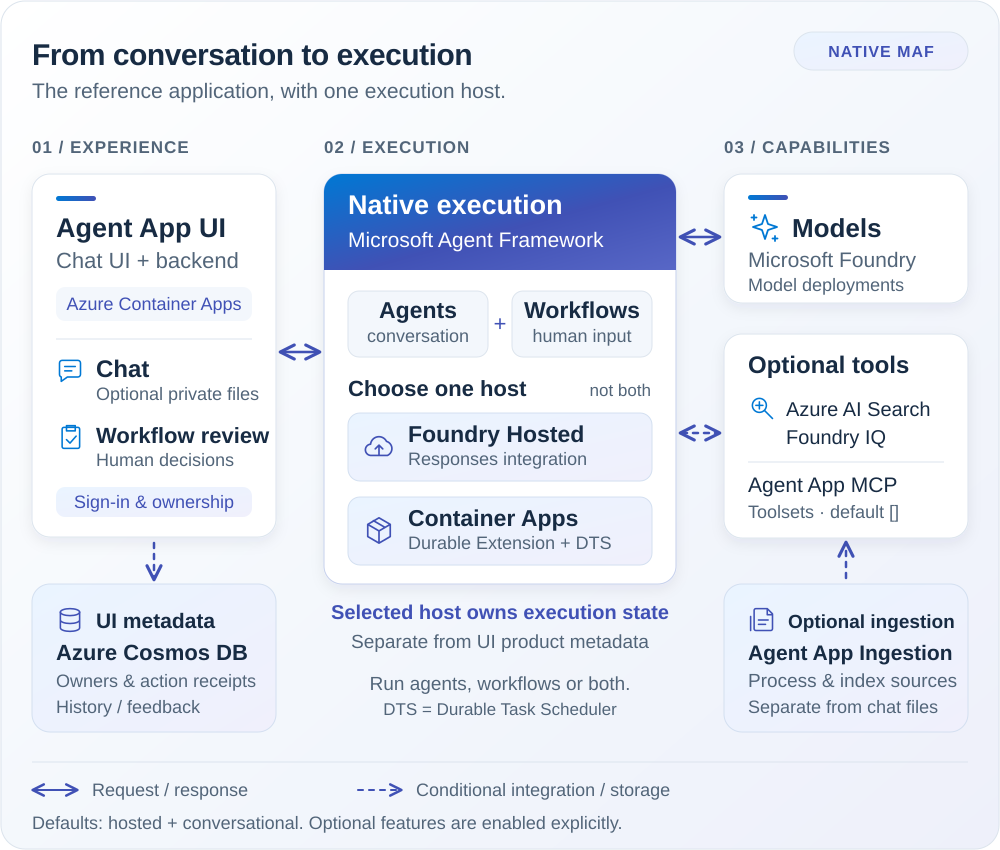

# Agent Application

Agent Application is the reference application included with Agent Landing Zone.
It brings together a Chainlit chat/process interface, native Microsoft Agent
Framework (MAF) execution, optional document processing and optional MCP tools. Use an Agent for
conversation or a Workflow for a published process with human input.

Start with [Deploy full stack](deploy-full-stack.md) to deploy the application.
The guides below explain how to configure, operate and extend it.

The reference application is **one application on the reusable foundation**,
not the definition of that foundation. To deploy other components instead of
the supplied UI/orchestrator, select your own
[application definition](build-your-own-app.md#application-binding-and-selection)
before provision. Application composition owns component names, tool selection
and dependency declarations; the foundation accepts generic compute, data,
capability and role inputs.

## First time using Agent Application?

Start with ordinary authenticated chat. Add data sources and other capabilities
after that baseline works.

| Order | Your next step | What to verify before continuing |
| --- | --- | --- |
| 1. Prepare | Review the full-stack [prerequisites](deploy-full-stack.md#prerequisites), budget, region, permissions and network | You have a deployment host, supported models and both Azure and Entra administrators where required |
| 2. Install | Follow the full-stack guide for [Bicep](deploy-full-stack.md) or [Terraform](deploy-terraform-full-stack.md), not both | The selected infrastructure and real application images are deployed |
| 3. Complete sign-in | Follow [login setup in order](application-auth.md#configure-login-in-order), including the post-provision callback and user grants | Your pilot user can sign in and invoke the agent, an unapproved user is denied |
| 4. Start a conversation | Open the frontend HTTPS URL from deployment outputs, sign in and send a simple greeting | The application receives a real model response |
| 5. Add a capability | Select a route in the table below and complete its source/identity setup | The capability works with permitted data and rejects denied access |
| 6. Operate | Set retention, review [monitoring](application-monitoring.md) and follow [updates and recovery](deployment-operations.md) | Owners know how to diagnose failures and apply controlled changes |

Provisioning and login setup are interleaved: register the UI application and
arrange consent **before provision**, then configure its actual callback,
secrets and admission **after provision and before deploy**.
The deployment guide marks that handoff explicitly.

The first greeting proves model connectivity, not document retrieval, SQL
readiness, saved history or workflow recovery. The default application does
not automatically know your organization's documents or databases.

### Choose what to add next

| You want to | Follow | Important distinction |
| --- | --- | --- |
| Ask about shared documents | [Foundry IQ](foundry-iq.md) and [source ingestion](ingestion.md) | Connect and authorize a source, enable its retrieval capability and check document allow/deny behavior |
| Ask about approved SQL data | [Agent App MCP Server](agent-app-mcp.md) and [NL2SQL walkthrough](nl2sql.md) | Explicitly select the `nl2sql` toolset as well as the optional server, approve SQL read access and import metadata |
| Run a process with human review | [Workflows & human input](workflows.md) | Select `workflow` or `both`, publish the process and test both approval and rejection |
| Reopen saved conversations | [Conversations & files](conversations.md) | Native execution persistence is not the same as enabled UI history discovery |
| Collect ratings | [User feedback](user-feedback.md) | Feedback is independently enabled and has its own metadata and access requirements |
| Add private files to a conversation | [Private attachments](conversations.md#private-attachments) | Independently enabled, conversational only, bounded formats/sizes, not shared knowledge publication |
| Customize document processing | [Agent App Ingestion](ingestion.md#3-custom-ingestion-only-when-needed) | Deploy it only for a processing path that needs it |
| Add another channel or your own code | [Chat & channels](#chat-channels) and [Bring your own app](build-your-own-app.md) | Each integration has its own identity, deployment and acceptance requirements |

## How the components fit together

[Open the full-size diagram](../media/agent-application-overview.svg)

| Component | What it does |
| --- | --- |
| Agent App UI/BFF | Provides sign-in, chat/process presentation, owner mappings, product metadata and feedback. |
| Agent App Orchestrator | Runs native MAF Agents and Workflows, using the explicit integration for the selected host. |
| Agent App Ingestion | Provides optional application-managed document processing and indexing. |
| [Agent App MCP Server](agent-app-mcp.md) | Extensible official Python SDK server in a separate Container App. Registers zero tools by default; `["nl2sql"]` explicitly selects the supplied SQL toolset. |

## Default deployment

The default deployment has web chat in Azure Container Apps and an
orchestrator hosted in Microsoft Foundry. The public native selectors are
`ORCHESTRATION_HOST=hosted` and `APPLICATION_MODE=conversational`, their defaults.
The UI is included automatically. Native Hosted execution does
not require application-owned Cosmos DB; Foundry backing resources and
optional UI product storage are separate concerns.
Search, Foundry IQ and multimodal tool flags default to off.
Agent App MCP Server is also omitted by default (`DEPLOY_AGENT_APP_MCP=false`).
When deployed, its `MCP_TOOLSETS` still defaults to `[]`: no business tools
or NL2SQL dependencies are initialized until explicitly selected.
Preparing a source does not register a tool. History, feedback and private
attachments also default to off; conversational UI owner maps are then bounded
and volatile, not a restart-safe saved-session store.

Foundry IQ manages
ingestion for the configured native Blob source. Deploy Agent App Ingestion
only when a selected custom processing path needs it; it is disabled by
default. A private conversation attachment is not a shared source-ingestion
request. Hosting owns native execution state, not the UI's history discovery,
feedback or per-user document authorization.

## Choose only the capabilities you need

| Your requirement | What to select | What is deployed or required |
| --- | --- | --- |
| Web conversation | Default `conversational` mode and `hosted` host | UI in Container Apps and a Foundry-hosted orchestrator; no application Cosmos without a storage consumer |
| A process with human review | `workflow` or `both` | Native workflow execution plus Cosmos UI ownership/action metadata |
| Durable Container Apps execution | `ORCHESTRATION_HOST=container_apps` | Native worker/client and Durable Task Scheduler instead of Hosted execution |
| Saved history, feedback or private chat files | The corresponding application feature | Application Cosmos for product metadata; private file bytes are not stored there |
| Authenticated MCP server without business tools | `DEPLOY_AGENT_APP_MCP=true`, `MCP_TOOLSETS=[]` | Separate Container App and MCP authentication; no NL2SQL model, catalog or secret grants |
| Questions over approved SQL data | `DEPLOY_AGENT_APP_MCP=true` and `MCP_TOOLSETS=["nl2sql"]` | MCP server plus application Cosmos catalog and model access; operator-approved SQL access and metadata import |
| Custom shared-document processing | `DEPLOY_INGESTION_CONTAINER_APP=true` | Optional ingestion component and its selected source/index dependencies |

The platform handles resource dependencies and generated connections.
You still choose the data sources, arrange authorization and provide approved
content. For NL2SQL, SQL owners approve database access and operators import
the catalog. Search and document ingestion are independent capabilities.

### What Cosmos means in this application

There are separate storage responsibilities:

- **Application Cosmos** is conditional. It is required automatically for
  workflow/`both` UI metadata, enabled history, feedback or private attachments,
  the selected NL2SQL toolset, retained catalogs and declared custom Cosmos capabilities.
  A compatible existing application account is reused, with separate containers
  and scoped grants for each consumer.
- **Foundry backing Cosmos** belongs to Foundry's service infrastructure.
  It is not the application catalog or UI database.
- **Native execution state** belongs to the selected host: Foundry persistence
  for Hosted, or Durable Task Scheduler for Container Apps. UI Cosmos is not a
  workflow checkpoint store.

You may also select generic application Cosmos with `DEPLOY_COSMOS_DB=true`
without MCP or the reference orchestrator, including for a custom application.
See [Application Cosmos DB](configuration.md#application-cosmos-db).
The normal standalone and customer-owned application paths remain available.

## Application mode and host

`APPLICATION_MODE` selects `conversational`, `workflow` or `both`.
`ORCHESTRATION_HOST` selects `hosted` or `container_apps`.
These are deployment choices, not a user-facing strategy selector.
History, feedback and private attachments remain independently selected
default-off features. Selecting Hosted does not enable history.
Workflow mode and `both` always require UI metadata, even with every product
flag off.

Hosted uses the official Responses integration and native persistence.
Container Apps uses the official Durable Extension worker/client and
Durable Task Scheduler. When both experiences use Hosted, conversation and
workflow are published as separate applications with separate endpoints.
See [Agent hosting](hosted-agents.md) and
[Workflows & human input](workflows.md).

The application repositories contain the code. These guides are the shared
documentation for the application components. The
[release manifest](https://github.com/Azure/agent-landing-zone/blob/main/manifest.json)
records their compatible versions.

## Before you invite users

Deployment creates the selected resources, but connecting a source and signing
in do not by themselves prove that every user has the right document access.
Complete the [sign-in and access setup](application-auth.md), configure the
sources you need and check both allowed and denied access.

Optional capabilities have their own prerequisites. Saved history and feedback
default to off; a selected workflow declares UI metadata storage independently
of native execution state. Private attachments have an explicit feature gate,
an owner-bound inline native input path and their own retention requirements.
They are conversational only; transport support is not proof of model
PDF/image understanding.
Additional channels and external tools have separate integration requirements.
For SQL, complete [MCP source onboarding](agent-app-mcp.md#onboard-sql-before-inviting-users):
authorize a read-only database principal, import approved metadata and verify
known results and denials. A deployed MCP container is not a populated catalog.

## Find your guide

### Agents

Choose [where execution runs](hosted-agents.md), configure
[agents and prompts](agent-strategies.md), operate
[workflows and human input](workflows.md), or connect
[tools and MCP servers](agent-tools.md). A tool lets an agent perform an
operation. Retrieval supplies information for its answer.
For the optional tool server, start with [Agent App MCP Server](agent-app-mcp.md)
to understand deployment, automatic configuration and operator responsibilities.
Its current NL2SQL tools have their own SQL onboarding procedure.

### Chat & channels

Configure [sign-in and access](application-auth.md),
[conversations and files](conversations.md), and [user feedback](user-feedback.md).
To reach users elsewhere, [embed chat in a portal](embed-chat.md),
[publish to Teams and Microsoft 365](publish-to-teams.md), or
[connect Copilot Studio](connect-copilot-studio.md).
These channels have different identity and network requirements. They do not
all use the web chat's session or sign-in flow.

### Knowledge & retrieval

Retrieval finds relevant information from your connected sources so that
the agent can use it in an answer. Start with [Foundry IQ](foundry-iq.md),
then follow the guide for [Work IQ](work-iq.md), [Fabric IQ](fabric-iq.md),
[SharePoint](sharepoint.md) or [structured data and NL2SQL](nl2sql.md).
These guides explain the available integration paths and their prerequisites.

### Document ingestion

Decide [when you need the ingestion service](ingestion.md), check
[document formats and image processing](multimodality.md), and configure
[jobs and schedules](ingestion-jobs.md).
Preparing a shared document collection is not private conversation input.
Shared ingestion does not enable private uploads. Processing images inside a
shared document also does not imply direct image or voice chat input.

### Operations

Change [application settings](application-settings.md), use the
[administrative panels](operations.md), and review
[monitoring and audit events](application-monitoring.md).
For failures, use [Troubleshooting](troubleshooting.md).

### AgentOps

Use the [AgentOps Accelerator](agentops.md) to evaluate, ship and operate
your workload on Agent Landing Zone.

### Development & customization

[Run the components locally](local-development.md),
[customize their behavior](customize-components.md), consult the
[API reference](application-api.md), and run the
[tests and quality checks](application-testing.md).
To replace the reference application, follow [Bring your own app](build-your-own-app.md).

## Know what you are changing

**Deployment settings** select resources, networking and which components are
deployed. They belong in the [deployment configuration](configuration.md).
**Application settings** control runtime behavior and normally live in Azure
App Configuration under the `agent-lz` label.
[Application settings](application-settings.md) explains how to change them
and when a reload or restart is required.

Keep deployment and redeployment steps in the
[deployment guide](deploy-full-stack.md). Do not run deployment hooks merely
to inspect a configuration value or execute a local test.
