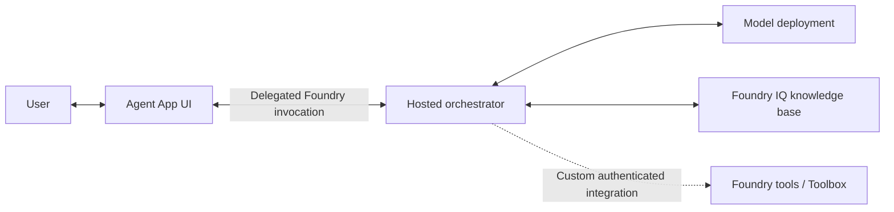

# Agent Application

Agent Application is the customizable reference app supplied by Agent Landing Zone.
The supplied `app-definition.json` identifies its UI, orchestrator and optional
ingestion components. Deployment composition applies the selected topology to
that definition. A fresh environment uses `hosted-no-panel`: Agent App UI runs
in Azure Container Apps and Agent App Orchestrator runs as a container in
Foundry Agent Service. Its default strategy is `maf_lite`.

These pages explain the components and their integration boundaries.
The [Deploy full stack runbook](deploy-full-stack.md) contains the deployment
procedure. [Bring your own app](build-your-own-app.md) covers customer-owned
applications.

## Application components

### Frontend

An Entra **tenant** is an organization's identity directory. An API **access
token** is a credential: its **audience** identifies the receiving API, and a
delegated **scope** identifies a permitted operation on behalf of a user.
It is a **bearer** token because possession lets a caller present it, so it
must stay protected.

A **delegated call** acts for the signed-in user;
on-behalf-of (OBO) exchanges that user's token for a downstream API token.

Agent App UI supplies chat, sign-in and the delegated call to the hosted agent.
Its optional embedding and feedback surfaces have separate integration limits.

| Concept | Reference |
| --- | --- |
| UI admission, Foundry invocation and document authorization | [Sign-in and document access](application-auth.md) |
| Chat inside an existing portal | [Embed chat](embed-chat.md) |
| Ratings and comments | [User feedback](user-feedback.md) |

### Agent hosting

[Agent hosting](hosted-agents.md) explains the hosted container, immutable image
handoff and runtime identities. Hosting the container in Foundry does not turn
its code into a portal-managed prompt agent.

### Model, tools and knowledge base

**Grounding** supplies retrieved information so the model can answer from
connected sources.

The default `maf_lite` code calls the configured model deployment directly.
Its configured grounding path is the Foundry IQ knowledge-base connector,
with `RETRIEVAL_BACKEND=foundry_iq` as the fresh default. A knowledge base
binds sources and returns retrieved content; it is not the model or the
hosted container.

Foundry offers native tools and Toolbox connections. A **Toolbox** groups tools
and their connections, including tools exposed through **Model Context Protocol
(MCP)**, a protocol for making operations callable by agents.
These are the service integration path for additional operations. The supplied
`maf_lite` code does **not** automatically consume a Toolbox added in the portal.
An authenticated Toolbox integration requires application development.
[Agent tools](agent-tools.md) describes that contract.

The flow shows request dependencies, not proof of document authorization.
The built-in native retrieval path separately exchanges and forwards a
delegated Search token; native permissions remain enforced independently of
Foundry invocation. Required retrieval fails without that credential.
This path does not require adding a Toolbox in the portal or customer-written
identity integration. Consent, source permissions and allow/deny validation
remain necessary; see [Agent Application access](application-auth.md).

### Ingestion

Fresh environments use native Foundry IQ ingestion for the configured Blob
source, without Agent App Ingestion. The optional ingestion Container App
provides application-managed processing and eligible conversation PDF uploads.
Native source ingestion alone does not enable chat attachments.
[Ingestion and conversation uploads](ingestion.md) explains these boundaries.

### Grounding

| Knowledge | Reference |
| --- | --- |
| Documents and knowledge-base retrieval | [Foundry IQ](foundry-iq.md) |
| Microsoft 365 knowledge | [Work IQ](work-iq.md) |
| Fabric data and data agents | [Fabric IQ](fabric-iq.md) |
| SharePoint content | [SharePoint](sharepoint.md) |

### Capabilities and extensions

[Multimodality](multimodality.md) distinguishes document image extraction from
direct image or voice input. [NL2SQL](nl2sql.md) explains structured-data
grounding and the boundary for custom SQL tools.

## Know what you are changing

**Deployment inputs** select Azure resources and application components.
**Runtime settings** control the supplied application's behavior, typically in
Azure App Configuration with label `agent-lz`. Other applications can have
different runtime settings. [Deployment settings](configuration.md) identifies
the owner and location of each value.

Runtime configuration is cached in process. A changed hosted runtime setting
requires a new agent version; affected UI or ingestion processes also need to
reload their settings. The [Deploy full stack runbook](deploy-full-stack.md)
covers deployment and redeployment.
