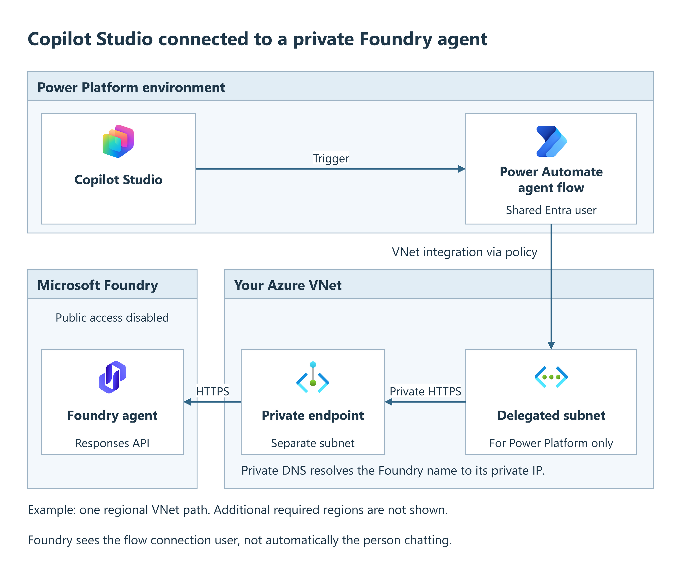

# Connect Copilot Studio to a private Foundry agent

## Objective

Connect a **Copilot Studio agent** to an existing **Microsoft Foundry hosted
agent** without enabling Foundry public network access.

You will reuse the existing Foundry agent and network, then create a relay flow
and a dedicated pilot agent in Copilot Studio.

## What you'll have after this runbook

A Copilot Studio agent that calls your private Foundry agent through an
authenticated Power Automate flow.



The figure shows one regional path, with separate subnets in your Azure VNet.

Foundry receives the flow connection user's identity, not automatically the
identity of the person chatting.

## When to use

Use this runbook when Copilot Studio needs to call an existing private Foundry
agent through an authenticated flow. It is a shared-connection relay, not the
native connected-agent setup or automatic per-user delegation.

The delegated subnet is in **your Azure VNet**, not inside Copilot Studio.
It must be dedicated to Power Platform.

It can use the VNet containing the Foundry private endpoint, provided that
VNet meets Power Platform's regional requirements. Use **different subnets**
for Power Platform delegation and private endpoints.

Another connected VNet also works if routing, private DNS and HTTPS reach the
Foundry private endpoint. Do not reuse the private-endpoint or Container Apps
subnet for Power Platform delegation.

!!! note "Why use a flow in this scenario?"
    This runbook covers **Foundry with Public Network Access (PNA) disabled**.
    It uses a Power Automate flow because the HTTP connector supports
    [virtual network integration](https://learn.microsoft.com/connectors/webcontents/#virtual-network-support-subnet-delegation),
    allowing HTTPS requests to reach Foundry through its private endpoint.

    The [native Microsoft Foundry integration](https://learn.microsoft.com/microsoft-copilot-studio/add-agent-foundry-agent)
    follows a separate setup, outside this procedure.

    In the documented lab, native connector requests still arrived through
    public ingress after VNet association and returned HTTP 403 with PNA disabled;
    the flow used the delegated private path successfully. These results are
    specific to that lab, not proof that native integration is impossible in
    every environment. Evaluate the native integration separately.

## Prerequisites

- **Foundry:** A running, tested hosted agent. Ask its owner for the stable
  **Responses URL** and **active agent version**. Use the agent endpoint shown in
  Step 3, not a Container Apps `/invocations` URL or an Activity endpoint.
  The Agent Application UI integrates a separate delegated Search credential;
  this relay does not automatically reproduce that exchange. Before using
  protected sources, prove the relay's supported per-user downstream credential
  path and source authorization. A working relay is not that evidence.
- **Azure network:** The platform team has already delivered the Power Platform
  subnet (default `powerplatform-subnet`, `192.168.4.0/24`, delegated to
  `Microsoft.PowerPlatform/enterprisePolicies`), regional connectivity,
  an enterprise policy and its
  **Azure resource ID**, an approved Foundry private endpoint and private DNS.
  Every subnet referenced by the
  policy must resolve and reach Foundry over HTTPS. Foundry **public network
  access must be Disabled**.
- **Power Platform:** A **Managed Environment** with Dataverse, a maker account
  allowed to create agents, flows and connections, and a Power Platform
  administrator to associate the enterprise policy. The administrator needs
  read access to that Azure policy.
- **Governance:** Your data policies permit the trigger and HTTP connector
  together. Confirm Copilot Studio capacity and premium-connector entitlements;
  this connector is Premium. Azure hosting and model charges are separate.
  See [agent-flow licensing](https://learn.microsoft.com/microsoft-copilot-studio/flows-faqs).
- **Recovery record:** Record the current enterprise-policy association and any
  existing agent-scoped grant. If changing an existing solution, export/version
  it before editing and retain its connection-reference settings. Use a dedicated
  pilot agent so disabling the relay does not interrupt unrelated topics.

Creating Azure network resources is outside this procedure. The enterprise
policy must reference the required regional networks and be associated with
the environment. Use the
[Power Platform setup requirements](https://learn.microsoft.com/power-platform/admin/vnet-support-setup-configure)
if the platform handoff is incomplete.

Use the [required regional VNets](https://learn.microsoft.com/power-platform/admin/vnet-support-overview#supported-regions)
for the Power Platform environment. Geographies with multiple supported
regions require two VNets in the specified Azure regions; every delegated
subnet must reach Foundry privately. The figure illustrates one regional
path, not the complete regional setup.

!!! warning "Foundry uses the connection user's permissions"
    This procedure uses a **specific, shared connection** signed in as an
    approved Microsoft Entra user in the Foundry tenant. Foundry sees that
    connection user, **not automatically the person chatting in Studio**.
    Do not use it for user-specific document permissions unless your application
    independently enforces them. Require authentication, restrict the Studio
    agent to approved users and approve the data they can all access.

    Per-user connections require a separate identity and channel design; they
    are not enabled by forwarding a user name in the prompt. See
    [flow connection credentials](https://learn.microsoft.com/microsoft-copilot-studio/advanced-flow-create#manage-which-connections-are-used-by-the-flow).

## Procedure

Complete Steps 1-4 in order with the named administrators and maker, then run
[Validation](#validation) before publishing to users.

### Step 1: Associate the environment with the private network

A **Power Platform administrator** performs this step. Schedule the change:
it affects other supported workloads in the environment and can cause up to
30 minutes of connection instability.

1. In the [Power Platform admin center](https://admin.powerplatform.microsoft.com/),
   open **Manage > Environments**, select the target environment and record its
   **Environment ID** from **Details**.
   Select this same environment in Copilot Studio and Power Automate.
2. Open **Security > Data and privacy > Azure Virtual Network policies**.
   Select the environment, select the prepared policy and **Save**. If the
   association is already correct, make no change.
3. Open **Manage > Environments**, select the environment, then **History**.
   Wait for the policy operation to show **Succeeded** before testing.
4. Have the platform team confirm private DNS, routing and HTTPS access from
   **each** delegated regional subnet, not just from the jumpbox.
5. In the Azure portal, open the Foundry resource's **Networking** settings.
   Confirm public network access is **Disabled** and the intended private
   endpoint connection is **Approved**. Do not change either setting to get a
   successful test.

**Expected result:** The Managed Environment is linked to the intended policy,
and all its regional paths can reach the Foundry private endpoint.

### Step 2: Authorize the connection user

Have an authorized Azure RBAC administrator grant the connection user
**Foundry Agent Consumer** on the **specific agent**, if equivalent access is
not already present. This allows invocation without authoring access.
The agent's own identity and downstream permissions are separate; do not replace
them with the connection user's identity.

<details class="runbook-command" markdown="1">
<summary>PowerShell: grant access to this agent only</summary>

Run with PowerShell 7 and Azure CLI. Replace every placeholder; use the
**object ID of the user who will sign in to the connection**, not an app client ID.
Copy **Object ID** from that user's **Overview** in the Microsoft Entra admin
center.

```powershell
$ErrorActionPreference = "Stop"
$PSNativeCommandUseErrorActionPreference = $true

$subscriptionId = "<subscription-id>"
$agentScope = "/subscriptions/$subscriptionId/resourceGroups/<resource-group>/providers/Microsoft.CognitiveServices/accounts/<foundry-resource>/projects/<project>/agents/<agent>"
$connectionUserObjectId = "<connection-user-object-id>"

az login
az account set --subscription $subscriptionId
az role assignment create `
    --assignee-object-id $connectionUserObjectId `
    --assignee-principal-type User `
    --role "eed3b665-ab3a-47b6-8f48-c9382fb1dad6" `
    --scope $agentScope `
    --query "{id:id,scope:scope}" --output json
```

</details>

**Expected result:** The assignment targets the intended user and agent.
Keep the returned `id` for rollback if this is a new pilot-only grant, and
allow time for the permissions to take effect.
Do not grant subscription Owner, broad Contributor or extra project-authoring
roles to resolve an invocation failure. See
[Foundry RBAC and agent scopes](https://learn.microsoft.com/azure/foundry/concepts/rbac-foundry#agent-scope-role-assignments).

### Step 3: Create the authenticated agent flow

In Copilot Studio, select **Flows > New flow > Agent flow**. Use the environment
from Step 1 and name the flow **Call private Foundry agent**. Keep it in a solution
so it can be moved with its connection reference; the solution is the deployment
package for these items.

!!! note "Use the flow's expression editor"
    In this step, paste expressions into the flow designer's **Expression**
    editor (**fx**), not as plain text. Step 4 uses Copilot Studio's
    **Formula** tab instead.

#### Input and connection

1. In **When an agent calls the flow**, add one **Text** input named `message`.
   Open the trigger's **Code view / Peek code** and find the property whose
   `title` is `message`. Its generated key is **`text`** in the tested designer;
   `message` is only the display name. Use the actual key in the body expression.
2. Between the trigger and **Respond to the agent**, add **Invoke an HTTP
   request** from **HTTP with Microsoft Entra ID (preauthorized)**.
   Do **not** use **Get web resource**; it is not supported with VNet delegation.
3. Create a connection with **Log in with Microsoft Entra ID**, using:

| Connection field | Value |
| --- | --- |
| Microsoft Entra ID Resource URI (Application ID URI) | `https://ai.azure.com` |
| Base Resource URL | `https://<foundry-resource>.services.ai.azure.com` |
| Sign-in account | The connection user authorized in Step 2 |

**"Preauthorized" refers to the Microsoft application used by the connector.**
Requests use HTTPS and the connection user's Microsoft Entra identity.
The agent-scoped permissions from Step 2 authorize access to Foundry.

Do not append the project path to the base URL or use the resource hostname as
the token audience. Do not supply a bearer token, API key or client secret.
If tenant policy blocks the connector or requires consent, stop and have the
administrator review the [connector's permission requirements](https://learn.microsoft.com/connectors/webcontents/);
do not bypass the policy with another connector.

<a id="http-request"></a>

#### HTTPS request

Keep the action name **Invoke an HTTP request**. The expressions below reference
its internal name, `Invoke_an_HTTP_request`; check that name in Code view if the
designer adds a suffix. If it differs, update every `body(...)` reference in the
response expression below.

| Request field | Value |
| --- | --- |
| Method | `POST` |
| URL | The fixed agent Responses URL below |
| Header | `Content-Type`: `application/json` |
| Retry policy | **None** for the pilot; a repeated POST can duplicate work |

```text
https://<foundry-resource>.services.ai.azure.com/api/projects/<project>/agents/<agent>/endpoint/protocols/openai/responses?api-version=v1
```

Use the exact stable **Responses** URL from the agent's **Publish** dropdown in
Foundry, or ask its owner for it. Do not substitute display names into the
template. Do not let the chat user or generative orchestration choose the URL,
method, headers or connection.

!!! note "API version is not the agent version"
    Keep `api-version=v1` unchanged. Foundry selects the **active agent version**
    behind the stable URL; do not add that version to the URL. Record and verify
    it before acceptance.

For **Body**, select **Expression** and paste this expression, without `@{...}`:

```text
string(setProperty(json('{"store":true,"stream":false}'), 'input', triggerBody()?['text']))
```

Replace `text` only if the trigger uses another property. Constructing the object
before serializing it preserves quotes, line breaks, backslashes and Unicode.
Do not concatenate the user's message into a JSON string.

The flow waits for a complete response; it does not stream tokens.
`store:true` requests response storage; approve
Foundry's retention settings before using real data. Each call sends only the
current message, so the relay has no multi-turn history.

#### Response and publication

In **Respond to the agent**, add a **Text** output named `foundry_response`.
Set its value using **Expression**:

```text
if(contains(body('Invoke_an_HTTP_request'), '$content'), base64ToString(body('Invoke_an_HTTP_request')?['$content']), string(body('Invoke_an_HTTP_request')))
```

This decodes the response to JSON text, whether the connector returns JSON
directly or inside a base64 `$content` envelope. Step 4 extracts the chat reply
from this JSON.

Select **Respond to the agent > Settings** and configure:

- **Run After:** Run only when **Invoke an HTTP request** **is successful**.
  Do not select failed, skipped or timed-out states.
- **Networking:** Set **Asynchronous response = Off**.

Save and **Publish** the flow. In [Power Automate](https://make.powerautomate.com/),
open its details page, then **Run only users > Edit**. For the HTTP connector,
select the specific authorized connection, not **Provided by run-only user**,
and save the settings.

In **Solutions**, open your team's solution and confirm the flow is listed.
If not, select **Add existing > Automation > Cloud flow**, select the flow and
**Add**. If needed, [create a solution first](https://learn.microsoft.com/power-automate/overview-solution-flows#create-a-solution).

**Expected result:** The published flow has one text input, one authenticated
POST and one text output. Its complete synchronous execution must stay within
the [100-second agent-action limit](https://learn.microsoft.com/microsoft-copilot-studio/advanced-flow-create).
Streaming and background completion are not handled by this relay.

### Step 4: Relay the actual response in Copilot Studio

In Copilot Studio, create or open a **dedicated pilot agent**. The topic below
handles every nonempty message; do not add it unchanged to an agent with other
routing responsibilities.
Require [user authentication](https://learn.microsoft.com/microsoft-copilot-studio/advanced-end-user-authentication)
and restrict sharing before adding real users.

1. Open **Topics > Add a topic > From blank** and name it **Private Foundry
   relay**. On the **Trigger** node, select **Change trigger > A message is
   received**, then **Edit**. In the trigger's **Condition**, switch
   **Builder > Formula** and enter `!IsBlank(System.Activity.Text)`.
   This is a trigger property, not a separate Condition node.
2. Add **Add a tool**, select the published **Call private Foundry agent** flow,
   and bind its `message` input to the system variable **`System.Activity.Text`**
   (the user's current message). For `foundry_response`, create a **Text** topic
   variable named **`FoundryResponse`**, shown as **`Topic.FoundryResponse`**.
3. Add **Variable management > Set a variable value**. Under **Set variable**,
   select **Create new** and name the variable **`FoundryReply`**
   (shown as **`Topic.FoundryReply`**). For **To value**, select **Formula** and
   paste the expression below; the resulting variable must be **Text**.
   Tool calls can precede message items in the response. The expression reads
   every `output_text` part in those messages.

    <details class="runbook-command" markdown="1">
    <summary>Power Fx: extract text only from a completed, error-free response</summary>

    ```powerfx
    IfError(
        With(
            { r: ParseJSON(Topic.FoundryResponse) },
            If(
                Text(r.status) = "completed" && IsBlank(r.error),
                Concat(
                    Filter(Table(r.output), Text(Value.type) = "message") As m,
                    Concat(
                        Filter(Table(m.Value.content), Text(Value.type) = "output_text") As c,
                        Text(c.Value.text),
                        Char(10)
                    ),
                    Char(10)
                ),
                Blank()
            )
        ),
        Blank()
    )
    ```

    </details>

4. Add a **Condition** node. In its **...** menu, select **Change to formula**,
   open the formula editor and enter
   `IsBlank(Topic.FoundryReply) || IsMatch(Topic.FoundryReply, "\s*", MatchOptions.Complete)`.

    In the true branch (missing or whitespace-only text), send:
   **"The Foundry agent did not return a completed text response. Please contact
   the support team."** Do not display raw JSON or retry the POST automatically.

    In **All Other Conditions** (false), add **Send a message** and insert the
   **`Topic.FoundryReply`** variable, without a generative rewrite.
   Insert its value with the variable picker; do not type its name as message text.

5. End **both branches** with **Topic management > End all topics**.
   Do not enable a second Foundry tool as an automatic fallback. Run the topic
   checker, fix every error, then save.

**Expected result:** One message invokes the flow once and displays Foundry's
actual text. Invalid JSON, an incomplete/failed response or missing text produces
an explicit failure message. If the HTTP action itself fails, Studio's error
handling must report the failed action, not substitute a generated answer.

<span id="step-5-verify-the-private-path-then-publish"></span>

## Validation

Use harmless test data in a **new** Studio test conversation and record the UTC
test window. In Power Automate, open the flow's details page and select the
matching run in **Run history**. Keep its run ID; expand the HTTP action to inspect
its status and outputs, and **Respond to the agent** for the decoded JSON.
Correlate this run with the Studio topic trace to verify backend execution.

| Check | Acceptance evidence |
| --- | --- |
| Request integrity | A message containing `"quotes"`, a newline, `C:\test\file` and `café` reaches the flow unchanged. Use an echo-capable test agent if exact round-trip comparison is needed. |
| Real Foundry execution | The matching flow run shows HTTP **200**, decoded `status: completed`, no non-null `error`, and real `output_text`. Check the selected agent/version in available response or runtime diagnostics. |
| Private ingress | Foundry public network access is still **Disabled**. Have the platform team correlate the UTC test window and target resource with existing Foundry gateway diagnostics or equivalent approved network evidence; the source must be the delegated private path, not a public connector address. |
| No hidden fallback | The topic trace invokes the intended flow once and sends its returned text. A failed action or invalid response gives an error, not a plausible generated reply. |
| Authorization | An approved pilot user can invoke the Studio agent; a user outside the shared audience cannot. Separately confirm that the connection identity and agent cannot expose data outside the approved shared-data boundary. |
| Runtime limit | Representative calls complete below **100 seconds**, including connector and agent processing. |

Use existing approved diagnostic settings; do not turn on prompt or document
capture just to obtain network evidence. Verify the delegated subnet path
separately from jumpbox connectivity. If gateway logs are unavailable, record
private ingress as awaiting independent verification.

After these checks pass, return to the Studio agent and select **Publish**.
Repeat the test from the intended authenticated channel with an approved pilot
user to validate channel authentication, sharing and connection behavior.

### Troubleshooting

| Symptom | Check and action |
| --- | --- |
| `Public access is disabled` / HTTP 403 | Confirm the flow ran in the associated environment, uses **Invoke an HTTP request** from the exact connector, and the policy operation succeeded. Inspect the ingress source before changing RBAC. Do not enable Foundry public network access. |
| DNS failure or timeout | Have the platform team check DNS, peering/routes, NSGs and HTTPS from **every delegated regional subnet**. Each path referenced by the policy must reach the private endpoint. |
| HTTP 401 / authorization 403 | Verify the connection user's tenant, `https://ai.azure.com` audience, connection health and agent-scoped invocation access. Distinguish connector-consent errors from Foundry RBAC errors; allow role propagation. |
| HTTP 404 / unsupported endpoint | Compare the fixed URL, project and agent with the tested stable Responses endpoint. Do not substitute Activity, Container Apps or another API version. |
| Response contains `$content`, or Studio shows base64 | Apply the Step 3 decoder and check the HTTP action's internal name. |
| Failed/empty response despite HTTP 200 | Inspect the decoded response status, error and output types in restricted run history. The agent must return a completed text response; the relay does not render files or handle tool approvals. |
| Flow is missing from the tool picker | Check the selected environment, solution membership, published state and required trigger/response actions. |
| Topic checker rejects the formula | Confirm `Topic.FoundryResponse` is Text, paste into the **Formula** tab, and preserve the `As m` / `As c` aliases. Use commas as Power Fx argument separators. |
| Studio action times out | Check full execution time and synchronous response settings. Optimize the agent or design an explicit asynchronous integration; do not increase retries or send a fake success. |

Restrict run-history access. After validation, apply your organization's
**Secure inputs / Secure outputs** policy to HTTP and response actions:
these can contain prompts, retrieved data and replies. Share only sanitized
UTC timestamps, run/request IDs and status codes.

### Operate or stop the integration

- **Change:** Export/version the solution and record the endpoint, active agent
  version and connection reference before editing. Rebind the connection in each
  target environment and repeat [Validation](#validation) after an agent, policy or identity change.
- **Maintain:** Assign an owner for connection reauthentication, monitor failures,
  latency and capacity, and review access and response-retention policies.
  This relay supplies neither multi-turn history nor the chat user's identity
  in Foundry.

## Rollback

1. Disable the relay topic and republish the dedicated Studio agent, then turn
   off the **Call private Foundry agent** flow in Power Automate. Test from the
   published channel and confirm the relay no longer reaches Foundry.
2. For an update to an existing relay, restore the previous versioned solution
   through the approved solution-import process, rebind its intended connection
   reference and repeat [Validation](#validation) before re-enabling it.
   Importing a solution does not restore Foundry data or the active agent version.
3. If Step 2 created a pilot-only RBAC assignment, have its administrator remove
   that exact recorded assignment ID after confirming it is not shared.
   In Azure **Access control (IAM)** at the recorded agent scope, verify the
   principal and role before removing it. Preserve pre-existing grants.
4. Keep the delegated subnet, private endpoint and environment VNet policy.
   If Step 1 changed an existing association, the Power Platform administrator
   must review its other consumers before restoring the recorded association
   through the same policy screen. Verify those workloads after any restoration.

Do not detach shared networking or delete connections used by other flows as
routine rollback. Keep Foundry PNA disabled and retain authentication throughout.
