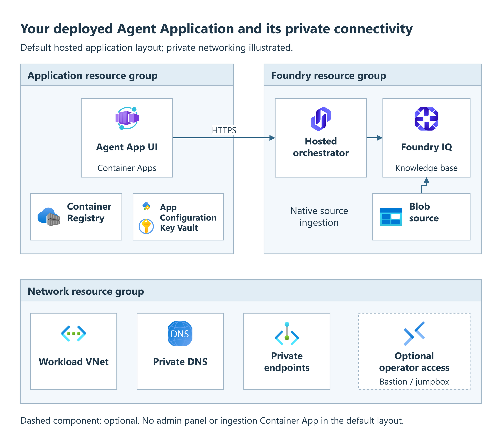

<span id="full-stack-deploy"></span>

<span id="deploy-the-full-stack"></span>

<span id="deploy-full-stack"></span>

# Deploy full stack with Bicep

## Objective

Deploy the Azure infrastructure and the Agent Application with its default
layout: Foundry hosts the orchestrator, Agent App UI runs in Container Apps,
and Foundry IQ manages source ingestion and retrieval. The default
`hosted-no-panel` layout omits the administrative panel and Agent Application
Cosmos DB. Foundry can require separate backing resources.
This procedure uses the default Bicep provider. For Terraform, use
[Deploy full stack with Terraform](deploy-terraform-full-stack.md); application
configuration and deployment are shared.

<span id="what-youll-have-after-this-runbook"></span>

## Expected outcome

Your Agent Application deployed with a Container Apps UI, a Foundry-hosted
orchestrator and native Foundry IQ ingestion and retrieval.

<div class="runbook-diagram" markdown="1">

<div class="runbook-diagram__summary" markdown="1">

**Default hosted application**

1. **Application resource group:** Agent App UI runs in Container Apps,
   alongside Container Registry, App Configuration and Key Vault.
2. **Foundry resource group:** the UI calls the hosted orchestrator over HTTPS.
   The orchestrator uses the Foundry IQ knowledge base, with native ingestion
   from the Blob source.
3. **Network resource group:** the illustrated private layout uses the workload
   VNet, private DNS and private endpoints. Bastion or jumpbox operator access
   is optional.

</div>

[](../media/runbooks/deploy-full-stack.png){: .runbook-diagram__image aria-label="Open full-size hosted application diagram"}

[Open full-size diagram](../media/runbooks/deploy-full-stack.png){: .runbook-diagram__open}

</div>

!!! note "Deployment options"
    This diagram illustrates the default hosted application layout, not a
    fixed list of resources for every deployment.

    Optional components are included only when enabled. The actual resources
    depend on your application, network and deployment settings; existing
    resources may be reused.

## When to use

Use this guide for a new Agent Application deployment or to add it to its
already configured Agent foundation. For a customer-owned application, use
the [Bring your own app](build-your-own-app.md) guide.
Only need infrastructure? Use the [Deploy infra only](deploy-infra-only.md) guide.
The [template overview](index.md#how-the-template-works) explains provisioning
and application deployment. [Source pinning](build-your-own-app.md#source-pinning)
explains the manifest contract for customizations.

## Prerequisites

Review the [capability readiness matrix](application.md#capability-readiness)
before choosing acceptance criteria: the supplied chat, optional capabilities
and protected retrieval do not have the same integration requirements.

- **Permissions:** Contributor for resource deployment plus
  `Microsoft.Authorization/roleAssignments/write` at the required scopes,
  for example through Role Based Access Control Administrator. Service
  configuration needs separate data-plane roles. Shared networks, DNS and
  monitoring can require additional scoped access. Subscription Owner is not
  a blanket prerequisite; see [resource group permissions](configuration.md#resource-group-permissions)
  and [default hosted permissions](../bicep/permissions.md).
- **Subscription readiness:** accepted Responsible AI terms, registered resource
  providers, supported service/model regions and sufficient quota for the
  selected parameters. Review [regional considerations](../bicep/regional-considerations.md)
  for constraints that preflight cannot eliminate.
- **Private deployments:** an authorized deployment host connected to the Azure
  virtual network (VNet), directly or through a virtual private network (VPN).
  It must resolve private service hostnames. An Azure Container Registry (ACR)
  Tasks build pool is not that host.
- **Identity inputs:** obtain the delegated Foundry audience and tenant consent
  plan from your identity administrator. `HOSTED_AGENT_RESOURCE_SCOPE` must be
  that audience followed by `/.default`, for example
  `https://ai.azure.com/.default` when that is the deployed audience.
  It is not the UI's `api://<client-id>/user_impersonation` login scope.
- **Application access:** arrange the Entra registration, HTTPS callback,
  Key Vault credential reference and user permissions in
  the [ordered login setup](application-auth.md#configure-login-in-order).
  Complete its registration/consent steps before provision, then its
  callback/settings steps once the frontend URL is available.
  Deployment does not perform tenant consent.

!!! important "Protected retrieval keeps the signed-in user's permissions"
    The UI and hosted `maf_lite` strategy integrate delegated Search
    authorization with `RETRIEVAL_AUTH_MODE=native_search`. The UI performs
    the downstream OBO exchange; the hosted connector supplies that credential
    to Search separately from its workload transport identity. A custom
    Toolbox integration is not required for this built-in path.

    Arrange downstream consent and source permissions, retain permission
    ingestion, and verify an allowed and a denied user before admitting
    sensitive content. Missing credentials fail closed. Do not enable
    anonymous retrieval, substitute service identity or weaken source
    permissions to recover from an authorization failure.

| Tool | Required for |
| --- | --- |
| [Azure Developer CLI (`azd`)](https://learn.microsoft.com/azure/developer/azure-developer-cli/install-azd) and [Azure CLI (`az`)](https://learn.microsoft.com/cli/azure/install-azure-cli) | Provisioning and lifecycle hooks; use current supported versions |
| PowerShell 7 | Windows hooks and cross-platform preflight checks |
| Bash, jq and curl on Linux/macOS | POSIX hooks and dependency bootstrap |
| Git | Fetching selected, pinned application sources |
| Python 3.12 with pip and venv | Validation, composition and service configuration |
| Foundry agents azd extension (`azure.ai.agents`) | Hosted deployment; install with `azd extension install azure.ai.agents` if absent |

Blocks marked `bash` use Bash syntax. In PowerShell, put commands with a
trailing backslash (`\`) on one line and remove the continuation backslashes.
Replace every `<placeholder>`. Run `powershell` blocks as written.

!!! warning "Cost and time"
    Provisioning creates billable resources before the application is ready.
    Review the [foundation inventory and cost scenarios](../bicep/deployed-resources.md)
    and [cost guide](../architecture/cost-guide.md), then budget for application runtime,
    model usage and data. First deployments take longer because of resource
    creation, image builds, role propagation and private-link approvals.
    No fixed completion time is guaranteed.

## Procedure

Run Steps 1-4 in order. After selecting a checkout, run lifecycle commands from
its platform root with the intended environment selected.

### Step 1: Get the code

```bash
git clone https://github.com/Azure/agent-landing-zone.git
cd agent-landing-zone
```

The checkout's `manifest.json` pins the compatible runtime components;
the deployment hooks fetch them automatically.

Alternatively, `azd init -t Azure/agent-landing-zone` initializes the current
default template in an empty directory. Reuse the environment it creates rather
than creating it again in Step 2.

#### Prepare Python

From the repository root:

```bash
python -m venv .venv
```

On Linux/macOS, use `python3` if `python` is unavailable. Activate
`.\.venv\Scripts\Activate.ps1` in PowerShell or
`source .venv/bin/activate` in Bash. Install the dependencies:

```bash
python -m pip install -r config/requirements.txt
```

Keep this environment active for the lifecycle commands.

#### Working from your own repository

An unmodified deployment needs only the platform checkout. Hooks fetch selected
runtime components automatically; four forks are not required. Fork or mirror
the platform when you maintain deployment inputs or automation, and fork only
the runtime components whose source you change.

Keep reviewed, nonsecret inputs in source control and apply them explicitly
with `azd env set`; an `environments/` folder is not loaded automatically.
Protect `.azure/`, credentials, sibling component workspaces and deployment
logs. For private components, configure Git read access on the actual deployment
host separately from Azure authentication. Never embed tokens in repository URLs.
See [Custom applications](build-your-own-app.md) for source pinning and composition.

<a id="step-2-sign-in-and-create-an-environment"></a>

### Step 2: Select the deployment target

The following creates a **new** environment. Replace all placeholders:

```bash
az login
azd auth login
az account set --subscription <subscription-id>
azd env new <environment-name>
azd env set AZURE_SUBSCRIPTION_ID <subscription-id>
azd env set AZURE_LOCATION <region>
```

For an existing environment, use `azd env select <environment-name>` instead
and preserve its approved inputs. Isolate DEV, TEST and PROD with separate
environments, resource groups, identities, configuration stores, secrets and
data. Promote the same reviewed source revision with stage-specific inputs.

New environments use three resource groups:
`rg-<environment-name>` for Foundry, `rg-<environment-name>-app` for the
application and `rg-<environment-name>-network` for workload networking.
To choose a different Foundry/root name, set `AZURE_RESOURCE_GROUP` before
provision. The hook creates missing additional groups by default; the deploying
identity needs permission to create them. To reuse pre-created groups or select
one or two groups, set the
[resource group destinations](configuration.md#resource-group-destinations)
now. Existing environments keep their mapping.

<a id="step-3-choose-a-topology"></a>

### Step 3: Choose the application and network

Set the deployment choices below in the selected azd environment with
`azd env set` before provisioning. Settings containing lists or groups of related
fields go in the root `main.parameters.json` file, as described in the linked
infrastructure choices.
[Deployment inputs](configuration.md#deployment-inputs) explains input formats,
ownership and generated provider files.

#### Orchestrator topology

Set the default layout explicitly for this new environment.
`DEPLOYMENT_TOPOLOGY` chooses the runtime layout, not the VNet design:

```bash
azd env set DEPLOYMENT_TOPOLOGY hosted-no-panel
azd env set HOSTED_AGENT_RESOURCE_SCOPE <approved-foundry-audience>/.default
azd env set DEPLOY_INGESTION_CONTAINER_APP false
```

Expect no administrative panel or Agent Application Cosmos DB. Preserve the
recorded layout when recovering an existing environment. See
[Hosted agents](hosted-agents.md) for separately configured capabilities.
Keep the runtime strategy `AGENT_STRATEGY=maf_lite` and retrieval backend
`RETRIEVAL_BACKEND=foundry_iq`; inspect their effective `agent-lz` settings
after service configuration. Runtime keys are not all `azd env` inputs.

#### Ingestion and custom applications

Use native Foundry IQ ingestion for the configured Blob source. Keep its
protected source policy; source ingestion does not prove user-authorized
retrieval works. Review [Ingestion](ingestion.md) if conversation uploads or
custom processing are required. They are additional capabilities, not default
deployment steps.

For a different application, stop here and follow the
[Bring your own app guide](build-your-own-app.md) before first provision.
One environment binds to one application ID.

#### Network and build mode

Use **private networking for production and workloads with sensitive data**.
Choose a self-contained private network or a private connection to your
organization's existing hub.

The template defaults to `NETWORK_ISOLATION=false`, so set `true` explicitly
before provisioning a private environment. Public endpoints are an exception for
approved, short-lived evaluations or demonstrations without sensitive data,
not the recommended production setup.

| Choice | Inputs and preparation |
| --- | --- |
| Private, self-contained network | `azd env set NETWORK_ISOLATION true`; review the [standalone design](../bicep/standalone.md) |
| Private spoke using an existing hub | `NETWORK_ISOLATION=true`, explicit hub routing, peering, DNS and shared-service inputs from the [hub-and-spoke reference](../bicep/hub-and-spoke.md) |
| Existing VNet | Choose [subnet ownership](network-isolation.md#allocate-subnets-and-agree-ownership) and apply the [matching inputs](configuration.md#network-selection-examples); review delegations and NSGs before provision |
| Public service endpoints, evaluation only | Read the [public-endpoint conditions and commands](deploy-infra-only.md#public-service-endpoints) first. Authentication does not make an endpoint private. |

Apply the approved foundation inputs from
[infrastructure choices](deploy-infra-only.md#step-3-choose-the-foundation-shape).
Do not change `NETWORK_ISOLATION` on an existing environment as a retry shortcut.
With isolation enabled, run configuration, preparation and deployment from the
connected host. If creating that host first, use the
[deferred post-provision procedure](deploy-infra-only.md#complete-a-deferred-post-provision).

| Image build path | Selection |
| --- | --- |
| Public registry, remote builds | Set `BUILD_MODE` to `acr-task` with the command below; builds use regular ACR Tasks |
| Private registry, remote builds | Also set `DEPLOY_ACR_TASK_AGENT_POOL` to `true` before provision; builds use the provisioned VNet pool |

```bash
azd env set BUILD_MODE acr-task
```

For the private registry path, also run:

```bash
azd env set DEPLOY_ACR_TASK_AGENT_POOL true
```

Hosted image preparation uses Azure Container Registry (ACR) Tasks, not local
Docker. With isolation enabled, keep the private build pool.
Use [Network design](network-isolation.md) for DNS and private connectivity,
and the [build-feed reference](configuration.md#application-specific-package-feeds)
for scoped package access.

### Step 4: Deploy

Deployment has two stages: **provision** creates and configures the Azure
resources; **deploy** builds and publishes the application. Run both from the
platform root with the same azd environment selected.

#### Before you deploy

Confirm the runner has Foundry agent authoring access on the exact project
(Foundry User or an appropriate equivalent),
account read access and the required scoped role-assignment authority.
Review [deployment prerequisites](#prerequisites) and
[hosted identities](hosted-agents.md) for the required scopes.

Review the resource scopes, public access, routes and role changes before
approving provisioning. Also review the application's
[outbound network requirements](deploy-infra-only.md#review-component-egress)
with `python -m config.deployment.egress --plan --environment <environment-name>`.
Deployment applies managed firewall rules automatically. If you use an external
firewall, give the generated report to its owner to arrange the required access.

<span id="container-apps-orchestrator-classic"></span>
<span id="foundry-orchestrator-hosted-no-panel-or-hosted-panel"></span>

#### Default Foundry orchestrator (`hosted-no-panel`)

For a new environment, run these commands in order:

```bash
azd provision
azd deploy
```

Alternatively, run `azd up` to perform both stages in one command.
These commands work on Windows, Linux and macOS. The normal deployment runs
its configuration checks automatically; no manual preparation command is needed.

!!! note "Optional: check configuration before provisioning"
    For an early check before `azd provision`, the following commands show the
    selected subscription, environment and region, then validate the application
    definition and check that it matches the environment:

    ```bash
    azd env get-value AZURE_SUBSCRIPTION_ID
    azd env get-value AZURE_ENV_NAME
    azd env get-value AZURE_LOCATION
    azd hooks run preup
    ```

    Running this check manually is recommended but optional. `azd provision`
    also validates the configuration; `azd up` runs `preup` automatically.

<a id="what-happens-during-the-deployment"></a>

| Stage | Result |
| --- | --- |
| Provision | Creates the foundation and configures its services; no running hosted agent or placeholder image is created |
| Deploy: image | Automatically fetches the pinned orchestrator source, builds its hosted image when needed, records an immutable digest and binds it to the existing foundation |
| Deploy: applications | Creates the hosted version, bootstraps its limited runtime grants, tests a greeting and deploys selected apps |

Image preparation is part of `azd deploy`; no separate preparation command or
second provision is required. If provisioning deferred configuration, complete
that work from a connected host before deployment. Do not replace the digest
with an image tag or bypass permission, network or configuration failures.

For an already configured infrastructure-only environment, reuse the same
checkout, inputs and bound application, then run `azd deploy`.
Review hook logs even after success: some configuration sections can log
failures and continue. Resolve those failures before validation.

<details markdown="1">
<summary>Optional: preview infrastructure changes before deployment</summary>

You do not need a preview for the normal deployment above. If you want to run
`azd provision --preview`, first follow the
[preview preparation instructions](deploy-infra-only.md#optional-preview-agent-source).
Unlike normal provisioning, preview skips the preparation hook, so you must
prepare the selected environment's parameters and any additional resource groups
first. This preparation can create resource groups. Neither preparation nor
preview confirms that private application connections work.

</details>

For an initial deployment, continue to [Validation](#validation) now.
Use the maintenance procedures below only for a later operational change.

### Lifecycle preparation

Run these tasks from the platform root with the intended environment selected,
Python active, both CLIs authenticated and private connectivity available when
required. Record the source revision, manifest, definition, approved inputs and
hosted digest before a change. Back up configuration and relevant data using
service-specific procedures.

<span id="lifecycle"></span>
<span id="upgrade-to-a-new-release"></span>

### Reapply a reviewed deployment

1. Select the reviewed compatible source and pin files. Keep the platform's
   `infra/` with that source, rather than replacing only that directory.
2. Preserve the environment's layout, component selection, names and source
   bindings. Back up affected data and separately managed configuration.
3. If previewing, follow the [selected-environment preparation](deploy-infra-only.md#optional-preview-agent-source),
   then review infrastructure changes with `azd provision --preview`.
4. Run [Step 4](#step-4-deploy). Deployment prepares the image automatically,
   including when its recorded generated-source provenance is stale.
5. Repeat [Validation](#validation) before promotion.

### Redeploy applications only

When foundation outputs, application binding and component selection remain
compatible:

```bash
azd deploy
```

Agent Application Container Apps use the manifest's verified sibling checkouts. Preserve
local work and relocate a stale checkout so the hook can fetch the selected
revision; it does not advance an existing checkout automatically. Child logs
are under each component's `.logs` directory and can contain sensitive details.

Hosted deployment reuses a generated digest only when its recorded source pin
and startup command match. Missing or stale generated images are built during
`azd deploy`, without another provision.
An operator-managed digest is not rebuilt automatically: verify its provenance,
compatibility and registry availability. When rebuilding the same source in
each environment, compare the resulting image digests before promotion.

Infrastructure, RBAC, topology or ingestion-selection changes require the full
workflow, not deploy-only. Changing a selection does not delete previously
deployed resources or revoke old permissions; retirement is separately authorized.

#### Component builds and deployment destinations

The component deployment hooks use existing platform resources. Their empty
Bicep entrypoints do not provision standalone environments.
For routine application updates, use root `azd deploy` as described above.

When diagnosing a component-only build, check the selected
[build mode](configuration.md#deployment-controls):

- `BUILD_MODE=local` builds `linux/amd64` with Docker and pushes to ACR.
  An explicit local choice fails if Docker is unavailable.
- `BUILD_MODE=acr-task` uses `az acr build`. A network-isolated remote build
  requires `ACR_TASK_AGENT_POOL`.
- Without an explicit mode, recognized legacy `USE_DOCKER` values take
  precedence over automatic selection. Otherwise isolation or a configured
  pool selects ACR Tasks, followed by Docker availability.
- Use exact legacy boolean values without whitespace for portable PowerShell
  and Bash behavior. Unknown explicit build modes fail.

Hosted orchestrator image preparation is a separate path that always uses ACR
Tasks. Setting `BUILD_MODE=local` does not replace that hosted image workflow.

Component scripts prefer a nonempty shell `APP_CONFIG_ENDPOINT` over the azd
environment value. Confirm the endpoint before invoking them. They read the
application destination from `AZURE_APP_RESOURCE_GROUP` under `agent-lz`.
Only a successful missing or empty read falls back to `AZURE_RESOURCE_GROUP`.
An inaccessible store or conflicting destinations stops deployment.
Do not treat deployment hooks as offline checks or run them from a test suite.

### Change a runtime setting

First check [Deployment settings](configuration.md) for ownership and overwrite behavior.
Provisioning-managed inputs must be changed in their source and applied through
the full workflow. For a directly managed, nonsecret runtime key:

```bash
az appconfig kv set --endpoint <app-config-endpoint> --auth-mode login \
  --key <KEY> --value <value> --label agent-lz --yes
```

Restart each affected Container App revision to reload configuration:

```bash
az containerapp revision restart -g <resource-group> -n <container-app-name> \
  --revision <revision-name>
```

For a hosted version, run root `azd deploy` with the compatible handoff.
Process environment inputs declared in `hosted-agent/azure.yaml` are immutable
version inputs and require a new agent version. An App Configuration edit
cannot replace a process-only setting such as `APP_CONFIG_TLS_COMPATIBILITY`.
Use `agent-lz` within each environment's separate configuration store.

### Rotate a secret

Inspect the Key Vault reference before rotating. An unversioned URI resolves
the current secret version when configuration reloads; a versioned URI must be
updated deliberately. Add the new secret version through your approved secure
process, preserve required access, then restart affected Container App revisions
or redeploy the hosted version. Verify the new credential before retiring the
old one. Never place secrets in plaintext App Configuration or command logs.

### Recover hosted runtime access

The Agent Application post-deploy hook normally bootstraps the discovered runtime principal.
To review the exact read-only role plan from the root's selected environment:

```bash
python -m config.deployment.hosted_access --azd-env --plan
```

An authorized administrator can reconcile only that plan with the idempotent
wrapper:

```powershell
pwsh scripts/bootstrapHostedAccess.ps1
```

On Linux/macOS use `./scripts/bootstrapHostedAccess.sh`. The wrapper selects
`hosted-agent` / `orchestrator-agent` by default; custom services use their own
project/service context. Allow role propagation, then retry root `azd deploy`
so the greeting and remaining deployment gates run before cutover.

The closed bootstrap set grants App Configuration Data Reader, model access,
native retrieval's scoped Search transport access and, when configured, access
to the exact audit secret. It is not a grant to
delegated users or a replacement for all capability profiles. Do not grant
Owner or remove unrelated assignments to recover. See [hosted identities](hosted-agents.md).

<a id="clean-up"></a>

### Remove an environment

!!! warning "Destructive action"
    Use the commands below only for an environment whose entire deletion scope
    is dedicated to this deployment and approved for removal. Confirm the
    subscription, resource group and deletion prompt. Export or back up required
    documents, indexes, configuration and conversation data. If the scope
    contains shared resources or retained data, stop and arrange itemized removal
    with the owners instead. Check retention obligations first.

For the default three-group layout, or any other multi-group path, inventory **every configured destination**
and its shared dependencies before cleanup. The root group alone is not the
complete inventory. A `predown` safety hook **blocks `azd down` for split-group
deployments**, with no automatic deletion or bypass option.

Arrange itemized,
owner-approved manual removal instead; do not bypass the hook or delete shared
groups. Additional groups created by the feature are not tagged `azd-env-name`.
Partial provisioning is not authorization to delete a group. The single-group
path below is unchanged.

```bash
azd env select <environment-name>
azd env get-value AZURE_SUBSCRIPTION_ID
azd env get-value AZURE_RESOURCE_GROUP
azd down
```

Do not add purge options as a retry. Permanent deletion requires separate
authorization and removes recovery options. Reused resources outside the
deletion scope and manually created links can remain and continue incurring
charges. For a spoke, retire only its own hub peering/DNS links with their owners;
do not delete shared hub, DNS or monitoring resources.

<a id="next-steps"></a>

<span id="related-runbooks"></span>

### Related guides

- [Connect Copilot Studio to a private Foundry agent](connect-copilot-studio.md)
- [Deploy infra only](deploy-infra-only.md)
- [Deploy with Azure DevOps](azure-devops.md) for optional reviewed promotion and automation

<span id="verify"></span>

## Validation

1. Confirm the platform revision and frontend source, then inspect the deployed
   Container Apps rather than accepting a placeholder response:

    ```bash
    git rev-parse HEAD
    git -C ../agent-app-ui rev-parse HEAD
    git -C ../agent-app-ui status --porcelain
    azd env get-value AZURE_RESOURCE_GROUP
    azd env get-value AZURE_APP_RESOURCE_GROUP
    az containerapp list -g <application-resource-group> \
      --query "[].{name:name,state:properties.runningStatus,revision:properties.latestReadyRevisionName}" -o table
    ```

    Compare the platform commit with your approved record and the UI commit
    with its `manifest.json` entry. The UI source should have no unexpected
    edits; matching HEAD alone does not prove the built source was unchanged.
    Apply the same check to ingestion only when that component is selected.

    The automatic hosted build clones the pinned orchestrator into a temporary
    directory; a sibling `agent-app-orchestrator` checkout is **not required**
    and is not evidence of the image that was deployed.

2. Read `AZURE_CONTAINER_REGISTRY_ENDPOINT` for the registry login hostname.
   The hosted repository is `HOSTED_AGENT_IMAGE` when explicitly set, otherwise
   `agent-app-orchestrator`, as declared in `hosted-agent/azure.yaml`.
   For an automatically generated image, read
   `azd env get-value HOSTED_AGENT_IMAGE_SOURCE_COMMIT` and compare it with
   the orchestrator commit in `manifest.json`. Retain the build record and
   `HOSTED_AGENT_IMAGE_STARTUP_COMMAND_SHA256` as startup provenance.
   For an operator-supplied digest without generated-source metadata, require
   the image owner's build/provenance record instead; do not assume the manifest
   proves its source.

   Use that registry's resource name, repository and recorded digest below
   (`<sha256-digest>` includes the `sha256:` prefix):

    ```bash
    azd env get-value HOSTED_AGENT_IMAGE_VERSION
    az acr repository show --name <registry-name> \
      --image <hosted-repository>@<sha256-digest> --query digest -o tsv
    ```

    Expect the exact same `sha256:` value, not merely matching tags. In Foundry,
    inspect the **actively routed** agent version and confirm its full image
    reference uses that registry, repository and digest. Record the agent
    name/version with the source and build evidence. Local source or registry
    existence alone does not prove that version is serving requests.

3. Open the frontend URL from the deployment outputs or UI ingress configuration.
   Use a connected browser for private endpoints. Complete
   [Entra sign-in and delegated authentication](application-auth.md).
4. Exercise an agent task and configured tools with representative identities.
   For documents, ingest a harmless test document through the configured source.
   With the integrated delegated retrieval path and downstream consent, test
   both permitted retrieval and denial to a user without that document's permission.
   Test uploads only when their additional capabilities are selected.
5. Correlate the task with runtime telemetry. The deployment's greeting checks
   basic response only; test actual UI login, OBO and source authorization.

Record unmet capability gates as **blocked**, not passed. Without validated
continuity, chat context lasts only for the active UI session. Default deployment
does not promise persistent history, feedback integration or uploads.
Use [Troubleshooting](troubleshooting.md) for failures.

For optional channel distribution after acceptance, use the
[Teams and Microsoft 365 guide](publish-to-teams.md). Publication is not
part of this deployment.

<span id="roll-back-to-a-previous-release"></span>

## Rollback

1. Stop promotion and record the failed revision, inputs and deployed state.
   Select the previous tested **complete compatible combination**, not an
   independent component tip. Check compatibility with current data and settings.
2. Restore the recorded platform commit, manifest, definition and reviewed
   parameters without overwriting uncommitted work. Align existing sibling
   checkouts with the restored manifest after preserving their local work.
3. Preview infrastructure or configuration reversals before applying them.
   Keep the approved authentication and network posture.
4. Follow [Step 4](#step-4-deploy) with the previous compatible source and inputs:
   provision, then deploy; deployment prepares the pinned image automatically.
   If retaining an operator-managed digest, verify its availability and
   compatibility; deployment does not rebuild it.
5. Restore directly managed runtime keys separately from the source checkout,
   reload affected components and repeat [Validation](#validation) before cutover.

### Outbound rule recovery

When removing component egress requirements, first review explicit empty
declarations for the components whose owned rules should be removed.
Keep declarations for remaining consumers and reconcile with the current
hooks before reverting hooks or metadata. A missing declaration is not
equivalent to an explicit empty one.

Reverting code alone does not remove existing rules. Review the resolved
report and resulting scoped changes. Preserve unmanaged entries and other
owners' rules. An external firewall remains its owner's responsibility,
never a target for automatic policy writes or shared-group deletion.
Use the [review procedure](deploy-infra-only.md#review-component-egress)
with the selected provider's normal workflow.

Restoring code does not restore data or reverse schema changes. If reversal is
unsupported, arrange an approved forward repair or service-specific recovery.
Do not delete the environment as rollback.
