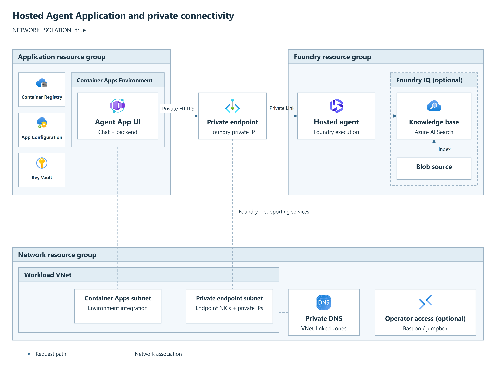

<span id="full-stack-deploy"></span>

<span id="deploy-the-full-stack"></span>

<span id="deploy-full-stack"></span>

# Deploy full stack with Bicep

## Objective

Deploy the Agent Application and the Azure resources it needs.
The default setup provides a web chat in Azure Container Apps.
Microsoft Foundry hosts the agent that answers messages.

This guide uses Bicep. For Terraform, use
[Deploy full stack with Terraform](deploy-terraform-full-stack.md).

<span id="what-youll-have-after-this-runbook"></span>

## Expected outcome

After deployment and validation, you can sign in to the web application and
send a message to the agent.

Document questions, SQL queries and saved history need additional setup.
Select these optional features in Step 3, before you provision Azure resources.

<div class="runbook-diagram" markdown="1">

<div class="runbook-diagram__summary" markdown="1">

**Default hosted application**

1. **Application resource group:** Agent App UI runs in Container Apps,
   alongside Container Registry, App Configuration and Key Vault.
2. **Foundry resource group:** the UI calls the hosted orchestrator over HTTPS.
   When selected, the orchestrator uses the Foundry IQ knowledge base, with
   native ingestion from the Blob source.
3. **Network resource group:** the illustrated private layout uses the workload
   VNet, private DNS and private endpoints. Bastion or jumpbox operator access
   is optional.

</div>

[](../media/runbooks/deploy-full-stack.png){: .runbook-diagram__image aria-label="Open full-size hosted application diagram"}

[Open full-size diagram](../media/runbooks/deploy-full-stack.png){: .runbook-diagram__open}

</div>

!!! note "Deployment options"
    The diagram shows a private network. The template does not enable private
    networking by default. Choose your network in Step 3.

    The resource list changes with the features you enable.
    The deployment can also use compatible existing resources.

## When to use

For your first installation, follow
[Get started: Deploy your first agent application](get-started.md).
That guide uses Bicep, the reference application, Hosted execution and
`conversational` mode. It creates a private standalone virtual network (VNet),
Azure Bastion and a jumpbox for initial access.

Use this full reference guide to select other Bicep deployment options.
You can also use it to add the application to a compatible, configured Agent foundation.

For another task, use the matching guide:

| Task | Guide |
| --- | --- |
| Deploy Azure resources without the application | [Deploy infra only](deploy-infra-only.md) |
| Deploy your own application | [Bring your own app](build-your-own-app.md) |
| Update or recover an existing installation | [Updates & recovery](deployment-operations.md) |

This procedure does not convert conversations or workflow state from an
earlier execution model.

## Prerequisites

### Prepare Azure access

Ask your Azure administrator to confirm the following access for the deployment identity:

| Task | Required access |
| --- | --- |
| Create Azure resources | Contributor at the deployment scopes |
| Assign resource roles | `Microsoft.Authorization/roleAssignments/write`, for example through Role Based Access Control Administrator |
| Configure service data | The service-specific data roles listed in [default hosted permissions](../bicep/permissions.md) |
| Publish the hosted agent | Foundry project authoring access, such as Foundry User, plus account read access |
| Use shared networks, DNS or monitoring | Permission at each shared resource's required scope |

Subscription Owner is not required if the assigned roles cover these tasks.
See [resource group permissions](configuration.md#resource-group-permissions) for the scope requirements.

Confirm these subscription requirements before you start:

- The required Responsible AI terms are accepted.
- The required Azure resource providers are registered.
- The selected region supports the services and models.
- The subscription has enough quota for the selected resources.

Use [regional considerations](../bicep/regional-considerations.md) to check service limits.
Automated checks cannot guarantee regional capacity.

### Prepare application sign-in

Follow the [ordered login setup](application-auth.md#configure-login-in-order).
Complete its registration and consent steps before provisioning.
After provisioning, use the frontend URL to complete the callback and application settings.
Step 4 marks this pause in the deployment.

For the default user-delegated mode, obtain the approved Foundry audience from
your identity administrator.
You will use it in `HOSTED_AGENT_RESOURCE_SCOPE` in Step 3.
For example, the audience `https://ai.azure.com` gives the scope
`https://ai.azure.com/.default`.

Do not use the UI login scope, `api://<client-id>/user_impersonation`, as the Foundry scope.
Azure resource deployment does not grant tenant consent.

### Prepare a deployment computer

For a private deployment, use a computer connected to the Azure virtual network (VNet).
It can connect directly or through a virtual private network (VPN).
It must resolve private service hostnames.

The Azure Container Registry (ACR) Tasks build pool builds images.
It does not give your deployment computer access to the private network.

Install the tools below on the computer that will run the deployment:

| Tool | Required for |
| --- | --- |
| [Azure Developer CLI (`azd`)](https://learn.microsoft.com/azure/developer/azure-developer-cli/install-azd) and [Azure CLI (`az`)](https://learn.microsoft.com/cli/azure/install-azure-cli) | Provisioning and lifecycle hooks; use current supported versions |
| PowerShell 7 | Windows hooks and cross-platform preflight checks |
| Bash, jq and curl on Linux/macOS | POSIX hooks and dependency bootstrap |
| Git | Fetching selected, pinned application sources |
| Python 3.12 with pip and venv | Validation, composition and service configuration |
| Foundry agents azd extension (`azure.ai.agents`) | Hosted deployment; install with `azd extension install azure.ai.agents` if absent |

Replace every `<placeholder>` with your approved value before you run a command.

Blocks marked `bash` use Bash syntax.
In PowerShell, join lines that end with `\` and remove those backslashes.
Run `powershell` blocks as written.

!!! warning "Cost and time"
    Charges start when Azure resources are created, before the application is ready.
    Review the [resource inventory](../bicep/deployed-resources.md) and
    [cost guide](../architecture/cost-guide.md).
    Include application runtime, model use and data storage in your budget.

    Resource creation, image builds and access approvals can delay the first deployment.
    There is no fixed completion time.

## Procedure

Complete Steps 1-4 in order, then run [Validation](#validation).
The later maintenance sections are not part of a first installation.

After Step 1, run all deployment commands from the project root.
Keep the same azd environment selected throughout the procedure.

<a id="step-1-get-the-code"></a>

### Step 1: Initialize the project

Create a new project directory outside any existing checkout:

```bash
mkdir agent-landing-zone
cd agent-landing-zone
azd init --template Azure/agent-landing-zone .
```

When prompted, choose an **environment name**.
Initialization creates and selects that local azd environment.
Do not run `azd env new` again in Step 2.
To supply the name in the command, use
`azd init --template Azure/agent-landing-zone --environment <environment-name> .`
instead of the init command above.

Keep the trailing `.` so azd puts the template in the current directory.
Without it, azd creates a subdirectory.
Confirm that this directory contains `azure.yaml`, `manifest.json` and `main.parameters.json`.
Stay here for the remaining steps.

Initialization downloads the template. It does not create Azure resources.
Do not add `--up`; configure the deployment first.

The `manifest.json` file selects compatible application versions.
Deployment fetches those sources automatically.
You do not need separate application forks for an unmodified installation.

#### Prepare Python

Create a Python virtual environment from the project root:

```bash
python -m venv .venv
```

On Linux/macOS, use `python3` if `python` is unavailable.
Activate the virtual environment with the command for your shell:

- PowerShell: `.\.venv\Scripts\Activate.ps1`
- Bash: `source .venv/bin/activate`

Install the dependencies:

```bash
python -m pip install -r config/requirements.txt
```

Keep this Python environment active while you run the deployment commands.

#### Working from your own repository

Skip this subsection for an unmodified installation.

Use a Git clone or fork if you need source history, custom code or reviewed
deployment automation.
Template initialization does not retain upstream Git history.
Fork only the application components whose code you change.

Keep reviewed, nonsecret deployment inputs in source control.
Set documented environment inputs with `azd env set`.
Keep structured declarations in the root `main.parameters.json`.
The deployment does not load an `environments/` folder automatically.

Protect `.azure/`, credentials, component workspaces and deployment logs.

For private repositories, configure Git read access on the deployment computer.
Azure sign-in does not provide that access.
Never put tokens in repository URLs.
See [source pinning](build-your-own-app.md#source-pinning) for custom application sources.

<a id="step-2-sign-in-and-create-an-environment"></a>

### Step 2: Select the deployment target

Use the environment created in Step 1.
Sign in to both CLIs, then set the subscription and region:

```bash
az login
azd auth login
az account set --subscription <subscription-id>
azd env set AZURE_SUBSCRIPTION_ID <subscription-id>
azd env set AZURE_LOCATION <region>
```

New environments use these resource groups:

| Resource group | Purpose |
| --- | --- |
| `rg-<environment-name>` | Foundry |
| `rg-<environment-name>-app` | Application |
| `rg-<environment-name>-network` | Workload network |

The deployment creates missing groups. Your deployment identity needs permission to create them.
To change the Foundry group name, set `AZURE_RESOURCE_GROUP` before provisioning.
To reuse groups or choose fewer groups, configure
[resource group destinations](configuration.md#resource-group-destinations) now.
Existing environments keep their group mapping.

To resume an existing environment, run `azd env select <environment-name>`.
Keep its approved inputs. Do not initialize the template again.
Use `azd env new <environment-name>` only to add a separate environment.

Keep development, test and production environments separate.
Use separate resource groups, identities, configuration stores, secrets and data.
Promote the same reviewed source revision with inputs for each stage.

<a id="step-3-choose-a-topology"></a>

### Step 3: Choose the application and network

Configure the application first, then choose its network and image build settings.
Complete these choices before provisioning.

Use `azd env set` for the environment inputs shown below.
Put structured infrastructure declarations in the root `main.parameters.json`.
See [Deployment inputs](configuration.md#deployment-inputs) for the supported format of each input.

#### Native application selection

For the default web chat, use the following settings.
Replace `<approved-foundry-audience>` with the audience obtained during sign-in preparation.

```bash
azd env set ORCHESTRATION_HOST hosted
azd env set APPLICATION_MODE conversational
azd env set HOSTED_AGENT_AUTH_MODE user_delegated
azd env set HOSTED_AGENT_RESOURCE_SCOPE <approved-foundry-audience>/.default
azd env set DEPLOY_INGESTION_CONTAINER_APP false
```

These settings select Foundry hosting and conversational mode.
They include the web UI but do not deploy the separate document-processing service.

`user_delegated` is the default authentication mode.
It uses an on-behalf-of (OBO) token exchange to call Foundry for the signed-in user.
Keep this mode for the procedure above.

History, feedback and private attachments are off by default.
Foundry hosting does not enable them.
To enable a feature, follow [Application settings](application-settings.md) before provisioning.

#### Choose optional experiences and storage

The default chat does not require an application Cosmos DB account.
The deployment adds UI storage when you select a feature that needs it:

| Selection | UI storage required? |
| --- | --- |
| Conversational mode, with history, feedback and private attachments off | No |
| History, feedback or private attachments enabled | Yes |
| Workflow mode or `both` | Yes, even when the three features above are off |

This table describes application storage, not storage used internally by Foundry.
See the [resource inventory](../bicep/deployed-resources.md) for the foundation resources.

For workflows, follow [native execution selection](configuration.md#native-execution-selection).
With Hosted `both`, deployment publishes the chat and workflow separately.
It passes their distinct endpoints to the UI automatically.
Do not add other host-selection booleans.

Use the [capability readiness matrix](application.md#capability-readiness) to choose tests for each feature.

<details markdown="1">
<summary>Alternative authentication or hosting</summary>

The alternative `HOSTED_AGENT_AUTH_MODE=service_identity` requires compatible
platform and application versions.
It also requires scoped grants for the component identities.
UI login remains required.
See [Choose user delegation](application-auth.md#choose-user-delegation) before selecting this mode.

This mode does not impose a source-type limit or clear ingestion permission options to `[]`.
A source that requires user delegation must reject requests when delegation is unavailable.
Do not weaken the protected source policy to resolve an access error.

Deployment publishes the mode to App Configuration under `agent-lz`.
To change it later, review source policy, connection authentication and caller grants.
Then publish compatible applications and start new sessions.
Editing a key alone does not complete this change.
An OBO failure must not trigger a switch to service credentials.

For Container Apps hosting, review [Agent hosting](hosted-agents.md).
That host requires the official Durable Extension worker and Durable Task Scheduler (DTS).
It does not use the Hosted HTTP entrypoint or a custom queue.

</details>

#### Ingestion and custom applications

Skip document setup if users do not need shared-document questions.

For shared documents, follow [Foundry IQ](foundry-iq.md).
It uses native ingestion for the configured Blob source.
If you need custom source processing, follow [Ingestion](ingestion.md).
Keep the source permission policy in either path.

Private attachments use a separate setting and upload path.
Deploying the ingestion service does not enable attachments.
UI storage does not require the ingestion service.

!!! important "Before you use protected documents"
    Foundry access does not grant access to documents.
    Setting `RETRIEVAL_AUTH_MODE=native_search` does not grant that access either.
    Configure downstream user authorization for Search.
    Retain source permissions during ingestion.

    The application uses the Microsoft Agent Framework (MAF) Toolbox integration for Foundry-managed delegation.
    After Search setup, provisioning publishes the generated `TOOLBOX_ENDPOINT`.
    See the [retrieval identity boundary](application-auth.md#hosted-retrieval-identity-boundary) for the required consent and source permissions.

    If the UI reports a managed consent error, obtain approved consent and retry manually.
    The request does not resume automatically.
    Missing credentials, consent or source authorization must stop the request.

    Before you load sensitive content, test access with an allowed user and a denied user.
    Do not enable anonymous retrieval or substitute service credentials to bypass a failure.
    Do not weaken source permissions.

For your own application, stop here and follow [Bring your own app](build-your-own-app.md).
Complete that setup before the first provision.
One environment binds to one application ID.

#### Optional SQL tools through MCP

Skip this subsection if users do not need SQL queries.

For approved Azure SQL or SQL Server data, deploy
[Agent App MCP Server](agent-app-mcp.md) and select its NL2SQL toolset.
Use the [coordinated platform source](agent-app-mcp.md#use-the-coordinated-platform-source)
and its reviewed application definition.

Before provisioning, confirm two additional permissions:

- The deployment identity can create Entra app registrations and assign application roles.
  Azure resource roles do not grant these directory permissions.
- The SQL owner has approved the datasource and database read access.

Set both inputs:

```bash
azd env set DEPLOY_AGENT_APP_MCP true
azd env set MCP_TOOLSETS '["nl2sql"]'
```

`DEPLOY_AGENT_APP_MCP` defaults to `false`.
Enabling it adds a separate service with either orchestration host.

`MCP_TOOLSETS` defaults to `[]`.
Deploying the server without a toolset registers zero tools.
It does not need NL2SQL catalog, model or secret grants.

Selecting `["nl2sql"]` also requires application Cosmos DB.
The deployment reuses a compatible account or creates one.
It configures the catalog containers, vector policies and scoped access.
It publishes settings under the `agent-lz` label.
Do not add tool-specific foundation parameters.
MCP does not require Search or document ingestion.

The deployment helper configures the dedicated Entra API registration, service
principal and `MCP.Invoke` app role.
It does not create SQL databases, users or database grants.
It does not import source metadata.

Complete [SQL onboarding](agent-app-mcp.md#onboard-sql-before-inviting-users) before users run queries.
For an existing installation, use the
[add-component procedure](agent-app-mcp.md#add-to-an-existing-installation).
Adding MCP requires provision followed by deploy, not deploy alone.

#### Network and build mode

Use **private networking for production or sensitive data**.
The template defaults to `NETWORK_ISOLATION=false`.
For a private environment, set it to `true` before provisioning.

Use public endpoints only for approved, short-lived evaluations without sensitive data.
Authentication does not make a public endpoint private.

| Choice | Inputs and preparation |
| --- | --- |
| Private, self-contained network | `azd env set NETWORK_ISOLATION true`; review the [standalone design](../bicep/standalone.md) |
| Private spoke using an existing hub | `NETWORK_ISOLATION=true`, explicit hub routing, peering, DNS and shared-service inputs from the [hub-and-spoke reference](../bicep/hub-and-spoke.md) |
| Existing VNet | Choose [subnet ownership](network-isolation.md#allocate-subnets-and-agree-ownership) and apply the [matching inputs](configuration.md#network-selection-examples); review delegations and NSGs before provision |
| Public service endpoints, evaluation only | Read the [public-endpoint conditions and commands](deploy-infra-only.md#public-service-endpoints) first. Authentication does not make an endpoint private. |

Apply the matching inputs from
[infrastructure choices](deploy-infra-only.md#step-3-choose-the-foundation-shape).
For a private environment, run configuration and deployment from the connected computer.
If that computer must be created first, follow the
[deferred post-provision procedure](deploy-infra-only.md#complete-a-deferred-post-provision).

Do not disable `NETWORK_ISOLATION` to retry a failed deployment.

Choose the image build path:

| Image build path | Selection |
| --- | --- |
| Public registry, remote builds | Set `BUILD_MODE` to `acr-task` with the command below; builds use regular ACR Tasks |
| Private registry, remote builds | Also set `DEPLOY_ACR_TASK_AGENT_POOL` to `true` before provision; builds use the provisioned VNet pool |

```bash
azd env set BUILD_MODE acr-task
```

For the private registry path, also run:

```bash
azd env set DEPLOY_ACR_TASK_AGENT_POOL true
```

Foundry-hosted images use ACR Tasks, not local Docker.
Keep the private build pool when network isolation is enabled.

Check [Network design](network-isolation.md) for DNS and connectivity requirements.
For private package feeds, follow the
[build-feed reference](configuration.md#application-specific-package-feeds).

### Step 4: Deploy

Deployment has two stages:

1. **Provision:** create and configure Azure resources.
2. **Deploy:** build and publish the application.

Run both from the project root with the same azd environment selected.

#### Before you deploy

Confirm the deployment identity has the [required access](#prerequisites) on
the selected Foundry project and Azure resources.
See [hosted identities](hosted-agents.md) for the exact role scopes.

Review the resources, public access, routes and role assignments before approving provisioning.
Review the application's outbound access with
`python -m config.deployment.egress --plan --environment <environment-name>`.
See [outbound network requirements](deploy-infra-only.md#review-component-egress) for the review procedure.

Deployment applies its managed firewall rules automatically.
For an external firewall, give the generated report to its owner.
The owner must arrange that access.

<span id="native-application-provisioning"></span>

#### Provision and deploy the selected native application

First, create and configure the resources:

```bash
azd provision
```

**Pause before running `azd deploy`.**
Use the frontend URL from provision outputs to complete steps 3-5 of
[login setup](application-auth.md#3-register-the-final-https-callback):

1. Register the exact HTTPS callback.
2. Store credentials in Key Vault and configure their references.
3. Publish the UI sign-in settings and configure who can use the application.

Azure deployment does not complete tenant consent or UI login setup.
If agent-scoped invocation access cannot be granted yet, grant it after the first agent publication.
Complete that grant before user acceptance testing.

Then build and publish the application:

```bash
azd deploy
```

These commands work on Windows, Linux and macOS.
Deployment runs its configuration checks automatically.
You do not need a separate image-preparation command or a second provision.

Use `azd up` only if login is already configured for the intended endpoint.
It combines provision and deploy, so it leaves no pause for the login setup above.

!!! note "Optional: check configuration before provisioning"
    To check your target and application definition before provisioning, run:

    ```bash
    azd env get-value AZURE_SUBSCRIPTION_ID
    azd env get-value AZURE_ENV_NAME
    azd env get-value AZURE_LOCATION
    azd hooks run preup
    ```

    This manual check is recommended but optional.
    `azd provision` also validates the configuration.
    `azd up` runs `preup` automatically.

<details markdown="1">
<summary>What happens during deployment</summary>

<a id="what-happens-during-the-deployment"></a>

| Stage | Result |
| --- | --- |
| Provision | Creates resources and configures services. It does not publish an agent or create a placeholder image. |
| Deploy: image | Fetches pinned orchestrator source. Builds an image if needed. Records its immutable digest and binds it to the foundation. |
| Deploy: optional MCP | Deploys the MCP image to its provisioned Container App before activating applications that call it. |
| Deploy: applications | Publishes the hosted version. Grants required runtime roles. Tests a greeting. Deploys selected applications. |
| Deploy: MCP access | Resolves caller identities and grants `MCP.Invoke`. Publishes allowed-caller and connection settings. |
| Deploy: MCP readiness | Restarts every active MCP revision to load startup-only authentication. Checks discovery before activating consumers. |

For MCP, `azd deploy` restarts the server revisions after configuring caller access.
Do not add a manual restart during normal deployment.
An MCP health response alone does not prove that callers can invoke tools.
SQL queries also require the approved metadata import.

</details>

If provisioning deferred private configuration, complete it from a connected
computer before deployment.
Do not bypass permission, network or configuration failures.
Do not replace an immutable image digest with a tag.

For an already configured infrastructure-only environment, keep the same
checkout, inputs and application binding.
Run `azd deploy` only if the provisioned component selection is unchanged.
If you add MCP, provision first.

After deployment, inspect the hook logs.
Some configuration sections can report failures without stopping the outer command.
Resolve those failures before validation.

<details markdown="1">
<summary>Optional: preview infrastructure changes before deployment</summary>

Preview is optional.
Before running `azd provision --preview`, follow the
[preview preparation instructions](deploy-infra-only.md#optional-preview-agent-source).
Preview skips the normal preparation hook.
You must first prepare the selected environment's parameters and additional resource groups.
That preparation can create resource groups.

Preview does not test private application connections.

</details>

Continue to validation below.

<span id="verify"></span>

## Validation

The deployment greeting checks only that the agent can return a basic response.
Complete these checks before you give users access.
Use harmless test data.

### 1. Check the deployed application

Confirm the UI source revision and check for unexpected local edits:

```bash
git -C ../agent-app-ui rev-parse HEAD
git -C ../agent-app-ui status --porcelain
azd env get-value AZURE_RESOURCE_GROUP
azd env get-value AZURE_APP_RESOURCE_GROUP
az containerapp list -g <application-resource-group> \
  --query "[].{name:name,state:properties.runningStatus,revision:properties.latestReadyRevisionName}" -o table
```

Compare the UI commit with its `manifest.json` entry.
A matching commit does not prove that the source had no local edits.
Confirm the Container Apps run application revisions, not placeholder images.
If you selected ingestion, check its source and application revision too.

For a template-initialized project, compare the files, manifest and inputs with
your approved source snapshot.
Initialization does not retain upstream Git history.
For a maintained source checkout, compare `git rev-parse HEAD` with your approved platform commit.

The hosted image build uses a temporary orchestrator checkout.
A sibling `agent-app-orchestrator` directory is not required.
It does not prove which image was deployed.

### 2. Check the hosted image

Read `AZURE_CONTAINER_REGISTRY_ENDPOINT` for the registry login hostname.
The image repository is `HOSTED_AGENT_IMAGE` if you set it.
Otherwise, it is `agent-app-orchestrator`, as declared in `hosted-agent/azure.yaml`.

For an automatically built image, read
`azd env get-value HOSTED_AGENT_IMAGE_SOURCE_COMMIT`.
Compare it with the orchestrator commit in `manifest.json`.
Retain the build record and `HOSTED_AGENT_IMAGE_STARTUP_COMMAND_SHA256`.
These records identify the source and startup command used by the build.

For an operator-supplied image, obtain its build record from the image owner.
Do not assume the manifest proves that image's source.

Use the registry resource name, repository and recorded digest below.
Include the `sha256:` prefix in `<sha256-digest>`.

```bash
azd env get-value HOSTED_AGENT_IMAGE_VERSION
az acr repository show --name <registry-name> \
  --image <hosted-repository>@<sha256-digest> --query digest -o tsv
```

The registry must return the exact recorded digest.
Matching image tags are not sufficient.

In Foundry, inspect the agent version that currently serves requests.
Confirm its full image reference uses that registry, repository and digest.
Record the agent name and version with the source and build records.
An image in the registry does not prove the agent uses it.

### 3. Test sign-in and chat

Open the frontend URL from the deployment outputs or UI ingress configuration.
For private endpoints, use a browser connected to the private network.

Complete [Entra sign-in and delegated authentication](application-auth.md).
Send an agent task through the UI.
Check the task in runtime telemetry to confirm the request reached the agent.

### 4. Test each selected feature

Test only the features you selected.
Use representative user identities, including users who must not have access.

| Selected feature | Required checks |
| --- | --- |
| Shared documents | Ingest a harmless document through the configured source. Confirm an allowed user can retrieve it. Confirm a user without permission cannot retrieve it. |
| SQL tools | Complete SQL onboarding. Test a query against an approved source with the intended identity. |
| Private attachments | Test a supported file through the UI. Confirm it uses the native inline attachment path. Confirm another user cannot access it. |
| Attachments disabled | Confirm upload controls are unavailable. Confirm direct upload requests are rejected. |
| Workflow | Test pending human input, fresh-client resume, approval and rejection. Confirm stale, duplicate and wrong-owner replies are denied. |
| History or feedback | Test each enabled feature through the UI. Check its storage and owner permissions. |

For protected documents, complete downstream consent before testing.
Foundry invocation alone does not prove source authorization.

The attachment test checks the native file path, not Blob downloads or ingestion.
It does not prove model understanding.
Test PDF or image understanding separately.

Record a check as **blocked** if its required setup is incomplete.
Do not mark an untested feature as passed.
Test session continuity for the selected host separately from saved-history discovery.

For failures, use [Troubleshooting](troubleshooting.md).
After validation, choose [optional application capabilities](application.md#choose-what-to-add-next).
Optional channel publication is covered in
[Teams and Microsoft 365](publish-to-teams.md), not this deployment procedure.

## Updates and recovery

The following procedures apply to an existing installation.
They are not additional steps for a first deployment.

### Lifecycle preparation

Before a change, return to the project root and select the intended azd environment.
Activate Python and sign in to both CLIs.
For a private environment, confirm private connectivity.

Record the source revision, manifest, application definition, approved inputs and hosted image digest.
Back up configuration and relevant data with the procedures for each service.
Keep the recorded host, application mode and application binding during recovery.

<span id="lifecycle"></span>

### Retry the same installation

Correct the reported failure, then retry [Step 4](#step-4-deploy).
Use the same approved source, application definition, environment and inputs.
Review resource changes before applying them.
Repeat [Validation](#validation).

Do not delete resources or user data to retry an installation.

### Redeploy applications only

Use deploy-only when foundation outputs, application binding and component selection are unchanged:

```bash
azd deploy
```

Container Apps deployment uses the sibling component checkouts selected by the manifest.
The hook does not update an existing checkout automatically.
If a checkout is stale, preserve local work and move it aside.
The hook can then fetch the selected revision.

Component logs are in each component's `.logs` directory.
Treat these logs as sensitive.

Hosted deployment reuses a generated image only when its source pin and startup command match.
Otherwise, `azd deploy` builds the image without another provision.
It does not rebuild an operator-managed image digest.
For that image, verify the build record, compatibility and registry availability.

If you rebuild the same source in each environment, compare image digests before promotion.

For infrastructure, RBAC, network layout or ingestion-selection changes, provision and deploy.
Changing a selection does not remove existing resources or revoke old permissions.
Obtain separate approval to retire them.

#### Component builds and deployment destinations

Component hooks use existing platform resources.
Their empty Bicep entrypoints do not create standalone environments.
For routine updates, run `azd deploy` from the project root.

When diagnosing a component-only build, check its
[build mode](configuration.md#deployment-controls):

| Selection | Build behavior |
| --- | --- |
| `BUILD_MODE=local` | Builds `linux/amd64` with Docker and pushes to ACR. Fails if Docker is unavailable. |
| `BUILD_MODE=acr-task` | Uses `az acr build`. A private remote build requires `ACR_TASK_AGENT_POOL`. |
| No explicit mode | Recognized legacy `USE_DOCKER` values take precedence. Otherwise, isolation or a configured pool selects ACR Tasks. Docker availability determines the remaining automatic choice. |

Use exact legacy boolean values without whitespace.
This keeps PowerShell and Bash behavior aligned.
Unknown explicit build modes fail.

The hosted orchestrator build is separate.
It always uses ACR Tasks, even when `BUILD_MODE=local`.

Before invoking component scripts, confirm `APP_CONFIG_ENDPOINT`.
A nonempty shell value overrides the azd environment value.
The scripts read `AZURE_APP_RESOURCE_GROUP` from App Configuration under `agent-lz`.

For UI and ingestion, a successful missing or empty read falls back to `AZURE_RESOURCE_GROUP`.
An inaccessible store or conflicting destination stops deployment.
Agent App MCP Server requires `AZURE_APP_RESOURCE_GROUP`; it has no such fallback.

The platform publishes the MCP application destination and registry outputs automatically under `agent-lz`.
Do not configure them manually for a normal deployment.

Do not treat deployment hooks as offline checks or run them from a test suite.

### Change a runtime setting

First, check [Deployment settings](configuration.md) to identify who manages the setting.
For provisioning-managed values, change the source input, then provision and deploy.

For a nonsecret runtime key that you manage directly, use:

```bash
az appconfig kv set --endpoint <app-config-endpoint> --auth-mode login \
  --key <KEY> --value <value> --label agent-lz --yes
```

For supported dynamic settings, wait for the configuration provider to refresh.
Test a new interaction.
You do not need to rebuild for those settings.

Existing workflow runs retain their functional settings.
Authorization is checked again for current access.

Other settings require a process reload or deployment.
Use a Container App restart only when it is the documented reload operation:

```bash
az containerapp revision restart -g <resource-group> -n <container-app-name> \
  --revision <revision-name>
```

For structural Hosted changes, run root `azd deploy` with compatible inputs.
Publish each affected application.
App Configuration edits cannot replace the environment inputs recorded during publication.

Host, execution graph, identity, persistence and registration changes are structural, not dynamic.
After configuration, inspect the effective settings under `agent-lz`.
Use each environment's separate configuration store.

### Rotate a secret

Inspect the Key Vault reference before rotating a secret.
An unversioned URI uses the current secret version when configuration reloads.
A versioned URI must be updated explicitly.

Add the new version through your approved secure process.
Keep the required access permissions.
Then restart affected Container App revisions or redeploy the hosted version.
Verify the new credential before retiring the old one.

Never put plaintext secrets in App Configuration or command logs.

### Recover hosted runtime access

The post-deploy hook normally grants the discovered runtime identity its required roles.
If that step fails, review the role plan from the project's selected environment:

```bash
python -m config.deployment.hosted_access --azd-env --plan
```

This command is read-only.
An authorized administrator can apply the planned assignments with:

```powershell
pwsh scripts/bootstrapHostedAccess.ps1
```

On Linux/macOS, use `./scripts/bootstrapHostedAccess.sh`.
The wrapper defaults to `hosted-agent` / `orchestrator-agent`.
For custom services, use the matching project and service context.

Wait for role assignments to take effect, then retry root `azd deploy`.
Complete its greeting and remaining checks before admitting traffic.

The helper grants only its defined runtime roles:
App Configuration Data Reader, model access and scoped Search transport access.
If configured, it also grants access to the exact audit secret.
These roles do not grant delegated users access.
Other capabilities can require separate roles.

Do not grant Owner or remove unrelated assignments to recover access.
See [hosted identities](hosted-agents.md) for the role scopes.

## Rollback

Stop promotion if a deployment fails.
Retain its records and backups.
For rollback, use only recorded, approved artifacts and settings.
Preview resource changes and keep the approved authentication and network settings.

Do not delete resources or user data during recovery.
Repeat [Validation](#validation) before routing traffic.

### Outbound rule recovery

To remove component outbound rules, explicitly declare an empty rule list for
each component whose owned rules must be removed.
A missing declaration does not mean an empty list.

Keep the declarations for components that still need access.
Apply the declarations with the current hooks before reverting hooks or metadata.
Reverting code alone does not remove existing rules.

Review the generated report and scoped changes.
Keep unmanaged entries and other owners' rules.
For an external firewall, ask its owner to make the changes.
Do not write its policy automatically or delete shared groups.
Follow the [review procedure](deploy-infra-only.md#review-component-egress) for your provider.

Restoring code does not restore data or reverse schema changes.
If rollback is unsupported, arrange an approved repair or service-specific recovery.
Do not delete the environment as rollback.

<a id="clean-up"></a>

## Optional PostgreSQL before first provision

For a fresh custom consumer, choose Basic dedicated ACA NAT/restricted public PG
or isolated PE/DNS, then supply the explicit Entra admin. Follow
[Optional PostgreSQL](postgresql.md) for inputs/defaults, operator access and
manual OID-bound schema CRUD. No bundled runtime/NL2SQL/Cosmos migration occurs.
Preserve `.azure/<environment>/postgresql-binding.json`. Protection/readback
precedes additive discovery; same-binding recovery is supported. Retrofit,
disable and immutable replacement/down are blocked, including Terraform
state-scoped destruction. The independent lock is outside both provider graphs.
Review backups/exact ownership before separately approved removal. Privileged
bypass and the pre-lock partial-provision window remain risks.

## Remove an environment

!!! warning "Destructive action"
    Remove an environment only with approval for its entire deletion scope.
    Check retention obligations first.
    Back up required documents, indexes, configuration and conversation data.

    If the scope includes shared resources or retained data, stop.
    Arrange itemized removal with the resource owners instead.

For the default three-group layout, inventory **all configured resource groups**
and shared dependencies.
The Foundry/root group is not the complete inventory.

The safety hook **blocks `azd down` for split-group deployments**.
There is no automatic deletion or bypass option.
Arrange owner-approved manual removal of individual resources.
Do not bypass the hook or delete shared groups.

Additional groups are not tagged `azd-env-name`.
Do not use that tag as the complete deletion inventory.
A partially completed provision does not authorize group deletion.

For an approved **single-group** installation only, verify the subscription,
resource group and deletion prompt:

```bash
azd env select <environment-name>
azd env get-value AZURE_SUBSCRIPTION_ID
azd env get-value AZURE_RESOURCE_GROUP
azd down
```

Do not add purge options to retry deletion.
Permanent deletion needs separate authorization and removes recovery options.

Reused resources and manually created links can remain after removal.
Check whether they still incur charges.
For a spoke, retire only its own hub peering and DNS links with their owners.
Do not delete shared hub, DNS or monitoring resources.

<a id="next-steps"></a>

<span id="related-runbooks"></span>

## Related guides

- [Connect Copilot Studio to a private Foundry agent](connect-copilot-studio.md)
- [Deploy infra only](deploy-infra-only.md)
- [Deploy with Azure DevOps](azure-devops.md) for reviewed promotion and automation
