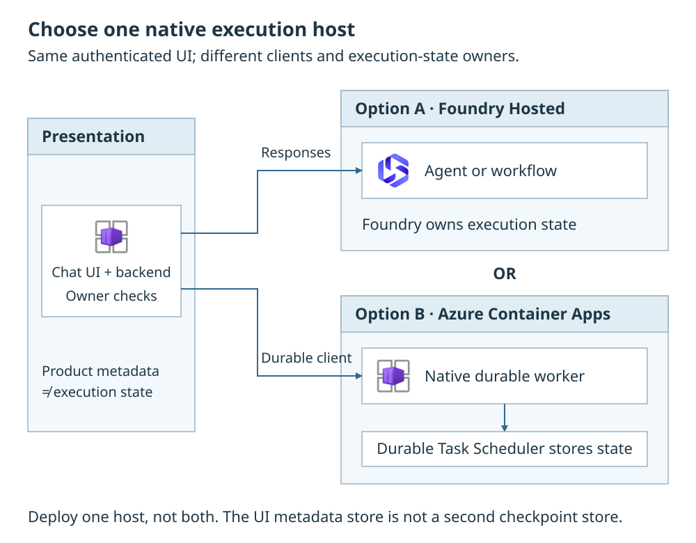

# Agent hosting

Agent App Orchestrator uses native Microsoft Agent Framework (MAF) execution.
Choose the application experience with `APPLICATION_MODE` and the host with
`ORCHESTRATION_HOST`. [Agents & prompts](agent-strategies.md) explains the
experience; the [full-stack guide](deploy-full-stack.md) owns deployment order.

<div class="runbook-diagram" markdown="1">

<div class="runbook-diagram__summary" markdown="1">

**Choose one execution host.** The authenticated UI uses either the Hosted
Responses client or the durable client. Foundry owns Hosted execution state;
DTS owns durable execution state for the Container Apps worker. UI metadata
is separate from both.

</div>

[](../media/runbooks/hosted-agents.svg){: .runbook-diagram__image aria-label="Open full-size agent hosting diagram"}

[Open full-size diagram](../media/runbooks/hosted-agents.svg){: .runbook-diagram__open}

</div>

## Before you start

Have the compatible platform checkout, an azd environment and an authorized
deployment identity. Confirm service availability, model capacity and network
access for the selected host. Private deployments need a connected runner.
Use the full-stack prerequisites
[for Bicep](deploy-full-stack.md#prerequisites) or
[for Terraform](deploy-terraform-full-stack.md#prerequisites).

## Select and activate a host

1. **Before provision**, select the environment from the platform repository
    root. Set the supported host and application mode there, not in the UI.
    For example, to run the reference review process on Container Apps:

    ```bash
    azd env select <environment-name>
    azd env set ORCHESTRATION_HOST container_apps
    azd env set APPLICATION_MODE workflow
    ```

    Use `hosted` for Foundry; mode accepts `conversational`, `workflow` or `both`.
    See [native execution selection](configuration.md#native-execution-selection).

2. **Provision and deploy** through the matching full-stack
    [Bicep procedure](deploy-full-stack.md#procedure) or
    [Terraform procedure](deploy-terraform-full-stack.md#procedure).
    Provision prepares dependencies and grants; deploy publishes the matching
    native image and binds the UI. Complete post-provision login setup before
    admitting users. Do not copy endpoint settings from a different host.
3. **After deployment**, check the generated bindings below and
    [runtime identity access](#runtime-identities-and-access). On Hosted `both`,
    confirm two single-mode publications and two distinct UI endpoints.
4. **At runtime**, sign in and complete a conversation or the
    [reference review process](workflows.md#try-the-reference-process).
    Reopen the owner-bound session/run, and verify another user cannot read
    or act on it. For durable execution, also verify recovery after an owned
    worker restart; local checks do not prove cloud durability.

Changing hosts or modes requires the matching provision/deploy lifecycle;
it is not a hot-reload setting or an automatic migration of existing native
sessions. Retain the old host and its state until owners approve retirement.

## Native host integrations

| Concern | Foundry Hosted | Azure Container Apps |
| --- | --- | --- |
| Host selection | `hosted` | `container_apps` |
| Application integration | Official Responses hosting with request-aware agent or workflow factories | Official standalone Durable Extension worker and client |
| Execution state | Native Foundry persistence | Durable Task Scheduler (DTS) |
| Human wait | Native workflow pending input | Native durable workflow pending input |
| When both experiences are selected | Separate conversational and workflow publications, each with a single application mode | The durable worker registers the selected agent and workflow |
| UI integration | Explicit Hosted client and publication endpoints | Explicit durable client and scheduler binding |

The Container Apps worker does not need an Azure Functions application or
public worker HTTP ingress. Its availability, scheduler connectivity and
scaling need operational planning. Do not assume scale-from-zero or Hosted
token-streaming parity for durable workflow progress.

The UI/BFF is the authenticated presentation boundary on both paths. It owns
product metadata and owner mappings, not workflow execution. No application
workflow engine, generalized state SDK or duplicate checkpoint database is
required. See [Conversations & files](conversations.md) and
[Workflows & human input](workflows.md).

## Public execution selection

Select only `ORCHESTRATION_HOST=hosted|container_apps` and
`APPLICATION_MODE=conversational|workflow|both`. Defaults are `hosted` and
`conversational`, with the UI included automatically. Network design remains
independent. History, feedback and private attachments are separate default-off
features; Hosted does not automatically enable history.
Workflow or `both` always requires UI metadata.

Foundry backing resources are not application-owned Cosmos DB. Native Hosted
execution does not require application Cosmos. Product metadata, history
discovery or feedback may have separately declared UI storage dependencies.
Custom ingestion is optional and disabled by default; it is not required
merely to keep owner mappings or feedback.

## Image and deployment handoff

Foundation provisioning creates the selected resources, network paths and
scoped access before application activation. Application publishing remains
in the application lifecycle, not inside the infrastructure templates.

Record the reviewed source, exact package versions, immutable image digest,
application mode, entrypoint and native registration/publication names.
Use the compatible manifest and generated host-specific definitions. A Hosted
HTTP entrypoint and a durable worker entrypoint are not interchangeable.
Do not substitute a generic ASGI command for the native host integration.

From the orchestrator repository root, the native entrypoints are:

| Host | Command | Listener |
| --- | --- | --- |
| Hosted | `python -m native.hosted` | Official hosting integration on port `8080` |
| Container Apps | `python -m native.durable` | Standalone worker; no public worker HTTP ingress or Dapr |

Supply the matching process mode, configuration endpoint and native binding.
A local Hosted listener does not reproduce Foundry's trusted ingress context.

When `APPLICATION_MODE=both` is selected on Hosted, publish **two applications**:
one with `APPLICATION_MODE=conversational`, another with
`APPLICATION_MODE=workflow`. Hand both endpoints to the UI. Do not publish a
single Hosted application with `both` and assume it exposes both protocols.
Each publication's single-mode process input must override the shared
`APPLICATION_MODE=both` composition value. Retain the common App Configuration
store while loading only relevant settings for each publication.

### Endpoint and client bindings

| Setting | Consumer and meaning |
| --- | --- |
| `HOSTED_AGENT_BASE_URL` | UI Hosted conversational client; actual conversational publication endpoint |
| `HOSTED_WORKFLOW_BASE_URL` | UI Hosted workflow client; actual separate workflow publication endpoint |
| `HOSTED_AGENT_RESOURCE_SCOPE` | Explicit Foundry audience ending in `/.default`, not the UI API scope |
| `DURABLE_TASK_SCHEDULER_CONNECTION_STRING` | Official nonsecret managed-identity scheduler binding for durable client and worker |

Use actual provisioned outputs and publication results. Do not construct a DTS
endpoint from a resource name or reuse a conversational endpoint as a workflow
endpoint. Keep registration names stable and align the durable client with
the worker's registered names: `agent-lz-conversation` and
`agent-lz-research-review`.

These native registration names are distinct from Azure resource names and
the Hosted publication's deployment name. Use the provisioned nonsecret
managed-identity scheduler binding:
`Endpoint=<actual output>;TaskHub=agent-lz;Authentication=ManagedIdentity`.
Keep the native worker and UI client aligned; do not change either component's
binding independently.

### Platform-injected and reserved variables

Microsoft Foundry Hosted Agents automatically inject and reserve `FOUNDRY_*`
(`FOUNDRY_PROJECT_ENDPOINT`, `FOUNDRY_PROJECT_ARM_ID`, `FOUNDRY_AGENT_NAME`,
`FOUNDRY_AGENT_VERSION`, `FOUNDRY_AGENT_SESSION_ID`), `AGENT_*` and
`APPLICATIONINSIGHTS_CONNECTION_STRING`.

`config.appdefinition` rejects overrides of those reserved variables in
`azure.yaml` or `agent.yaml` during preflight validation before publish.
Telemetry settings such as `APPLICATIONINSIGHTS_STATSBEAT_DISABLED_ALL` and
`OTEL_*` remain valid. See
[Bring your own app](build-your-own-app.md#folder-layout-and-azureyaml).

## Validation rules

Check a compatible **published** package set for the selected Python
integrations, including explicit prereleases where needed. A source sample
that imports an editable development SDK is not a supported package contract.
Service availability alone does not establish Python integration support.

Publish only when the exact product entrypoint/image has passed its native
execution checks. Compilation, configuration mocks and a separately working
sample do not establish deployment readiness.
Tests against installed native SDK types establish the exercised local client
contract, not deployed checkpoint durability, cross-user platform isolation or
private-network reachability. Record those live scenarios separately; do not
infer that every capability passed from local mocks.

<span id="bootstrap-the-agents-runtime-access"></span>

## Runtime identities and access

| Identity | Responsibility |
| --- | --- |
| Deployment principal | Provision resources, publish applications and reconcile reviewed scoped grants |
| Runtime/worker principal | Read relevant configuration and call declared dependencies |
| UI/BFF principal | Use host clients and required product-metadata services |
| Authenticated user | Own conversations/runs and hold required source/tool permissions |

Grant App Configuration Data Reader to actual readers. Grant Key Vault secret
access only to components that consume the corresponding secrets. Reading
App Configuration does not grant access to Key Vault references.

The implicit base grants are configuration read and image pull, not blanket
secret access. UI authentication, enabled audit and MCP/tool secrets require
their declared grants; `NATIVE_TOOL_SECRET_NAMES` is the platform's actual
name-only grant declaration, not a key consumed by the native runtime to load
secrets.

Grant scheduler access to durable worker/client identities at the required
scope. These service permissions are not end-user authorization.

If publication creates a runtime identity, reconcile its grants as an explicit
deployment step before admitting traffic. Runtime startup does not create
resources, grant roles or repair missing foundation configuration.
See [hosted access recovery](deploy-full-stack.md#recover-hosted-runtime-access).

### AI Gateway allowlisting and external models

Each hosted agent publication creates a dedicated runtime managed identity on
its first `azd deploy`, including two distinct runtime identities when
`APPLICATION_MODE=both`. Allowlist each hosted agent's dedicated runtime
identity at the AI Gateway rather than only the Foundry project identity.

Deployments routing all model inference through an external AI Gateway set
`DEPLOY_MODEL_DEPLOYMENTS=false` so local chat and embedding deployments and
model quota preflight checks are skipped. Container Apps `profile_name`
resolves dynamically against `WORKLOAD_PROFILES`. See
[external AI Gateway mode](configuration.md#model-deployments-and-external-ai-gateway)
and [workload profiles](configuration.md#container-apps-workload-profiles).

## Calling the agent

<span id="configure-the-uis-delegated-authentication"></span>

### Trusted caller context

Use the authenticated BFF boundary or trusted Foundry invocation context
supported by the deployed integration. Delegated Hosted invocation and
source/tool authorization remain separate checks. A shared managed identity,
caller-provided metadata or a known session ID is not a verified user.
Missing required trusted context fails closed.

The BFF binds the authenticated owner to native session/run IDs. It checks
ownership on reads, feedback and human replies.
A native ID selects state; it does not authorize access.
[Sign-in & access](application-auth.md) explains consent and retrieval.

### Persistence and progress

Hosted uses the official Responses integration and native persistence.
The application does not force stateless execution or manually replay a UI
transcript as a substitute for native state. Container Apps uses the official
durable client rather than emulating Responses over a custom queue.

Workflow pending input survives a browser disconnect in the native execution
backend. Reconnect and resume through the selected host's official client.
Do not equate an open Chainlit socket, waiting coroutine or displayed progress
message with persisted execution.

Token streaming and durable process progress have different contracts.
Do not add Redis solely to make the hosts appear identical.

### Continuity, history and the administrative panel

Native session state supplies execution continuity. User-facing saved-history
discovery, titles, owner maps and feedback belong to the UI/BFF and its selected
metadata store. An administrative panel is not a prerequisite for native
conversation or workflow persistence.

History, feedback and private attachments default to off. Workflow mode,
`both` or any enabled product flag selects UI metadata.
The container is `native-ui-metadata`, with partition key `/principal_id`
and owner `tid:oid`. Only the frontend receives its metadata grant.

Records contain descriptors/references, not bytes,
transcripts or tokens. With conversational mode and all product flags off,
bounded volatile owner maps are lost on UI restart.

Selecting the NL2SQL toolset on Agent App MCP Server requires a separate
source/vector-metadata catalog in application Cosmos, without making Cosmos
the native execution backend. Server compute alone, with `MCP_TOOLSETS=[]`,
does not require that catalog or NL2SQL model/secret access.

The MCP server always runs in a separate Container App, including
when its consumers use Hosted. The lifecycle authorizes the actual consuming
identities; Hosted `both` has separate conversation and workflow callers.
Catalog and SQL grants belong to the MCP identity, not the Hosted runtime.
See [Agent App MCP Server](agent-app-mcp.md).

Private attachments use owner-bound conversational inline native file/image
input, not Blob, SAS or corporate ingestion. They are not workflow inputs;
transport tests do not verify model PDF/image understanding.

Retention, deletion and recovery must cover each store explicitly.
Do not copy Foundry or DTS checkpoints into Cosmos for product history.
Known workflow resume does not require saved-history listing to be enabled.
See [Conversations & files](conversations.md), [User feedback](user-feedback.md)
and [Administration](operations.md).

## Configuration and telemetry

Use [Application settings](application-settings.md) for scoped provider
loading, refresh and workflow snapshots. Host, graph, identity, persistence
and entrypoint changes require deployment; supported functional parameters can
refresh without rebuilding.

<span id="telemetry-and-topology-changes"></span>

Native persistence does not authorize prompt/completion capture.
Keep sensitive content and credentials out of telemetry. Correlate owner-bound
UI operations with native session/run and deployment identifiers under the
approved logging policy. See [Monitoring & audit](application-monitoring.md).

### Scheduled trace evaluations

Hosted agents use **scheduled trace evaluations** (`azure_ai_traces` over
`invoke_agent` spans) rather than `responseCompleted` continuous evaluation
rules, which are not supported for hosted agents. With
`azure-ai-agentserver-responses`, persisted `GET /responses/{id}` lookups and
GenAI OpenTelemetry `invoke_agent` spans emit automatically when
`APPLICATIONINSIGHTS_CONNECTION_STRING` is injected.

Check per-item agent version (`gen_ai.agent.version` or
`FOUNDRY_AGENT_VERSION`) and non-empty assistant output across rolling trace
lookback windows so older agent versions or empty startup probes do not skew
evaluation scores. See
[Administration](operations.md#run-scheduled-trace-evaluations-on-hosted-agents)
for opt-in evaluation RBAC.
