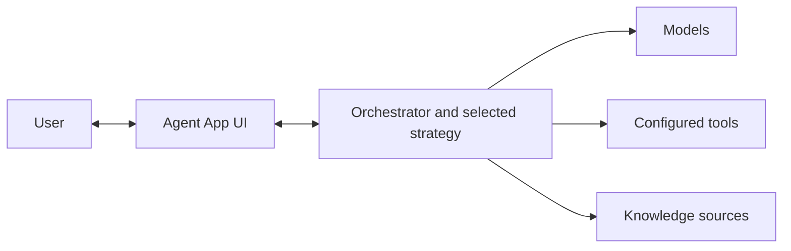

# Agent Landing Zone

Agent Landing Zone provides a secure Azure foundation and an extensible agent
application built on Microsoft Foundry. Deploy the foundation on its own, use the
bundled application, or bring your own application.

Source code: [Azure/agent-landing-zone](https://github.com/Azure/agent-landing-zone)

## Foundation and application

The template separates Azure resource provisioning from application deployment.
Deployment parameters and application selection determine what is created.

| Layer | What it contains | Deployed by |
| --- | --- | --- |
| Foundation | Azure resources, identities and service configuration selected by the deployment inputs | `azd provision` and its configuration hooks |
| Application | The selected application components and, for hosted orchestration, the agent version | `azd deploy` and its deployment hooks |

For the file layout and lifecycle, read [How the template works](how-it-works.md).
For the exact resource inventory, see [Deployed resources and cost estimates](../bicep/deployed-resources.md).

## Agent application

The [Agent App Orchestrator](https://github.com/Azure/agent-app-orchestrator)
coordinates models, knowledge sources and configured tools through a selected
**orchestration strategy**. Extend its strategies and tools to implement your
workload's behavior. The [Agent App UI](https://github.com/Azure/agent-app-ui)
provides the conversational interface.

### Strategies and hosting

A strategy determines how the agent uses models, obtains context and invokes
tools. Hosting determines where the orchestrator runs. These are separate
choices, and not every strategy supports both hosts.

| Hosting option | Execution model |
| --- | --- |
| Foundry hosted agent | The default for a fresh environment. Foundry Agent Service runs the orchestrator image with a supported strategy. |
| Azure Container Apps | Runs the orchestrator as a Container App, including strategies that are not yet supported by the hosted runtime. |

See [Agent hosting](hosted-agents.md) for supported strategies and the differences
in history, continuity and optional administration features.

### Knowledge ingestion

The optional [Agent App Ingestion](https://github.com/Azure/agent-app-ingestion)
provides application-managed document processing, including format-aware
chunking, embeddings and configured SharePoint ingestion. Native Foundry IQ can
instead ingest configured Blob sources without that application.

These paths are not feature-equivalent. Conversation attachments require the
ingestion app and the existing upload eligibility checks. SharePoint has
separate connector and permission requirements; the native Blob path does not
establish ingestion-free SharePoint support. See [Ingestion choices](ingestion.md)
before selecting or changing the ingestion path.

## Choose your path

Follow the planning steps in order, then choose a deployment runbook.

| I want to | Guidance |
| --- | --- |
| Understand how the template fits together | [How the template works](how-it-works.md) |
| Review architecture and security decisions | [Design checklist](../architecture/design-checklist.md) |
| Understand resources and estimate spending | [Resource inventory and estimates](../bicep/deployed-resources.md), then [Cost planning](../architecture/cost-guide.md) |
| Plan capacity for my workload | [Sizing and capacity](sizing.md), with current planning questions and detailed guidance planned |
| Choose deployment settings, hosting and connectivity | [Configuration](configuration.md), [Agent hosting](hosted-agents.md) and [Network isolation](network-isolation.md) |
| Provision a foundation without deploying application code | [Deploy infrastructure only](deploy-infra-only.md) |
| Deploy the foundation and agent application | [Full stack deploy](deploy-full-stack.md) |
| Make a hosted agent available in Teams and Microsoft 365 Copilot | [Publish to Teams and M365](publish-to-teams.md) |
| Call a private Foundry agent from Copilot Studio | [Connect Copilot Studio](connect-copilot-studio.md) |
| Integrate my own application or modify a component | [Custom applications](build-your-own-app.md) |
| Automate deployments with Azure DevOps (optional) | [Deploy with Azure DevOps](azure-devops.md) |
| Diagnose a deployment or runtime problem | [Troubleshooting](troubleshooting.md) |
