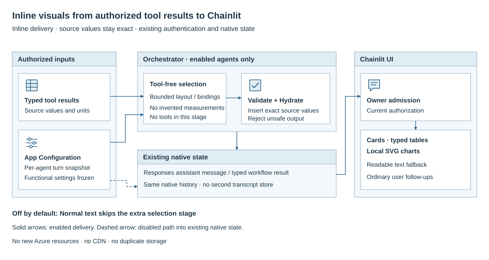
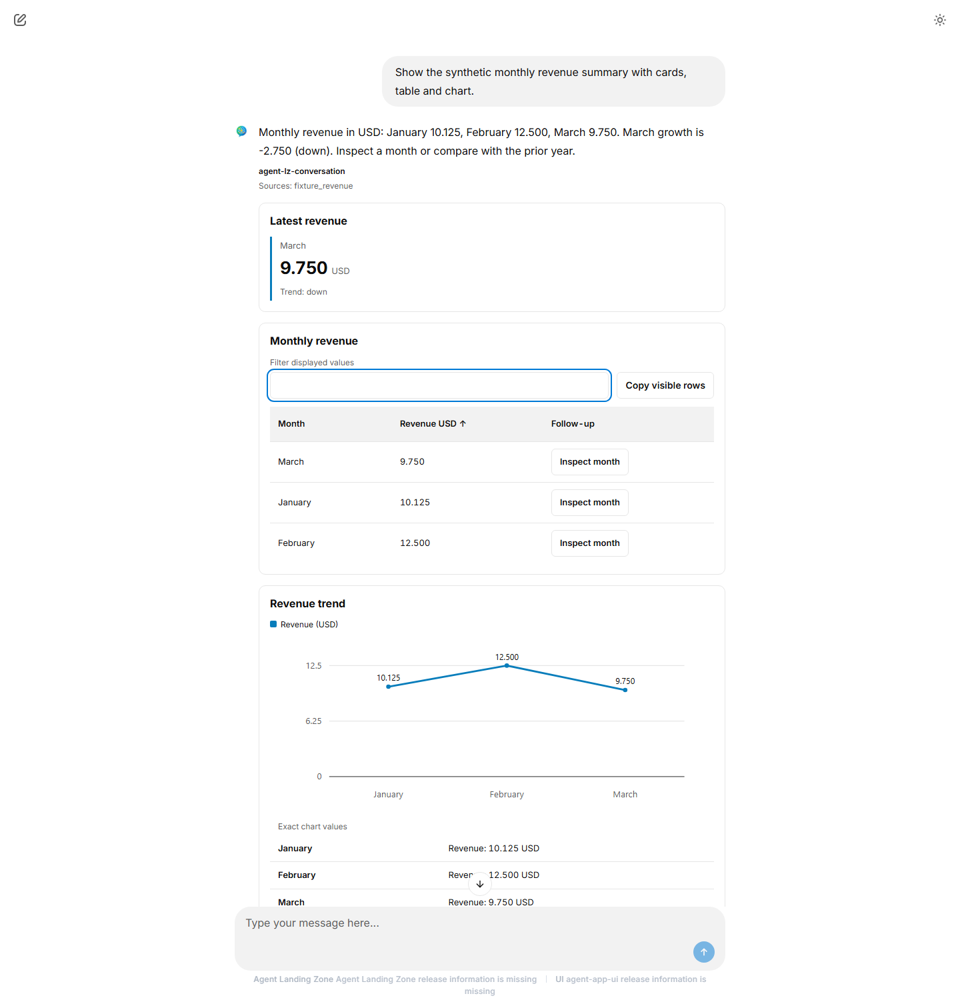
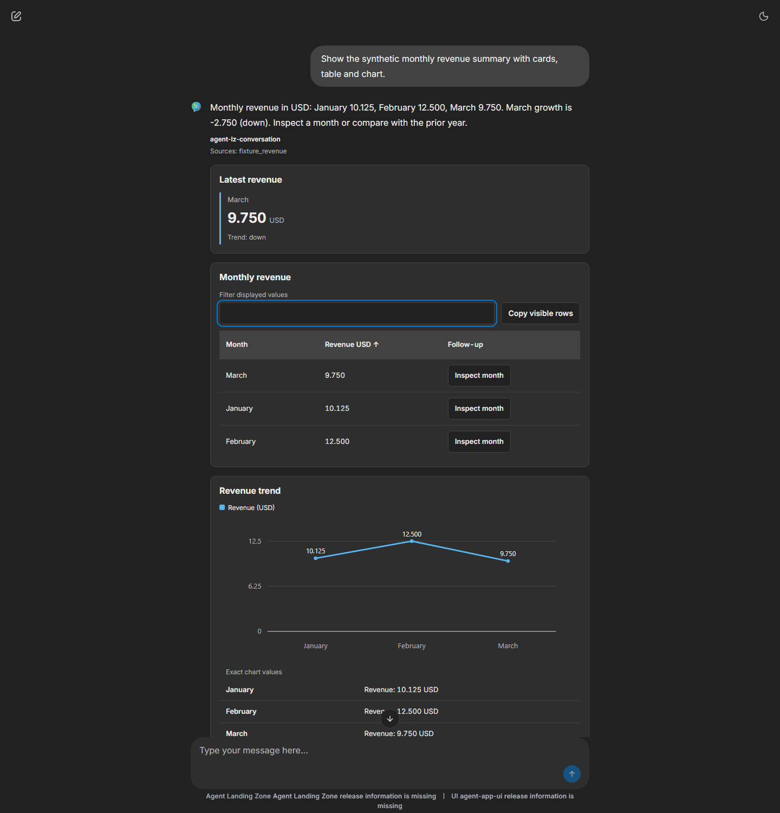

# Inline visuals

## Objective

Show useful cards, tables and charts beside an agent's text answer in Chainlit.
Inline visuals are **off by default** and enabled separately for each agent.

## Expected outcome

When a supported typed tool result supplies suitable data, the agent can select:

- **Cards** for individual values, units and source-backed indicators.
- **Typed tables** with text, dates and numeric values.
- **Bar, grouped-bar and line charts** using source values.
- **Suggestions**, and **row follow-ups** when the source supplies a business ID.

Not every answer becomes a chart. The model selects a presentation from
supported tool results; it does not invent numeric measurements. Ordinary text
remains readable. This feature adds no new Azure resources, presentation
service, CDN or separate conversation store.

<div class="runbook-diagram" markdown="1">
<div class="runbook-diagram__summary" markdown="1">

**Inline visuals delivery**
1. Authorized typed tool results and the agent's settings supply the inputs.
2. The orchestrator selects a bounded presentation, validates it and inserts source values.
3. Existing native state carries the result; the UI checks ownership and displays visuals and text.
4. When disabled, the agent returns normal text without the extra selection stage.

</div>

[](../media/runbooks/inline-visuals.svg){: .runbook-diagram__image aria-label="Open full-size inline visuals delivery diagram"}

[Open full-size diagram](../media/runbooks/inline-visuals.svg){: .runbook-diagram__open}
</div>

## When to use

Use inline visuals for supported structured results, such as monthly revenue,
where users need to compare values or inspect rows. This page covers Chainlit
web chat only; it does not promise these visuals in Teams, Microsoft 365
Copilot, Copilot Studio or other clients.

## Prerequisites

- Orchestrator and Chainlit UI with matching v1 presentation contracts.
- A registered agent and authorized tools returning supported typed results.
- Access to the ordinary nonsecret [application settings](application-settings.md)
  declaration. Existing authentication and tool permissions stay unchanged.

## Procedure

### Step 1: Enable one agent

Append this declaration to
`parameters.additionalAppConfigurationSettings.value` in the project-root
`main.parameters.json`. Preserve the other entries and use the actual registered
agent ID. This example uses the reference conversation agent:

```json
{
  "name": "AGENT_PRESENTATION_SETTINGS",
  "value": "{\"schemaVersion\":1,\"agents\":{\"agent-lz-conversation\":{\"enabled\":true,\"guidance\":\"Prefer monthly revenue tables. Preserve source units.\"}}}"
}
```

### Step 2: Apply the setting

Use the existing [setting publication lifecycle](application-settings.md#change-a-setting)
for the selected provider. Bicep and Terraform share this declaration path.
Editing the file alone does not update runtime settings.

An absent setting, empty `agents` map, missing agent entry or `enabled: false`
means off. Invalid settings are rejected. Each new turn uses fresh functional
settings, frozen for that turn or workflow; authorization remains current.

### Step 3: Read and interact with the answer

Ask for an answer backed by a supported typed tool result, then:

- Read card values and units alongside the text answer.
- Click a table heading to **sort**, enter text to **filter**, or choose
  **Copy visible rows** to copy headings and displayed rows in displayed order.
  These actions change the local display, not the source query.
- **Hover** a chart mark for its native tooltip with category, series, exact
  value and unit. Keyboard focus also exposes the exact value. There is
  **no zoom, pan or chart drill-down**.
- Choose a suggestion or row follow-up to send an ordinary new user message.
  A row follow-up needs a source business ID. It does not directly execute a
  tool or approve a workflow's pending human review.



*Synthetic data in actual Chainlit 2.12.0 with a local mock agent. The user
requested monthly revenue with a card, table and
chart and sorted Revenue USD ascending: March 9.750, January 10.125, February
12.500. The card retains 9.750 USD; the chart also lists exact values as text.*



*The same synthetic data and local mock agent in actual Chainlit 2.12.0 after
switching to dark theme. The filter is empty, so all three sorted rows remain
visible. No new source query or numeric conversion is needed to change theme.*

## Validation

Use controlled local tool results and restored native history to check:

| Check | Expected result |
| --- | --- |
| Agent disabled or omitted | Normal text; no extra presentation stage |
| Supported typed result | Only source-backed values and units appear |
| Sort, filter and copy | Visible rows and copied order match |
| Suggestion or identified row follow-up | One ordinary authorized new user message |
| Invalid, unsupported or oversized presentation | Readable authorized text, not a raw envelope |
| Disable after saving a visual answer | New answers are text-only; authorized saved history remains readable |

### Troubleshooting

| Symptom | Action |
| --- | --- |
| Text only | Check the exact agent ID, published setting and supported typed tool result. Not every response qualifies. |
| No row follow-up | Supply a stable business ID in the typed source result. |
| Rejected setting | Check the versioned configuration example; do not loosen validation. |
| Presentation falls back to text | Check source bindings and limits: 10 blocks, 500 rows/table, 8 series/chart, 1,000 non-null plotted values and 262,144 compact UTF-8 bytes. The extra stage has a total 10-second budget. |
| Other client shows raw data | Use an envelope-aware text reader after its existing ownership check. Other channels are not certified visual clients. |

See [Inline visual contracts](inline-visuals-contract.md) for exact schemas,
typed-source samples and safe text-only integration.

## Rollback

1. Set the agent's `enabled` to `false`, remove its entry, or publish
   `{"schemaVersion":1,"agents":{}}`.
2. Apply the change through the existing settings lifecycle. Removing the
   declaration publishes the empty map **when publication runs**, not when
   the file is edited.
3. Keep matched readers and contracts so authorized saved visual history
   remains readable. Do not remove authentication, change retention policy,
   re-query saved sources or add another conversation store.
