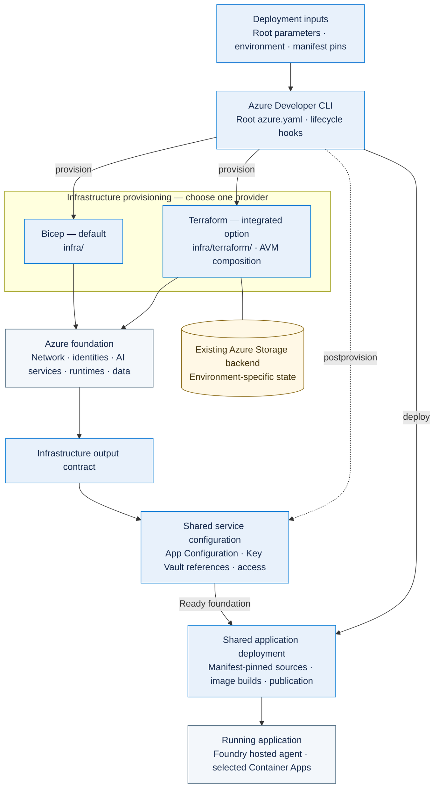

# Terraform templates

Agent Landing Zone offers Bicep and Terraform infrastructure definitions in the
[same product repository](https://github.com/Azure/agent-landing-zone).
The **Azure Developer CLI (`azd`)** coordinates provisioning, service
configuration and application deployment for either choice. Bicep is the
default. Select Terraform once in the checkout's root `azure.yaml`.

## Choose the outcome

| Goal | Runbook |
| --- | --- |
| Create and configure Azure resources without application images | [Deploy infra only with Terraform](deploy-terraform-infra-only.md) |
| Provision the foundation and deploy the Agent Application | [Deploy full stack with Terraform](deploy-terraform-full-stack.md) |

## One lifecycle, two infrastructure providers

`azd provision` creates the foundation and configures its services; it does not
build or publish application images. `azd deploy` uses that foundation to
build and publish the selected application. `azd up` runs both stages.
Reprovisioning must preserve application images and revisions already published
by deployment. Infrastructure ownership does not extend to resetting those
application-managed values.

The root `azure.yaml` selects the native azd Terraform provider,
`infra/terraform` path and `main` module. Shared PowerShell and shell hooks
configure services and deploy the application. Use the selected provider for
provisioning, updates and removal.

## Repository-owned AVM composition

The Terraform root composes **Azure Verified Modules (AVM)** with explicit
inputs, dependencies and outputs. Complementary AzureRM or AzAPI resources
cover requirements not met by the selected modules. The composition lives in
`infra/terraform/` alongside the product's configuration and lifecycle hooks.

Operators use documented environment inputs and root `main.parameters.json`.
Preprovision resolves the shared topology and generates typed
`infra/terraform/main.tfvars.json`; generated inputs are not operator-edited.
The environment records its provider and application binding.
The adapter derives matching provider, storage and backend cloud settings for
`public`, `usgovernment` or `china`; operators do not edit the generated
`azureCloud` context.

All flat infrastructure outputs feed azd and the shared configuration hooks
automatically. The hooks publish runtime settings and
[platform outputs](deploy-infra-only.md#platform-outputs) under the `agent-lz`
App Configuration label, with secrets referenced from Key Vault.
The platform-output document is part of the integration contract, not a
replacement for every lifecycle output.
Foundation settings and declared additional values retain their labels and
content types. Shared defaults fill only missing keys; runtime-owned values
follow the [declared ownership contract](configuration.md#configuration-ownership-and-declarations).

## Versions, state and ownership

- `manifest.json` pins the coordinated application component sources.
- Every direct and transitive provider version is pinned exactly. The committed
  `infra/terraform/.terraform.lock.hcl` records provider selections and checksums
  for Windows and Linux. Module versions are pinned separately.
- Native azd initialization uses `-upgrade`. Exact pins constrain provider
  selection; read-only lock-file validation runs separately in CI.
- Azure Storage holds remote state with an environment-specific key and
  identity-based access. Backend storage, permissions, network access and
  recovery controls are prerequisites outside every workload resource group.
  The workload uses an existing backend and leaves it outside `azd down`.
- Immutable private backend/group records bind the state address and ownership.
  Terraform teardown uses that recorded state across owned or bring-your-own
  group layouts; it does not use a bulk group-deletion hook.
- With azd 1.37.1, plan and apply run without native backend state locking.
  Individual environments can use local azd. Shared and production operations
  use one authorized executor and a non-canceling queue per actual backend
  state identity, not per branch. Follow the
  [single-writer policy](deploy-terraform-infra-only.md#state-protection).
- State, saved plans, generated inputs and local `.azure/` data can expose
  sensitive values. Do not commit them. Review dependency updates deliberately,
  rather than upgrading providers to repair an unrelated deployment failure.

See the [Terraform infrastructure runbook](deploy-terraform-infra-only.md)
for backend readiness, updates and removal boundaries.

## Validation scope

Verification includes offline tests and an Azure-authenticated plan of the
public foundation, using in-memory test state without applying resources.
Native backend operations, full-stack and private deployments, runtime RBAC
and recovery were not exercised in Azure. Validate your deployment with the
[foundation](deploy-terraform-infra-only.md#validation) and
[application](deploy-terraform-full-stack.md#validation) runbook checks.

## Related reference

The [AI Landing Zone Terraform foundation reference](../terraform/index.md)
is for composing a foundation directly from the shared AVM pattern.
For Agent Landing Zone service configuration and application deployment,
use the product runbooks above.
