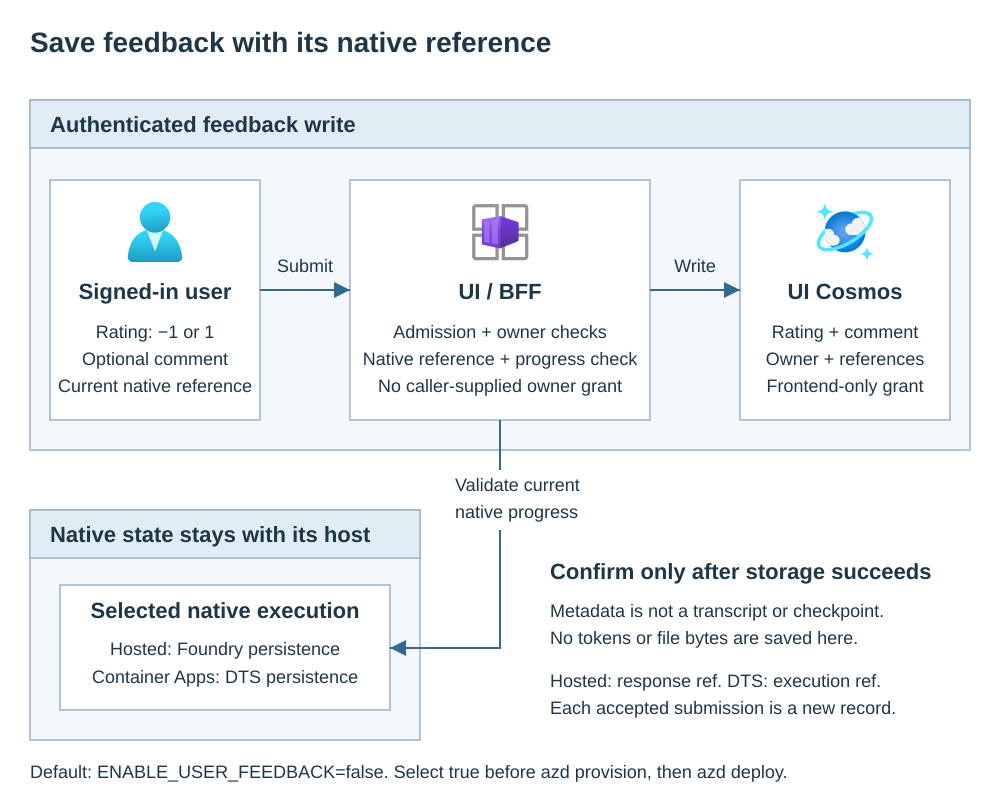

# User feedback

Enable feedback when signed-in users need to rate an agent's result.
`ENABLE_USER_FEEDBACK` defaults to `false`; explicitly select `true` before
provisioning. Ratings and optional comments belong to the UI's owner-scoped
metadata store, not to Foundry or Durable Task Scheduler execution storage.
The UI server, also called the backend for frontend (BFF), checks these requests.

<div class="runbook-diagram" markdown="1">

<div class="runbook-diagram__summary" markdown="1">

**Saving feedback**

1. A signed-in user submits a rating with its native result/execution reference.
2. The UI checks admission, session ownership and the current native reference,
   then reads native progress to validate the execution.
3. Only the frontend writes the rating, optional comment and references to
   UI Cosmos. It stores no transcript, token or execution checkpoint.
4. The UI confirms success only after the metadata write succeeds.

</div>

[](../media/runbooks/user-feedback.svg){: .runbook-diagram__image aria-label="Open full-size feedback diagram"}

[Open full-size diagram](../media/runbooks/user-feedback.svg){: .runbook-diagram__open}

</div>

## Enable feedback in deployment order

The deployment operator needs the platform checkout and intended azd
environment, resource deployment permissions and permission to assign scoped
Cosmos data access. The identity administrator owns login and consent;
complete [application access](application-auth.md) in its stated order.
The data owner must approve comment retention and operator access before
users enter real data.

1. From the **platform checkout root**, select the intended environment
   and explicitly enable feedback:

```bash
azd env select <environment-name>
azd env set ENABLE_USER_FEEDBACK true
```

2. Run `azd provision` from that checkout with the same environment selected.

This sequence also applies when adding feedback to an existing deployment.
The platform reads this supported environment input, selects the application
Cosmos dependency, provisions the metadata container and grants access to the
**frontend identity only**. It publishes the flag under App Configuration
label `agent-lz`. No ingestion service, extra execution service or history
flag is required.

Do not enable the flag only in **Configuration explorer** or add it only
to `additionalAppConfigurationSettings`: that bypasses dependency selection.
Do not force `DEPLOY_COSMOS_DB=false` when metadata is required.
[Enable a product feature](application-settings.md#enable-a-product-feature)
describes the canonical lifecycle path.

After provision, open **App Configuration > Configuration explorer**, select
label `agent-lz`, and check these nonsecret values:

| Key | Expected value |
| --- | --- |
| `ENABLE_USER_FEEDBACK` | Plain-text `true` |
| `DATABASE_ACCOUNT_NAME` | Provisioned application Cosmos account name, not a URL |
| `DATABASE_NAME` | Provisioned application database name |
| `NATIVE_UI_METADATA_CONTAINER` | `native-ui-metadata` by default |

In **Cosmos DB > Data Explorer**, confirm the named database/container exists
with partition key **`/principal_id`**. Its owner value is the authenticated
`tid:oid` (tenant ID and user object ID). The post-provision grant is
container-scoped Cosmos DB Built-in Data Contributor for the frontend;
it does not give users or the native runtime a metadata grant.

3. Run `azd deploy` only after provision and grants succeed.

The UI chooses its metadata backend at startup.
A flag write alone cannot switch a running volatile owner map to Cosmos.
Reopen/sign in to chat after deployment and use
a new harmless conversation for acceptance. Existing volatile mappings are
not recovered or migrated by enabling feedback.

<span id="choose-the-supported-path"></span>

## Submit feedback

In conversational chat, send a harmless prompt and wait for the real result.
Choose **Útil** (helpful) or **Não útil** (not helpful) on that response.
The supplied controls submit a rating with an empty comment; wait for
**Feedback salvo.** (feedback saved) before treating it as stored.
They do not provide a comment editor or a feedback administration panel.

Authenticated API clients can include a comment using
`POST /api/native/sessions/{id}/feedback`. Use the owner-bound **UI session
UUID** and the `native_ref` returned by its latest turn:

```json
{
  "native_ref": "<current-native-ref>",
  "rating": 1,
  "comment": "The answer helped me locate the policy."
}
```

Send a delegated UI API access token in the bearer header, never in the JSON
or URL. `rating` must be `-1` or `1`; `comment` is optional and limited to
2,000 characters. Successful API writes return `201` with the feedback
record's `id` and `created_at`.

The BFF checks current admission and ownership, requires the current native
reference and reads native progress before saving. Unknown/nonowned UI IDs
return `404`. A native ID or body-supplied user identity is not authorization.
Anonymous embedding cannot supply this authenticated owner.

**Reference granularity differs by host.** Hosted returns a response ID;
an earlier response reference returns `409` once a newer turn advances that
session. DTS retains its session reference across turns, so its feedback is
execution-scoped, not independently bound to an immutable chat message.
Always use the reference returned by the UI, not a guessed message ID.

<span id="verify-and-recover"></span>

## Verify and recover

1. Submit one harmless rating. Verify the UI confirmation or API `201`, then
   have an authorized operator confirm the metadata record below.
2. Sign in as a different user and submit against the first user's UI UUID.
   Expect `404`, without accessing that native execution.
3. On Hosted, advance the owner's conversation and submit the earlier
   `native_ref`. Expect `409`; reload and rate the current result.
   On DTS, confirm feedback records retain the session's execution reference.
4. In a controlled test, confirm an unavailable store reports failure rather
   than a saved rating. Disabled feedback is unavailable (`503` on the API).

On an interrupted request, ask an authorized operator to check whether the
record exists before retrying. Each accepted submission creates a separate
record; retries are not an update or a guaranteed deduplication mechanism.
Keep tokens, comments and document contents out of diagnostic logs.

## Read and administer stored feedback

The supplied native UI API supports feedback **writes**, not a feedback-list
or administrative-read endpoint. For an approved investigation, use
**Azure portal > Cosmos DB > Data Explorer > the application database >
native-ui-metadata > New SQL Query** (or the configured container).
The operator needs separately approved Cosmos data-plane read access and
network connectivity; ordinary UI admission does not grant it.

Use the returned feedback ID and the approved owner's `tid:oid` to read only
that record. Replace both placeholders:

```sql
SELECT c.id, c.session_id, c.native_ref, c.rating, c.comment, c.created_at
FROM c
WHERE c.kind = "feedback"
  AND c.principal_id = "<tenant-id>:<object-id>"
  AND c.id = "<feedback-record-id>"
```

Handle the result as sensitive user-authored data. An organization can build
a separately authorized reporting/export process against this metadata
schema, with least-privilege reads and audit controls. Such a process is
customer-owned; deployment does not install a consolidated feedback panel.
See [Administration](operations.md).

## Privacy, disablement and retention

Comments can contain sensitive data even though metadata stores no transcript.
Define allowed readers, export/deletion handling and backup policy separately
from native conversation retention. Audit identifiers and outcomes rather
than unnecessary comment content.

To disable new submissions, set `ENABLE_USER_FEEDBACK` to `false` in the same
azd environment and apply the reviewed provision/deploy lifecycle. Review
resource changes first: workflow mode or other enabled features can still
require UI metadata. Disabling feedback is not deletion. Retain or remove
existing records through an approved data-management process, and verify
native-state cleanup separately.

See [Conversations & files](conversations.md) for ownership and continuity,
and [Monitoring & audit](application-monitoring.md) for operational evidence.
