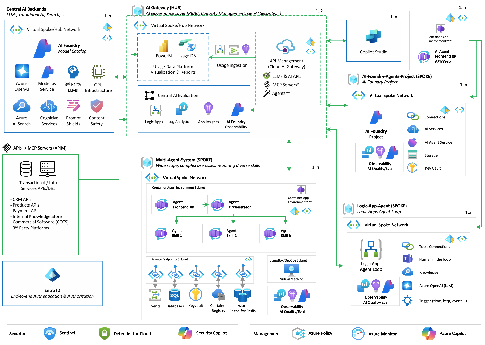
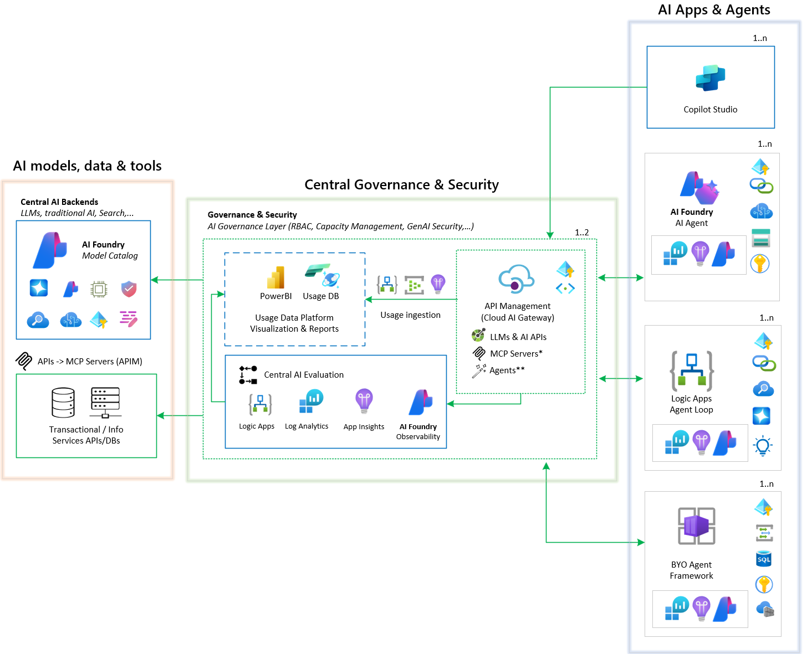

# Foundry Citadel Platform

!!! note "Original platform guide"
    This guide describes the Foundry Citadel Platform as first published, organized around three pillars and a hub-and-spoke architecture. For the current layered guidance, see the [AI Citadel Blueprint overview](index.md) and its layer guides.

> *Scalable **AI Landing Zone** with Governance, Observability & Rapid Development*

Foundry **Citadel** Platform is a solution accelerator designed as a **supplemental AI landing zone** that integrates seamlessly with your Azure environment. It provides a **secure, scalable foundation** for running AI applications and agents in production – with **unified governance**, **end-to-end observability**, and tools to **accelerate development**. Citadel delivers a **pre-configured reference architecture** (aligned to Azure’s Cloud Adoption and Well-Architected Frameworks) that can be deployed with one click and includes ready-made code, templates, and documentation following Microsoft’s best practices. This comprehensive approach helps organisations adopt AI **responsibly and efficiently**, ensuring that advanced AI agents can be developed **quickly** while remaining **well-managed** and **compliant** with enterprise requirements.

> ### Citadel Adoption Signals  
> _Enterprise teams highlight these blockers and enablers for scaling AI responsibly._

| 🛡️ **Security** | 📊 **Consumption** | 🧭 **Guardrails** | 🗂️ **Registry** |
| --- | --- | --- | --- |
| **62 %** of practitioners cite security concerns as the top blocker to wider AI or agent adoption. | **71 %** of enterprises struggle to track AI usage, enforce quotas, and report costs per team. | **47 %** of organisations require explicit guardrails before deploying autonomous AI agents safely. | **70 %** of customers need an AI registry for both agents and tools to adopt AI at scale. |

> 🧩 _Citadel turns these pain points into platform strengths—governed access, transparent consumption, defensible guardrails, and a shared catalog of reusable AI capabilities._

These challenges highlight why **Citadel’s capabilities** are crucial. **Foundry Citadel Platform** focuses on **three key pillars** – **Governance & Security**, **Observability & Compliance**, and **AI Development Velocity** – to address these concerns end-to-end. Below, we outline each pillar and the core capabilities provided, with architecture components and features that ensure enterprise-grade AI deployments:

***

## **1. Governance & Security Pillar** – *Trustworthy AI Operations at Scale*

> ### Why Governance Matters
> Without centralized AI governance, organisations face **unpredictable costs, reliability issues, security risks, developer friction,** and compliance nightmares. Citadel fixes this by building guardrails into every AI call.

**Foundry Citadel Platform** implements strong governance and security controls so that enterprises can adopt generative AI **safely and in compliance**. Key capabilities of this pillar include a **unified AI gateway** for all model access, granular policy enforcement, and robust safety mechanisms:

*   **🔐 Unified AI Gateway:** At the core of Citadel’s security is the **“AI Gateway”** – a central entry point (built on Azure API Management) through which **all AI model requests** are routed. This gateway enforces organisation-wide policies consistently. For example, it implements **universal LLM policies like rate limiting and token quotas** to prevent misuse or cost overrun. **No application calls the model directly**; instead, apps call the gateway, which authenticates and forwards requests to the appropriate model (Azure OpenAI, open-source, or even third-party services like Amazon Bedrock) while applying the required controls. This design **centralises oversight** of all AI consumption.

*   **🗝️ Granular Access Control & Key Management:** Citadel’s gateway introduces a **gateway-keys model access pattern** for developers. Rather than embedding master API keys for various AI services, teams use **managed credentials issued by the gateway**. 
The gateway can map these to backend keys or identity tokens, ensuring that **no master keys are directly exposed** in code. Access can be segmented by team or use-case, with **role-based authorisation** (e.g. only approved apps or users can invoke certain AI endpoints) for greater security. This prevents uncontrolled use of AI services and allows rapid **revocation or rotation** of credentials from a single place.

*   **🔑 Credential Management:** Citadel secures API keys and service credentials by leveraging Azure Key Vault. Secrets are stored securely and accessed at runtime, ensuring that **no raw keys are exposed in code or logs**.

*   **🛡️ Policy Enforcement and Compliance:** The governance layer allows administrators to define and enforce a range of **custom policies**. These include **traffic mediation rules** (e.g. routing requests to different model endpoints based on content or load) and **usage policies** (per-user or per-app call rate limits and monthly token budgets). It also supports complex **expressions for policies** – for example, automatically choosing an Azure OpenAI instance in a specific region for compliance, or requiring certain **request headers/tags for auditing**. All usage is captured centrally, enabling compliance auditing and simplifying answer to the question *“Who is using which model, and how?”*.

*   **🌐 Multi-Cloud and Hybrid Support:** Citadel’s governance is flexible – it can govern not only Azure OpenAI, but also **open-source model servers or third-party AI APIs**. The AI Gateway speaks **OpenAI-compatible APIs** natively, meaning it can front-end virtually any generative model service. For instance, it can direct certain requests to Azure OpenAI or to an on-premises GPU-VM model, or even to Amazon Bedrock, all under the same policy umbrella. This multi-cloud ability gives organisations a **single control plane** for heterogeneous AI systems. Citadel’s gateway and related services can themselves run on-premises if needed (via APIM self-hosted gateways), supporting scenarios with strict data residency or partially air-gapped networks.

*   **🛡️ AI Content Safety & Guardrails:** Citadel includes built-in **AI safety** mechanisms to enforce responsible AI usage. Every request and response can be scanned by **Azure AI Content Safety** – which detects **hate speech, violent or sexual content, self-harm indications, and other harmful outputs**. If an application user tries to prompt an agent to produce disallowed content or if a model’s answer contains such content, the system can **block or filter** that response automatically. Citadel’s safety system also includes **“prompt shields”** that detect attempts to jailbreak the agent with malicious instructions hidden in user input or documents. This protects the AI agents from executing unintended commands. Additionally, **“protected content”** checks can recognise if a model’s answer includes large verbatim excerpts of known copyrighted text (lyrics, articles, etc.) and prevent accidental leakage of such content. These guardrails give organisations confidence that AI systems won’t go off-policy or create liability.

*   **📊 Central Monitoring & Cost Governance:** All AI usage through the gateway is logged centrally (calls, tokens used, timings, outcome). FCP provides **built-in reports and dashboards** to track this usage by application or department. This **solves the cost attribution problem** – e.g. you can see how many tokens the Finance team’s chatbot consumed this week and enforce per-team quotas. It also enables **cost optimisation** – detecting anomalous spikes or inefficient prompt usage. Combined with Azure Monitor, admins can set **alerts** (e.g. if a project exceeds its monthly AI budget, or if a spike in requests suggests a rogue script). By providing this transparency and control, Citadel helps prevent the “blank cheque” scenario of uncontrolled AI API spend. It effectively addresses the **“shadow AI”** governance nightmare by keeping all AI calls within the managed guardrails.

*   **📘 Central AI Registry for Agents and Tools:** FCP provides a unified **AI Registry** powered by the **Model Context Protocol (MCP)**, enabling organisations to manage and discover both **first-party** and **third-party** AI agents and tools. This registry acts as a central catalog where teams can securely share, document, and govern AI capabilities across the enterprise. By standardising metadata and access policies, the registry ensures that all agents and tools – whether developed in-house or sourced externally – are easily discoverable and can be integrated seamlessly into workflows. This capability fosters collaboration, reduces duplication of effort, and ensures consistent governance for all AI assets.

*   **🔒 Data Security:** Citadel ensures the protection of sensitive data in AI workflows by integrating with Microsoft Purview. This enables governance through **data sensitivity labels and policies**, ensuring that sensitive information remains within approved boundaries. For example, an AI agent accessing a database will operate under Purview’s oversight, with all usage logged and any policy violations (such as accessing restricted customer data) flagged for review.

**Governance & Security Features and Components:** The table below summarises some of the key governance components of Citadel and their roles:

<table>
  <tr>
    <th>Governance Feature</th>
    <th>Description</th>
  </tr>
  <tr>
    <td><b>Unified AI Gateway</b></td>
    <td>Central gateway that mediates <u>every</u> AI call. It applies global policies (rate limits, authentication, routing) and provides a single secure endpoint for clients. This ensures all AI usage is centrally visible and controlled.</td>
  </tr>
  <tr>
    <td><b>Policy Engine</b></td>
    <td>Rich rule framework to enforce business rules – e.g. restrict certain models to specific regions, apply <u>token quotas per user</u>, or inject safety prompts. Administrators can write custom policies or use built-in templates for common requirements.</td>
  </tr>
  <tr>
    <td><b>Managed Credentials</b></td>
    <td>Uses gateway-keys with/without Identity Platform issued tokens (like Microsoft Entra ID) to abstract backend secrets. Developers no longer handle raw AI services master keys – the gateway issues tokens/keys with scoped access. This prevents key leakage and allows instant revocation if needed.</td>
  </tr>
  <tr>
    <td><b>Content Safety Filters</b></td>
    <td>Automated checks on prompts and responses using Azure AI Content Safety. Flags or removes profanity, hate, sexual or violent content, and can block outputs that violate compliance policies (e.g. privacy or confidential data).</td>
  </tr>
  <tr>
    <td><b>AI Registry & Catalog</b></td>
    <td>A registry (via Azure API Center) for discovering and managing AI endpoints and tools (known as MCP servers). This catalogue lets teams securely share AI “skills” (Agents, APIs, functions) across the enterprise with proper metadata and governance.</td>
  </tr>
  <tr>
    <td><b>Multi-cloud Connectors</b></td>
    <td>Built-in support to govern AI services beyond Azure. The gateway can proxy requests to <u>open-source model APIs</u> or other cloud’s AI endpoints (e.g. Bedrock) securely. This ensures consistent security and monitoring even for third-party AI services.</td>
  </tr>
  <tr>
    <td><b>Azure Key Vault</b></td>
    <td>Secure store for secrets and credentials by AI Apps/Agents. All API keys, connection strings, etc., used by agents or the gateway are kept in spoke Key Vault, and accessed via managed identities. This eliminates hard-coded secrets and protects sensitive data at rest.</td>
  </tr>
</table>

**In practice, these governance features mean AI applications can be deployed with confidence.** For example, if you build a GPT-based internal assistant, it will run through Citadel’s gateway – **ensuring it only answers within approved data sources, filters any policy-breaking content, and logs its activity**. Administrators remain in control: they can update a policy to block a newly discovered prompt attack pattern, or quickly see which prompts are costing the most. FCP thus fosters **strong customer and stakeholder trust in AI** by providing the oversight needed beyond just “having a model”. Governance is no longer a roadblock – it’s baked into the platform so that **compliance officers and developers can collaborate effectively** without endless manual reviews. The result is faster deployment of AI solutions **“with the guardrails on”**, avoiding the common pitfalls of unchecked AI experimentation (data leaks, runaway costs, or reputational damage).

***

## **2. Observability & Compliance Pillar** – *End-to-End Monitoring, Evaluation & Trust*

> ### Full Visibility = Trust & Confidence
> Citadel provides **holistic observability** for AI systems through a **dual-layer approach**: centralised monitoring at the platform level and detailed tracing at the agent level. This ensures teams can debug issues, assure quality, and govern compliance in real time. *"You need a dashboard, not a crystal ball"* to manage AI.

The **Observability & Compliance** pillar of **Foundry Citadel Platform** equips organisations with the tools to **monitor, trace, and evaluate** AI agents and LLMs behaviour continuously through a structured **layered observability approach**. This ensures that AI applications are not a "black box" – instead, they are transparent and auditable at both platform and agent levels, which is essential for maintaining reliability and trust in their outputs.

### **Platform-Level Observability**

Platform observability provides **centralised monitoring and governance** across all AI workflows, offering enterprise-grade visibility without requiring any agent code changes:

*   **📊 Central Application Performance Monitoring (APM):** Citadel integrates seamlessly with **Azure Monitor Application Insights** to provide comprehensive platform-wide APM capabilities. This centralised monitoring captures infrastructure-level metrics, performance data, and system health indicators across all AI workloads. Teams gain visibility into resource utilisation, system bottlenecks, and overall platform performance without needing to instrument individual agents.

*   **📈 Detailed Usage Tracking per Team/Use Case/Agent:** The platform provides **granular usage analytics** that can be segmented by team, use case, or individual agent. This includes tracking metrics such as:
  *   **Token consumption trends** broken down by team, project, or agent
  *   **Request volumes and patterns** across different use cases
  *   **Cost allocation and budgeting** with detailed spend visibility per organisational unit
  *   **User adoption patterns** and engagement metrics across different AI applications
    
  For example, operations teams can see that *"the Sales team's Q&A Bot consumed 1.2M tokens (cost ~£60) today across 5,000 requests, while the Legal team's document analysis agent used 800K tokens across 200 complex queries."* This granular tracking enables accurate **cost management, capacity planning, and resource allocation** across the organisation.

*   **🔍 Centralised AI Evaluation (No Code Changes Required):** One of FCP's key strengths is its ability to run **comprehensive AI evaluations** without requiring any modifications to agent code. The platform can:
  *   **Automatically intercept and evaluate** AI outputs using predefined and custom metrics
  *   Run **periodic batch evaluations** on historical data (e.g., evaluate 10% of conversations overnight)
  *   Provide **comparative analysis** between different time periods, agent versions, or teams
  *   Support **custom business-specific evaluators** that can be deployed centrally and applied across multiple agents
    
  The evaluation framework includes a comprehensive suite of **pre-defined metrics**:

  *   *Response Quality Metrics:* **groundedness** (did the answer stick to the provided data sources?), **relevance** (did it address the user's query?), **coherence and fluency** of the language, and **completeness** (did it follow all instructions and provide all parts of the answer?)
  *   *Retrieval Accuracy:* for agents using knowledge bases, Citadel checks whether facts in answers occur in retrieved documents (measuring **truthfulness** to sources)
  *   *Safety Metrics:* evaluation for **potential harms** – offensive language, biased content, and **"jailbreak" susceptibility** (was the agent tricked into breaking rules?)
    
  This centralised approach means quality assurance and safety evaluations are **consistent across all AI applications** and can be managed by a central AI governance team without requiring development resources from individual agent teams.

*   **🚨 Enterprise Alerts and Automated Remediation:** For sensitive AI use cases, the platform provides **sophisticated alerting and automated response capabilities**:
  *   **Configurable alert rules** on critical metrics (e.g., groundedness scores below thresholds, token usage spikes, error rate increases)
  *   **Automated remediation actions** such as temporarily disabling agents, switching to backup models, or escalating to human oversight
  *   **Integration with enterprise notification systems** (Teams, email, ITSM platforms) for immediate response
  *   **Compliance monitoring** with automated reporting for regulatory requirements
    
  For high-stakes scenarios, teams can configure cascading responses – for instance, if safety scores drop below acceptable levels, the system can automatically route queries to human reviewers while alerting the responsible teams. Early warning of anomalies (maybe a new version of the model started "hallucinating" more, or an API that agents rely on is down) is critical for maintaining **high uptime and trust**.

### **Agent-Level Observability**

Agent observability provides **detailed, granular insights** into individual AI agent behaviour, enabling deep debugging and optimisation:

*   **📋 Detailed Execution Traces:** Citadel guidance for agent deployments allows records comprehensive **execution traces** for each AI query or conversation. These traces capture **every step an agent takes** – from the initial user prompt, to system and tool prompts, all intermediate reasoning or chain-of-thought messages, calls to external tools or knowledge bases, and the final response. Along with the content, traces log **parameters, model identities, and timing** (latency and token counts) for each step. These traces are visualised in a **structured timeline** for developers and engineers.

    For example, if an AI agent uses a calculator API as part of its reasoning, you will see the exact API call and result in the trace. This level of insight makes it far easier to **debug issues** – such as figuring out *why* an agent gave a wrong answer (maybe it chose a flawed chain of actions), or why latency spiked (perhaps one tool took too long). Traces are stored durably (via Azure Application Insights/Log Analytics), allowing comparative analysis between runs and even between different versions of an agent. In short, **every conversation or action path is observable**; nothing is truly "hidden" behind an AI magic curtain.

*   **⚡ Performance Monitoring:** Agent-level monitoring captures detailed performance metrics including:
  *   **Response latency** broken down by reasoning steps, tool calls, and model inference
  *   **Token usage patterns** for each component of the agent's workflow
  *   **Tool utilisation efficiency** and success rates
  *   **Memory and resource consumption** during agent execution
    
  This granular performance data enables developers to identify bottlenecks, optimise agent workflows, and ensure consistent performance across different scenarios.

*   **🎯 Agent-Specific Quality Evaluations:** Beyond platform-wide evaluations, agent-level observability includes metrics tailored to specific agent behaviours:
  *   **Intent fulfilment** (did the agent actually achieve what the user asked?)
  *   **Tool use correctness** (did it call the right tool with correct parameters?)
  *   **Reasoning efficiency** (were there unnecessary steps or redundant operations?)
  *   **Multi-step coordination** (for complex agents with multiple reasoning phases)
    
  These agent-specific metrics provide developers with actionable insights for improving agent design and prompt engineering.

*   **🔧 Advanced Debugging & Diagnostics:** FCP's guidance provides rich tools to **search and inspect logs and traces** for any session or conversation. It has powerful filtering capabilities. This helps in **root cause analysis**. Moreover, developers can **replay traces**: taking a stored conversation and running it step-by-step (either on the same or updated version of the agent) to reproduce issues or test fixes.

*   **🔄 Continuous Improvement Integration:** Agent observability feeds directly into the **development and deployment lifecycle**:
  *   **CI/CD integration** with automated testing using historical prompt datasets
  *   **A/B testing capabilities** for comparing different agent versions
  *   **Performance regression detection** when deploying new agent versions
  *   **Feedback loop integration** allowing insights from production to inform development
    
  For example, AI Evaluation tests can be integrated with your CI/CD pipeline: whenever a new version of an agent is deployed, a battery of **automated tests and evaluations** can run (using stored prompt datasets) to compare its performance versus the previous version. If any metric regresses or new safety issues appear, the deployment can be halted or flagged. This DevOps-style approach – sometimes called **"AIOps"** – ensures that quality is maintained even as the AI system evolves.

### **Unified Platform & Agent Observability**

The true power of FCP's observability recommendations lies in the **seamless integration** with platform layer and **clear guidance** for agent layers:

*   **🎛️ Unified Dashboards:** Ready-to-use dashboards provide both **platform-wide overviews** and **agent-specific drill-downs**. Operations teams can monitor overall system health while developers can dive deep into individual agent performance. These dashboards give a **bird's-eye view** of the system including:
  *   **Platform metrics:** Overall usage, cost trends, system performance, and compliance status
  *   **Agent metrics:** Individual performance, quality scores, and usage patterns
  *   **Comparative analytics:** Performance trends across teams, use cases, and time periods
    
  For example, an operations engineer can see that *"today, across all teams, we served 15,000 AI requests, consumed 4.2M tokens (cost ~£180), with average platform latency 1.5s and 99.2% uptime, while the Sales Q&A Bot specifically had 1.8s average response time with 2 minor safety flags."* Having this in one place allows both **technical and business stakeholders to stay informed**. The dashboard is dynamic – teams can drill down into specific time windows or filter by scenario/agent.

*   **🚨 Coordinated Alerting:** Alerts can be configured at both platform and agent levels, with **intelligent escalation paths** that consider both individual agent issues and platform-wide concerns. For instance, if multiple agents start showing performance degradation simultaneously, this might indicate a platform-level issue rather than individual agent problems.

*   **📊 Cross-Layer Analytics:** The platform provides **correlation analysis** between platform metrics and agent performance (when Azure Monitor used end-to-end), helping teams understand how infrastructure changes, model updates, or usage patterns affect individual agent behaviour and overall system performance.

**Key Observability Tools in Citadel:**

<table>
  <tr>
    <th>Observability Feature</th>
    <th>Purpose</th>
    <th>Layer</th>
  </tr>
  <tr>
    <td><b>Central APM Monitoring</b></td>
    <td>Infrastructure-level monitoring, resource utilisation, and system health indicators across all AI workloads without requiring agent code changes.</td>
    <td>Platform</td>
  </tr>
  <tr>
    <td><b>Usage Analytics & Cost Tracking</b></td>
    <td>Granular tracking of token consumption, request patterns, and cost allocation segmented by team, use case, or agent for enterprise resource management.</td>
    <td>Platform</td>
  </tr>
  <tr>
    <td><b>Centralised AI Evaluations</b></td>
    <td>Automated quality, safety, and compliance evaluations applied consistently across all agents without requiring code modifications from development teams.</td>
    <td>Platform</td>
  </tr>
  <tr>
    <td><b>Enterprise Alerting & Remediation</b></td>
    <td>Sophisticated alerting with automated responses for sensitive use cases, including agent disabling, human escalation, and compliance notifications.</td>
    <td>Platform</td>
  </tr>
  <tr>
    <td><b>End-to-End Tracing</b></td>
    <td>Captures every step of an AI agent's reasoning and interactions (prompts, tool calls, responses), enabling transparent debugging and post-mortem analysis.</td>
    <td>Agent</td>
  </tr>
  <tr>
    <td><b>Agent Performance Monitoring</b></td>
    <td>Detailed real-time metrics including response latency breakdown, token usage patterns, tool efficiency, and resource consumption per agent.</td>
    <td>Agent</td>
  </tr>
  <tr>
    <td><b>Agent-Specific Evaluations</b></td>
    <td>Tailored quality metrics for individual agent behaviours including intent fulfilment, tool use correctness, and reasoning efficiency.</td>
    <td>Agent</td>
  </tr>
  <tr>
    <td><b>Advanced Debugging Tools</b></td>
    <td>Powerful querying, filtering, and trace replay capabilities for root-cause analysis and issue reproduction at the agent level.</td>
    <td>Agent</td>
  </tr>
  <tr>
    <td><b>Unified Dashboards</b></td>
    <td>Integrated visual dashboards providing both platform-wide overviews and agent-specific drill-downs for comprehensive operational visibility.</td>
    <td>Both</td>
  </tr>
  <tr>
    <td><b>Continuous Improvement Loop</b></td>
    <td>Connects operational data back to development with CI/CD integration, A/B testing, and regression detection for ongoing AI system enhancement.</td>
    <td>Both</td>
  </tr>
</table>

All these observability measures ensure AI systems are **reliable and accountable**. Teams using Citadel principals can confidently answer **"What is my AI doing and why?"** at any time – a question that's otherwise hard to address. This pillar thus mitigates one of the biggest barriers to enterprise AI adoption: the fear of not knowing what the AI might do. With Citadel, **governance and observability go hand-in-hand**: if the Governance pillar is about setting the rules and guardrails, the Observability pillar is about **watching and verifying** adherence to those rules, and catching anything that falls outside. Together, they create a closed-loop system for responsible AI management, where issues are not only prevented but also detected and learned from in an ongoing cycle.

***

## **3. AI Development Velocity Pillar** – *Accelerating Innovation with Templates & Tools*

> ### Build Fast, Build Right
> Citadel provides both **low-code and pro-code** pathways to build AI agentic solutions, so teams can experiment and innovate quickly. Pre-built templates, integratable DevOps guidance, and flexible model choices enable rapid iteration *without* sacrificing governance or quality.

While governance and oversight are crucial, **Foundry Citadel Platform** is not a single tool but an **AI Landing Zone**—a pre-configured set of Azure resources designed to help organizations **move quickly** and capitalize on AI opportunities. The **AI Development Velocity** pillar ensures that the platform **empowers AI developers and data scientists** with a spectrum of agentic platform choices, frameworks, and reusable assets. FCP strikes a critical balance: it enables rapid development **within established guardrails** through a template-based approach, so speed doesn’t come at the cost of security or oversight. Key aspects of this pillar include:

*   **🚀 Pre-built Deployment Templates:** FCP accelerates the provisioning of cloud environments with predefined deployment templates that can target single or multiple types of agents. These templates are integrated with the platform's central governance and security, allowing teams to quickly establish a production-ready environment for building and operating agents without manual configuration.

*   **🤖 Flexible Agent Development Models:** FCP supports a variety of agent types, allowing teams to choose the right approach for their needs. Customers may use one or a mix of these agent types, even within a single multi-agent system. The built-in types include:

  *   **Copilot Studio Agents:** For a low-code approach, FCP integrates with **Copilot Studio**, a fully managed graphical interface for building and deploying AI agents. This drag-and-drop environment allows developers and power-users to design AI workflows visually. Within FCP, Copilot Studio agents are enhanced by integrating with the **Citadel AI Registry**, enabling them to securely discover and reuse existing agents and tools (like Model Context Protocol servers), ensuring governance even in a low-code context.

  *   **Managed Runtime Agents:** For developers who want more control without managing the underlying infrastructure, FCP offers managed runtimes. Options include the **AI Foundry Agent Service**, which provides a scalable environment for hosting agent logic, and **Logic Apps Agent Loop**, which allows for the creation of serverless agent workflows. These runtimes provide a balance of flexibility and operational simplicity.

  *   **Bring-Your-Own (BYO) Agents:** For maximum flexibility, FCP allows teams to bring their own agent architectures. Developers can leverage Microsoft's first-party AI orchestrators like **Semantic Kernel**, **Agent Framework**, and **AutoGen**, or third-party orchestrators such as **LangChain**. These agents can be containerized and deployed into Citadel’s environment, inheriting the platform's governance, security, and observability benefits.

*   **📚 The Citadel AI Registry:** At the heart of the platform's governance is the **Unified AI Gateway (CGH)** and its native capability to expose an **AI Registry**, which serves as a central catalog for all AI assets. Integration with the Citadel Governance Hub AI Gateway happens in two primary ways:
  *   Getting **Managed AI Access:** Agents get secure access to LLMs, AI services, and published AI tools from the registry. This ensures that only approved models and tools are used within predefined capacity and security context.
  *   **Publishing:** Service and team owners can publish their own tools and agents into the central AI Registry, making them discoverable and reusable by other teams across the organization. This fosters a secure collaborative environment and prevents duplication of effort.

*   **📦 One-Click Deployment & Reusable Blueprints:** To truly accelerate time-to-value, FCP provides automation for **environment setup and deployment**. The entire FCP reference architecture can be deployed via an **automated script or template** (e.g., Bicep), essentially a **“one-click deploy”** of the agent AI landing zone. This drastically reduces the initial setup time. On top of this, Microsoft offers **Gold Standard** assets—ready-made AI solution blueprints for common patterns like "Chat with your data" or "Conversation summarization." These blueprints come with code, configuration, and deployment scripts, serving as accelerators that allow teams to adapt proven solutions rather than starting from scratch.

*   **🔄 DevOps Integration & Lifecycle Management:** FCP treats AI solutions with the same rigor as any software project, embedding them into the DevOps toolchain. It provides seamless integration with **GitHub and Azure DevOps**, allowing developers to use pre-configured environments like **GitHub Codespaces**. Automated CI/CD pipelines can run evaluation suites on pull requests to ensure quality and deploy updated agents to staging or production environments. With **APIs and CLI tools**, teams can programmatically manage AI Gateway policies and safety settings as part of a release. FCP also supports **A/B testing and shadow deployments**, enabling teams to run multiple versions of an agent in parallel, compare their performance using observability data, and bring Agile principles to AI development.

**Key Development Tools & Components:**

<table>
  <tr>
    <th>Development Accelerator</th>
    <th>Role in Citadel</th>
  </tr>
  <tr>
    <td><b>Deployment Templates</b></td>
    <td>Pre-built, one-click templates (i.e. Bicep) to provision a secure, governed cloud environment for single or multiple agent types, accelerating time-to-production.</td>
  </tr>
  <tr>
    <td><b>Flexible Agent Runtimes</b>  <em>(Copilot Studio, Managed Runtime, BYO)</em></td>
    <td>Supports a spectrum of development models, from low-code (Copilot Studio) to managed services (AI Foundry Agent Service) and fully custom "Bring-Your-Own" orchestrators (Semantic Kernel, LangChain), allowing teams to choose the best fit for their use case.</td>
  </tr>
  <tr>
    <td><b>Citadel AI Registry</b></td>
    <td>A central, governed catalog for discovering, managing, and reusing AI assets. It provides managed access to LLMs and tools and allows teams to publish their own, fostering collaboration and preventing redundant work.</td>
  </tr>
  <tr>
    <td><b>Reusable Blueprints</b>  <em>(Gold Standard Solutions)</em></td>
    <td>End-to-end solution examples that demonstrate common AI patterns. They serve as accelerators for new projects, embodying proven architectures and best practices.</td>
  </tr>
  <tr>
    <td><b>DevOps Integration</b></td>
    <td>Integrates with GitHub and Azure DevOps for CI/CD, automated testing, and lifecycle management of AI solutions. Supports A/B testing and canary releases to bring modern software engineering speed to AI development.</td>
  </tr>
</table>

All these capabilities mean that teams can innovate **rapidly** with AI. They can start with an idea, quickly assemble an MVP agent using existing building blocks, test it with real data (with governance in place), and iterate to improve it – all in a matter of days or weeks rather than months. Citadel’s approach of providing both low-code and pro-code options also ensures that **different personas can collaborate**: a business analyst could craft an initial agent behavior in Copilot Studio, then a software engineer could refine it using the code SDK for more complex logic – all deploying to the same managed environment.

Crucially, **development speed does not mean throwing caution to the wind**. Every agent built on Citadel pillars and guidance, no matter how fast it was created, **runs within the secure, monitored framework** described in the previous sections. This means organisations can encourage experimentation and pilot projects without fear: if something grows in importance, the governance and reliability scaffolding is already there for it. Citadel effectively frees teams from the heavy lifting of creating a safe AI infrastructure from scratch, so they can focus on applying AI in ways that differentiate their business (be it new customer experiences, process automation, or decision support).

Finally, this pillar embodies the idea of **scaling AI responsibly**. Once you’ve built one successful solution, Citadel makes it easier to rollout others (since the platform is already in place) and to templatise your approach. Over time, the catalogue of internal tools and connectors will grow – a “**network effect**” where each new AI project potentially adds reusable pieces for future projects. This accelerates AI adoption across the organisation in a governed way, helping build an **“AI factory”** capability. In summary, Citadel turns the typically slow, risky journey of AI solution development into a **fast, repeatable, and governed process**, accelerating innovation while maintaining **enterprise-grade standards**.

***

## **Architecture Overview:** *Inside the Foundry Citadel Platform Landing Zone*

To support the three pillars above, **Foundry Citadel Platform (FCP)** implements a **reference architecture** that covers all necessary layers – from networking and compute to integration and data. It is essentially an **extension of your Azure Landing Zone** tailored for AI workloads, meant to run alongside your existing cloud setup (reusing things like your networking, identity, and governance foundations). Here is a high-level look at the key components of the FCP architecture and how they relate to the pillars:

The above architecture ensures that FCP is not a monolithic product but a **collection of Azure services** wired together in a reference design. This modularity means it can be adapted – e.g., if an organisation has an existing logging solution, that can be integrated, or if they prefer AKS over Container Apps for specific compliance reasons, the design supports that swap.

Critically, the **governance, observability, and dev velocity features are achieved by these components working in harmony**. 

For instance, the **Unified AI Gateway (Governance)** is a single point of entry for LLMs, published agents and tools, which allows it to mediate the traffic, enforcing governance policies and have observibility at a platfrom level across all AI agents and apps. 

Also, because the **landing zone is separate but connected** to the main enterprise landing zone, it can be introduced without disrupting existing applications – it’s an **add-on landing zone for AI** that still connects back to the core (network peering to the company’s Hub VNet, adhering to central governance via Azure Policy, etc.).

To summarise the architecture in simpler terms: **Citadel’s landing zone is like a secure factory for AI agents**. The **Unified AI Gateway** is the fortified front door and guard for LLMs, tools & agents, the **Agent hosting** (AI Foundry, containers, apps,...) is the assembly line where work gets done, and the **observability layer** is the set of instruments and dials that supervisors use to monitor the process and outcomes both at platform-level and agent-level. 

All of this is delivered with a blueprint so that organisations can set it up quickly and be confident that nothing was left out in the design (security, networking, ops, all accounted for). It gives you the **peace of mind** that as you scale up AI usage, you have an architecture that can handle **growth in users, agents, and integrations** without sacrificing control or performance.

**Foundry Citadel Platform** is divided into two deployments: the central **Citadel Governance Hub (CGH)** landing zone representing the **governance and security** pillar, and **Citadel Agent Spoke (CAS)** landing zones for single agents or multi-agent systems serving specific use cases or business units, representing the **AI development velocity** pillar. 

The **Observability and compliance** pillar spans both CGH and CAS landing zones, providing unified monitoring and evaluation capabilities.

### **Citadel Governance Hub (CGH)**: Central governance & security

The **Citadel Governance Hub (CGH)** is an enterprise-grade solution accelerator that establishes a centralized, governable, and observable control plane for all AI service consumption across multiple teams, use cases, and environments. Often referred to as the **AI Hub Gateway**, CGH replaces fragmented, unmonitored, key-based model access with a **unified AI gateway** pattern built on Azure API Management (APIM), adding intelligent routing, security enforcement, compliance guardrails, usage analytics, AI registry and automated onboarding. 

This elevates AI consumption from ad hoc experimentation to a scalable, auditable, and cost-attributable platform capability.

> **🔗 Explore the AI Gateway Landing Zone:**  
> For detailed guidance on deploying and operating the AI Hub Gateway—including architecture, templates, and best practices—see the [**AI Gateway Landing Zone**](../index.md) documentation.  
>  
> This resource is your starting point for hands-on instructions, reference implementations, and operational insights to accelerate secure, governed AI adoption in your enterprise.

#### What Gets Deployed

| Component | Purpose | Enterprise Features |
|-----------|---------|-------------------|
| **🚪 API Management** | Unified AI gateway | LLM governance, AI resiliency, AI registry gateway |
| **📘 API Center** | Universal AI Registry | Discovery of available AI tools, agents and AI services for 1st and 3rd party |
| **🔍 AI Foundry** | Platform Observability and Compliance | Platform AI Evaluations & Compliance reports |
| **📊 Log Analytics Workspace** | LLM Logs, metrics & audits | scalable enterprise telemetry ingestion and storage |
| **📊 Application Insights** | Platform monitoring & analytics | performance dashboards, automated alerts |
| **📨 Event Hub** | Usage data streaming & processing | Usage streaming, custom logging |
| **🛡️ Azure Content Safety** | Centralized LLM protection | Prompt Shield and Content Safety protections |
| **💳 Azure Language Service** | PII entity detection | Natural language based PII entity detection, anonymization |
| **🗄️ Cosmos DB** | Usage analytics & cost allocation | Long term storage of usage, automatic scaling |
| **⚡ Logic App** | Event processing & data transformation | Workflow-based processing of ingested usage/logs & AI Eval workflow |
| **🔐 Managed Identity** | Zero-credential authentication | Secure service-to-service communication |
| **🔗 Virtual Network** | Private connectivity & isolation | BYO-VNET support, private endpoints |
| **🤖 Azure OpenAI (OPTIONAL)** | Multi-region OpenAI deployments (3 regions) |  GPT-models, Realtime API, fully private |

***

### **Citadel Agent Spoke (CAS)**: Local AI development velocity

The **Citadel Agent Spoke (CAS)** provides a comprehensive, enterprise-ready infrastructure foundation for deploying and scaling AI agent workloads on Azure. Built on Azure Verified Modules (AVM), CAS delivers a secure, network-isolated environment optimized for generative AI applications and agent services per domain or workload. The architecture centers around Azure AI Foundry with integrated agent capabilities, supported by a full suite of AI services, data stores, and enterprise-grade security controls.

> **🔗 Explore the Agent Landing Zone:**  
> For comprehensive guidance on deploying and operating Citadel Agent Spokes (CAS)—including architecture, deployment templates, and enterprise best practices—see the [**Agent Landing Zone**](../../agent-landing-zone/index.md) documentation.  
>  
> This resource provides step-by-step instructions, reference implementations, and operational insights to help you rapidly build, scale, and manage AI agent solutions in a secure, governed Azure environment.

#### What Gets Deployed

| Component | Purpose | Enterprise Features |
|-----------|---------|-------------------|
| **🤖 Azure AI Foundry** | AI agent development platform with Standard Agent Services | Agent capability hosts, project management, private networking, managed identities |
| **🚪 API Management** | Unified AI gateway and service orchestration | LLM governance, API versioning, traffic control, usage analytics, security policies |
| **🔍 Azure AI Search** | Vector and hybrid search for RAG patterns | Private endpoints, semantic search, vector indexing, enterprise security |
| **🗄️ Azure Cosmos DB** | Distributed database for agent state and conversations | Global distribution, multi-region failover, private connectivity |
| **💾 Azure Storage Account** | Blob storage for documents and model artifacts | Private endpoints, hierarchical namespace, lifecycle management |
| **🔐 Azure Key Vault** | Secrets and certificate management | Private endpoints, RBAC integration, HSM-backed keys |
| **📊 Azure Container Apps** | Containerized AI applications and microservices | Auto-scaling, managed environments, private networking |
| **📦 Azure Container Registry** | Container image registry for AI workloads | Private endpoints, vulnerability scanning, geo-replication |
| **📈 Application Insights** | Telemetry and performance monitoring | Custom metrics, distributed tracing, alerting |
| **🌐 Virtual Network** | Network isolation and security | Private endpoints, NSGs, subnet segmentation |
| **🌍 Application Gateway** | Web application firewall and load balancing | WAF protection, SSL termination, path-based routing |
| **💻 Jump VM** | Secure access to private resources | Bastion integration, managed maintenance, RBAC |
| **🏗️ Build VM** | DevOps and CI/CD operations | Automated deployments, secure build environment |
| **🔒 Network Security Groups** | Subnet-level security controls | Fine-grained traffic rules, security logging |
| **🌐 Private DNS Zones** | Name resolution for private endpoints | Automated DNS management, secure resolution |

> Note: Many of the above components highlighted as part of CAS like network and Application Gateway are optional with toggles to provision new, do not provision or use existing.

#### Key Enterprise Capabilities

##### **AI Agent Infrastructure**
- **Agent Capability Hosts**: Dedicated infrastructure for AI agent services with Azure AI Foundry
- **Project Management**: Multi-tenant project isolation and management capabilities
- **Standard Agent Services**: Pre-configured agent runtime environment with networking integration/isolation

##### **Security & Compliance**
- **Zero Trust Architecture**: All services communicate through private endpoints
- **Network Isolation**: Dedicated subnets with network security groups for each service tier
- **Identity & Access Management**: Managed identities and RBAC integration across all components
- **Secrets Management**: Centralized key and certificate management with Azure Key Vault

##### **Scalability & Performance**
- **Auto-scaling Container Apps**: Elastic compute for variable AI workloads
- **Global Distribution**: Multi-region capabilities with Cosmos DB and geo-replication
- **Load Balancing**: Application Gateway with WAF for high availability and security
- **Caching & CDN**: Built-in caching strategies for optimal performance

##### **DevOps & Operations**
- **Infrastructure as Code**: Complete Bicep templates with Azure Verified Modules
- **Monitoring & Observability**: Comprehensive telemetry with AI Foundry observability powered by Application Insights and Log Analytics
- **Automated Deployments**: CI/CD integration with build agents and maintenance windows
- **Configuration Management**: Centralized app configuration with Azure App Configuration

##### **Networking & Connectivity**
- **Hub-Spoke Architecture**: VNet peering capabilities for enterprise network integration
- **Private Connectivity**: All AI services accessible only through private endpoints
- **DNS Management**: Automated private DNS zone configuration and management
- **Firewall Protection**: Azure Firewall with threat intelligence and custom rules

##### **Data & Analytics**
- **Vector Search**: Advanced AI Search capabilities for RAG and semantic search scenarios
- **Document Storage**: Hierarchical blob storage with lifecycle management policies
- **State Management**: Distributed database for conversation history and agent state
- **Configuration Store**: Centralized configuration management with feature flags

#### Deployment Flexibility

The blueprint supports both stand alone **greenfield deployments** and **integration with existing Foundry Citadel Platform - Citadel Governance Hub (CGH)**:

- **Create New**: Deploy all components as new resources with optimized defaults
- **Reuse Existing**: Integrate with existing virtual networks, DNS zones, and shared services
- **Hybrid Approach**: Mix of new and existing resources based on organizational requirements

This enterprise-ready blueprint provides the foundation for building, deploying, and scaling AI agent solutions while maintaining the highest standards of security, compliance, and operational excellence.

### **Citadel Governance Hub Integration** – *Automated Alignment Between Agents & Guardrails*

Citadel streamlines the handshake between each **Citadel Agent Spoke** and the central **Citadel Governance Hub**, ensuring that every agent inherits the platform’s security, policy, and observability standards from day one. Through a fully automated onboarding flow, teams can codify their integration in source control and wire it directly into CI/CD pipelines—enabling repeatable deployments, rapid environment cloning, and verifiable governance drift checks.

*   **AI Access Contract:** Declares the governed dependencies an agent needs—LLMs, AI services, tools (MCP), and reusable agents—along with the precise access policies (model selection, capacity, regions, safety requirements). When automated, this contract guarantees consistent consumption guardrails across environments and simplifies approvals by making entitlements explicit.
*   **AI Publish Contract:** Describes the tools and agents a spoke exposes back to the hub, including the publishing rules, ownership metadata, and security posture. Automation turns this into a predictable cataloging workflow, accelerating time-to-discovery, enforcing compliance gates, and keeping the enterprise AI registry continuously in sync.

By treating governance onboarding as code, organisations gain **audit-ready traceability**, **faster release cycles**, and **reduced manual effort**, while ensuring every agent remains within the Citadel’s unified policy perimeter.

## **Conclusion & Next Steps**

**Foundry Citadel Platform (FCP)** brings together everything an enterprise needs to **build, run, and scale AI-powered solutions responsibly**. By focusing on the three pillars of **Governance & Security**, **Observability & Compliance**, and **Development Velocity**, it ensures that AI projects can move fast from idea to production **with the right safety nets in place** at every stage. Organisations adopting FCP can accelerate their AI journey: teams are empowered to create powerful AI agents (from simple chatbots to complex multi-agent systems) using a rich set of tools and templates, while central IT can rest assured that **proper controls and insights** are enforced globally through the **Citadel Governance Hub (CGH)** and delivered securely through **Citadel Agent Spokes (CAS)**.

In practice, Citadel’s impact is significant: it can **accelerate time-to-value** for AI initiatives (by providing out-of-box infrastructure and best practices), and at the same time **reduce the risks** that typically accompany AI experiments (thanks to its rigorous governance and monitoring). It helps answer common executive concerns in AI projects – *“How do we prevent sensitive data leaks? How do we ensure the AI stays reliable and fair? How do we integrate these new AI apps into our existing systems and culture?”* – by providing a proven solution. This platform has already been leveraged in various industries, from finance (where auditability and security are paramount) to retail and manufacturing (where rapid innovation and cost control are key). Early adopters have reported increased confidence in deploying generative AI for critical use cases, knowing they can track usage, attribute costs, and meet compliance requirements.

In essence, **Foundry Citadel Platform** enables enterprises to **innovate with AI at scale – safely, efficiently, and transparently**. It represents a move from ad-hoc AI experiments to a **disciplined AI engineering approach**: akin to going from crafting one-off artisan pieces to running a well-oiled factory that can produce reliable, high-quality products repeatedly. With FCP, organisations can unlock the tremendous potential of generative AI and autonomous agents *“with the confidence that comes from having a Citadel around your AI operations.”*

In summary, **Foundry Citadel Platform** helps you **“build the future, safely”** – delivering the **speed** that business demands, with the **safeguards** that IT requires, all in one comprehensive, evolving platform. It is your organisation’s Citadel in the new world of AI – providing **protection, structure, and strength** as you scale new heights with enterprise AI.
