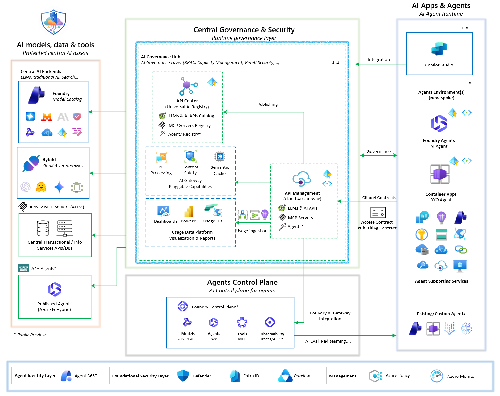
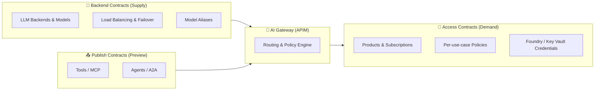

# AI Gateway Landing Zone

AI Gateway Landing Zone is an **enterprise-grade landing zone** that provides a centralized, governable, and observable gateway plane for AI consumption across teams and environments. It is delivered by the **Citadel Governance Hub** solution accelerator, a comprehensive solution for governing, observing, and accelerating AI deployments at scale with unified security, compliance, and intelligent orchestration.

The accelerator helps you deploy and operate the gateway using:

- Infrastructure-as-code (Bicep, Terraform)
- A unified AI gateway pattern (Azure API Management)
- Usage ingestion components (Logic Apps + Event Hub + Cosmos DB)
- Validation notebooks and operational guides

Use it on its own, or together with [Agent Landing Zone](../agent-landing-zone/index.md), which provides the Azure foundation for the agents and applications that consume the gateway.

Source code: [Azure-Samples/ai-hub-gateway-solution-accelerator](https://github.com/Azure-Samples/ai-hub-gateway-solution-accelerator) (Bicep) and [Azure/terraform-ai-gateway-landing-zone](https://github.com/Azure/terraform-ai-gateway-landing-zone) (Terraform).

## Part of the AI Citadel Blueprint

!!! important
    This accelerator is the **reference implementation of Layer 1 – Governance Hub** in the [AI Citadel Blueprint](blueprint/index.md) layered security architecture.

The **AI Citadel Blueprint** is a unified, layered approach to AI security and compliance, designed to enable enterprises to scale AI innovation while maintaining trust, security, and regulatory alignment. The blueprint is composed of four interlocking layers:

| Layer | Name | Responsibility | Implementation |
|-------|------|----------------|----------------|
| 🔷 **Layer 1** | **[Governance Hub](blueprint/layer-1-governance-hub.md)** | Runtime enforcement — unified AI gateway, policy-as-code, identity validation, token rate limiting, content filtering, cost attribution | **👉 This Accelerator** ([aka.ms/ai-hub-gateway](https://aka.ms/ai-hub-gateway)) |
| 🔶 **Layer 2** | **[Agent Operations](blueprint/layer-2-agent-operations.md)** | Agent runtime, observability & compliance — agent traces, AI evaluations, fleet operations, automated compliance checks | [Microsoft Foundry Agents & Control Plane](https://learn.microsoft.com/en-us/azure/ai-foundry/control-plane/overview) |
| 🟢 **Layer 3** | **[Agent Management](blueprint/layer-3-agent-management.md)** | Agent identity & lifecycle governance and security — unique agent identities, blueprints, shadow agent detection, sponsorship model, access packages | [Governing Agent Identities with Agent 365](https://learn.microsoft.com/en-us/microsoft-agent-365/) |
| 🛡️ **Layer 4** | **[Security Foundation](blueprint/layer-4-security-foundation.md)** | Unified protection — `Microsoft Defender` for AI threat intelligence, `Purview` for data governance, `Entra` for authentication and authorization | Microsoft Defender, Purview & Entra |

The layers are not isolated silos — they form an integrated architecture grounded in the principle of **separation of concerns with unified oversight**.

**Layer 1: Governance Hub** (this accelerator) acts as the runtime gateway through a hub-and-spoke deployment where a centrally managed AI gateway (Azure API Management) enforces runtime policies, while **Layer 2: Agent Operations** spoke environments give each business unit autonomous development within guardrails.
Adding **Layer 3: Agent Management** ensures that every agent has a unique, governable identity, while **Layer 4: Security Foundation** provides unified threat protection and data governance across the entire architecture.

> 📎 For the full Citadel Blueprint approach and guidance, see the [AI Citadel Blueprint](blueprint/index.md) section of this site.

---

## Benefits (Summary)

Citadel Governance Hub helps you standardize AI governance while maintaining developer velocity:

- **Governance & security**: consistent access control, identity patterns, policy enforcement
- **Observability & compliance**: central logging/metrics and near real-time usage analytics
- **Developer velocity**: repeatable onboarding patterns and contract-driven configuration

For a detailed stakeholder- and capability-level breakdown, see [Governance Hub Benefits](plan/governance-hub-benefits.md).

---

## What's included

The Bicep implementation includes:

- [bicep/infra](https://github.com/Azure-Samples/ai-hub-gateway-solution-accelerator/tree/main/bicep/infra): main IaC entrypoint and modules for provisioning the hub in addition to submodules for operational processes.
- [src/usage-ingestion-logicapp](https://github.com/Azure-Samples/ai-hub-gateway-solution-accelerator/tree/main/src/usage-ingestion-logicapp): Logic App workflows for processing usage/log streams and other governance workflows.
- [Validation notebooks](validation/notebooks-bicep.md): Jupyter notebooks for post-deployment validation and onboarding.
- Operational and architecture guides, published on this site.

The [Terraform implementation](deploy/terraform.md) has a parallel structure to the Bicep implementation.

## Architecture Overview

AI Citadel Governance Hub follows a **Central-Control-Plane** with decentralized **Agent-Execution-Plane** architecture that integrates seamlessly with your existing `Azure Enterprise Landing Zone` network topology:



### Networking approach

Detailed networking approach guidance for Citadel Governance Hub can be found in the [Network Approach Guide](plan/network-approach.md).

Initial deployments support optional [private-only Logic App website and SCM/Kudu access](plan/network-approach.md#logic-app-private-connectivity). This is opt-in; defaults remain public access enabled with no Logic App private endpoint.

Below is a high-level overview of the two supported deployment approaches:

#### Part of spoke network (peered to a hub VNet in the connectivity subscription)

In this approach, the Citadel Governance Hub is deployed within a dedicated spoke VNet that connects to the hub VNet via VNet peering.

Agentic workloads in other spokes are routed first to the hub network firewall through direct peering, then forwarded to the Citadel Governance Hub gateway network.

This provides an additional layer of isolation for AI workloads while still enabling secure communication with other enterprise resources in the hub.

This is the recommended approach for large enterprises with strict network segmentation requirements or those who want to isolate AI workloads from other enterprise resources.

#### Part of the enterprise network hub (usually in Connectivity subscription)

In this approach, the Citadel Governance Hub is deployed within the existing enterprise hub virtual network (VNet) of your Azure Enterprise Landing Zone.

This allows for direct communication between the unified AI gateway and connected agentic spokes (as the hub already peered with all spoke networks), leveraging existing networking configurations.

This approach is suitable for enterprises that prefer to integrate the governance hub within their existing network architecture without additional segmentation.

### **Citadel Governance Hub Components** - Central Runtime Control Plane

The central governance layer with unified AI Gateway that all AI workloads route through.

#### Core Components

| Component | Classification | Purpose | Enterprise Features |
|-----------|----------------|---------|---------------------|
| **🚪 API Management** | Required | Unified AI gateway | LLM governance, AI resiliency, AI registry gateway |
| **📘 API Center** | Recommended | Universal AI Registry | Discovery of available AI tools, agents and AI services |
| **🔍 Microsoft Foundry** | Required | Control Plane/Models/Observability | Platform LLMs, Control Plane & AI Evaluations |
| **📊 Log Analytics** | Required | Logs, metrics & audits | Scalable enterprise telemetry ingestion and storage |
| **📊 Application Insights** | Required | Platform monitoring | Performance dashboards, automated alerts |
| **📨 Event Hub** | Required | Usage data streaming | Real-time usage streaming, custom logging |
| **🗄️ Cosmos DB** | Required | Usage analytics | Long-term storage of usage, automatic scaling |
| **⚡ Logic App** | Required | Event processing | Workflow-based processing of usage/logs & AI Eval |
| **🔗 Virtual Network** | Required | Private connectivity | BYO-VNET support, private endpoints |

#### Security & Compliance

AI Gateway security & compliance enforcements components:

| Component | Classification | Purpose |Enterprise Features |
|---------|----------------|---------|---------------------|
| **🔐 Managed Identity** | Required | Zero-credential auth | Secure service-to-service communication |
| **🛡️ Content Safety** | Required | LLM protection | Prompt Shield and Content Safety protections (served from the **primary Microsoft Foundry / AI Services** account) |
| **💳 Language Service** | Required | PII detection | Natural language and RegEx based PII entity detection with anonymization support (served from the **primary Microsoft Foundry / AI Services** account) |
| **🔍 Microsoft Foundry** | Recommended | Control Plane | Control plane, responsible AI, registration of external agents  |

Supported by subscription wide security services:

| Component | Classification | Purpose |Enterprise Features |
|---------|----------------|---------|---------------------|
|**Defender for AI**|Recommended|Threat protection|AI workload security posture management|
|**Purview**|Recommended|Data governance|Sensitivity labeling, data classification|
|**Entra ID**|Required|Identity & access management|Zero Trust architecture, conditional access|

#### AI Services

Optionally you can deploy one or more generative AI services as part of the Citadel Governance Hub to provide fully functional gateway with LLMs already integrated:

| Component | Classification | Purpose | Enterprise Features |
|---------|----------------|---------|---------------------|
| **Microsoft Foundry** | Required | Model Catalog | Access to rich foundational model catalog with variety of deployment options and required for Azure Language and Azure Content Safety services |

#### Optional Components

Pluggable components to enhance AI Citadel Governance capabilities:

| Component | Classification | Purpose |
|-----------|----------------|---------|
| **Azure Managed Redis** | Optional | Semantic caching layer for high-throughput AI workloads |

### **Agents Onboarding** - for existing and new agents

To govern AI agents through Citadel Governance Hub, agents must communicate with AI backends (central LLMs, tools and agents) through the Citadel's unified AI gateway.

#### Access Contracts

Leverage **Citadel Access Contracts** to declare the required access to LLMs, tools and agents through the gateway along with precise governance policies.

[Access contracts](contracts/access-contracts-bicep.md) are infrastructure-as-code declarations of the access requirements and governance policies for an agent, which are then automatically enforced at runtime by the gateway.

> NOTE: Recommendation is to create one contract per business-unit/use-case/environment to allow for precise governance policies and better observability in the hub.

#### Publish Contracts (Preview)

Leverage **Citadel Publish Contracts** to onboard and publish centrally protected AI assets — **Tools (MCP)** and **Agents (A2A)** — through the gateway with per-asset backends, resiliency, baseline policies, usage tracking, and optional API Center registration.

[Publish contracts](contracts/publish-contracts.md) are infrastructure-as-code declarations of the AI assets published on the gateway. See the [Publish Contract Guide](contracts/publish-contract-guide.md) for asset types, backend/auth options, and Foundry A2A publishing.

> NOTE: Publish Contracts and Foundry-hosted A2A publishing are available in Preview (`publish-contract-version: 1.0.0-preview`). Publishing an asset does not grant access to it — governed access (products/subscriptions) is handled by Access Contracts.

#### Existing agents

Guidance to bring existing agents is through updating endpoint and credentials to access central LLMs, tools and agents through the **unified gateway** endpoint and credentials that are produced by the access contract provisioning for each agent.

> NOTE: Recommendation is to use Azure Key Vault to store these information due to its sensitivity when the agent is running on Azure.

#### New agents (AI Landing Zone for Microsoft Foundry)

Building new agents is accelerated through the **AI Landing Zone for Microsoft Foundry** guidance, which helps enterprises adopt AI faster by offering a governed, secure, and repeatable foundation for deploying AI applications and agents on Azure at scale.

For detailed guidance and technical implementation, see [Agent Landing Zone](../agent-landing-zone/index.md).

**Deployment Approach:**

- **One Agent Execution Plane per business unit or use case** - Deploy dedicated Foundry landing zone environments for each business unit, such as insurance claims processing, customer support automation, or other agentic scenarios
- **Flexible runtime options** - with Microsoft Foundry Agents (fully managed agent runtime) you get to choose between native Foundry agents or bring-your-own agent container frameworks like LangChain, Microsoft Agent Framework, or custom implementations while still benefiting from the unified governance and security of the hub
- **Pre-configured infrastructure** - Automated deployment via Bicep or Terraform with all networking, security, and monitoring built-in
- **Hub integration** - Seamless connection to Citadel Governance Hub through **Citadel Access Contracts**

**Deployment Patterns:**

- **Greenfield (Standalone with New Resources)** - Creates all infrastructure from scratch with new VNet and Log Analytics workspace
- **Brownfield (Standalone with Existing Resources)** - Integrates with existing enterprise landing zones, reusing VNets and centralized monitoring

> NOTE: As per Citadel Blueprint principles for **Layer 2: Agents Operations**, this landing zone provides a standardized foundation for enterprise AI workloads, with implementation options in Terraform and Bicep deployment. By activating **Access Contracts**, agents deployed in this landing zone can seamlessly integrate with the Citadel Governance Hub for unified runtime governance and observability.

---

## Governance Hub Operations - Contract-Driven Governance

Day-to-day operation of the Citadel Governance Hub is **contract-driven**: every change to what the gateway serves and who can consume it is declared as version-controlled infrastructure-as-code (`.bicepparam` files) rather than manual portal configuration. Three complementary contract types govern the gateway lifecycle:

- **🔌 Backend Contracts** — govern the **supply side**: which LLM backends and models the gateway can route to.
- **📤 Publish Contracts (Preview)** — govern which Tools (MCP) and Agents (A2A) are published through the gateway.
- **📝 Access Contracts** — govern the **demand side**: which use cases and agents can consume those models, and under which policies.

Together they create a clean separation of concerns: platform teams curate AI capacity and published assets, while business units onboard use cases against those governed assets without touching gateway internals.



### Backend Contracts — Onboard LLM backends and models

Declares the **governed AI capacity** the gateway can route to, enabling dynamic backend routing without modifying APIM policies:

- Multi-provider backends (Microsoft Foundry, Azure OpenAI, Amazon Bedrock, external/OpenAI-compatible providers)
- Automatic load balancing and failover across backends serving the same model
- Model aliases that abstract a client-facing name over multiple underlying models (with priority/weighted routing)
- Dynamic model discovery (`GET /deployments`) so clients and Microsoft Foundry can enumerate available models

> 🔗 **Learn More:** [Governance Hub Backend Contract Guide](contracts/backend-contracts-bicep.md)

### Access Contracts — Onboard use cases and agents

Declares the governed dependencies an agent or use case needs—LLMs, AI services, tools, and reusable agents—along with precise access policies enforced at runtime by the gateway:

- Model selection and capacity allocation (scoped to the curated backend capacity)
- Per-use-case APIM product, subscription, and policy (one contract per business-unit / use-case / environment)
- Safety and security guardrails (content safety, PII handling, layered API key + JWT authentication, OAuth scopes)
- Usage quotas, cost limits, and flexible credential delivery (Key Vault, Microsoft Foundry connection, or direct output)

> 🔗 **Learn More:** [AI Citadel Access Contracts Guide](contracts/access-contracts-bicep.md)

### Publish Contracts (Preview)

Publishes Tools (MCP) and Agents (A2A) through the gateway with declarative endpoint and backend configuration, baseline policies, usage tracking, resiliency for supported backend types, and optional Azure API Center registration. Foundry-hosted agents can be exposed as A2A endpoints.

> NOTE: This capability is available in Preview (`publish-contract-version: 1.0.0-preview`). Its contract surface may change before general availability. See the [Publish Contract Guide](contracts/publish-contract-guide.md).

### Why Contract-Driven Governance

- ✅ **Separation of concerns** — platform teams manage backends; business units manage their own access contracts
- ✅ **Audit-ready traceability** — every backend and access change is captured as reviewable infrastructure-as-code
- ✅ **Faster release cycles** — repeatable, declarative onboarding with automated approvals via DevOps pipelines
- ✅ **Reduced manual effort** — no manual gateway configuration for onboarding models or use cases
- ✅ **Continuous policy compliance** — guardrails are enforced consistently at runtime for every request

---

## Deployment Prerequisites (Basic/Fast)

For fast deployment, ensure you have the following prerequisites in place:

**Azure Requirements:**

- **Azure CLI** and **Azure Developer CLI** installed and signed in
- **Owner** or **Contributor + User Access Administrator** permissions on the subscription
- All required subscription resource providers registered (providers are outlined in the [Full Deployment Guide](deploy/bicep-full-deployment.md)).

**Tools:**
Although it is recommended to have the below tools installed on a local machine or through DevOps agents to conduct the provisioning, you still can leverage Azure Cloud Shell (mounted to storage account) as an alternative which has all the tools pre-installed.

- [Azure Developer CLI (azd)](https://learn.microsoft.com/azure/developer/azure-developer-cli/install-azd)
- [Azure CLI](https://learn.microsoft.com/en-us/cli/azure/install-azure-cli)
- [VS Code](https://code.visualstudio.com/Download) (optional)

> NOTE: Azure Cloud Shell is a great option for quick deployment without local setup, but for ongoing development and operations, having the tools installed locally or in your DevOps environment along with a git-repo will provide a better experience especially when it comes to production deployments.

---

## Quick Deploy

Deploy your Citadel Governance Hub in minutes with Azure Developer CLI:

```bash
# Authenticate and setup environment
azd auth login

# in a new folder, initialize the template (i.e. folder name: ai-hub-citadel-dev)
azd init --template Azure-Samples/ai-hub-gateway-solution-accelerator -e ai-hub-citadel-dev --branch citadel-v1

# Deploy Citadel Governance Hub
azd up
```

> 💡 **Tip**: Use Azure Cloud Shell to avoid local setup. This accelerator is setup by default to deploy ready to use Governance Hub. Review [main.bicepparam](https://github.com/Azure-Samples/ai-hub-gateway-solution-accelerator/blob/main/bicep/infra/main.bicepparam) configuration in case your need adjustments before deployment.

To deploy with Terraform instead, follow the [Terraform quick start](deploy/terraform-quick-start.md).

### Transient deployment issues
During deployment, you might encounter transient errors related to resource provisioning, which are common in complex deployments. If you encounter errors, please try to rerun the ```azd up``` command. If the issue persists, please check the error message for specific details and ensure that all prerequisites are met.

> TIP: For bicep deployments, a full list of deployed resources and status can be found in the Azure Portal under the resource group created -> Deployments.

### Validation Notebooks

After successful deployment, validate your Citadel Governance Hub setup using our interactive notebooks.

Detailed list and guidance of the available notebooks can be found in the [Validation Notebooks Guide](validation/notebooks-bicep.md), which includes step-by-step instructions to test key functionalities.

---

## Explore the documentation

Start with the [benefits](plan/governance-hub-benefits.md) of the Governance Hub, then use these guides to plan, deploy and operate the AI Gateway Landing Zone.

### Understand the Citadel Blueprint

| Guide | Description |
|-------|-------------|
| [AI Citadel Blueprint overview](blueprint/index.md) | The layered approach to governed AI at scale: the four layers, the shared trust model and defense in depth |
| [Layer 1 · Governance Hub](blueprint/layer-1-governance-hub.md) | The runtime enforcement plane — one governed front door across four dimensions (the layer this accelerator implements) |
| [Layer 2 · Agent Operations](blueprint/layer-2-agent-operations.md) | The AI experience engine and its first line of trust |
| [Layer 3 · Agent Management](blueprint/layer-3-agent-management.md) | Agents as owned, accountable enterprise and auditable assets |
| [Layer 4 · Security Foundation](blueprint/layer-4-security-foundation.md) | Protect and detect beneath every agent across all layers |
| [Organizational alignment & ownership](blueprint/organizational-alignment.md) | The operating model and the full RACI: who sets the standards, who runs the platform, who builds the agents |
| [Technical activation paths](blueprint/activation-paths.md) | The four parallel tracks from deep dive to proof of value to production, plus what to provision, what to activate, and sizing |
| Original platform guides: [technical guide](blueprint/platform-technical-guide.md) and [Well-Architected alignment](blueprint/platform-waf-alignment.md) | The Foundry Citadel Platform guides as first published |

### Plan

| Area | Guide | Description |
|------|-------|-------------|
| Infrastructure | [Parameters (Bicep)](deploy/bicep-parameter-files.md) | Comprehensive Bicep parameter file usage |
| | [Network approach](plan/network-approach.md) | Detailed networking approach for Citadel Governance Hub deployment |
| Capacity planning | [Citadel sizing guide](plan/sizing-guide.md) | Guidance on sizing the Citadel Governance Hub based on workloads and environments |
| | [PTU estimation guide](plan/ptu-estimation.md) | Azure OpenAI / Foundry LLM sizing guide for PTU vs Pay-as-you-Go capacity planning |
| | [AI Search cost estimation logic](observability/ai-search-cost-estimation.md) | Cost estimation logic for Azure AI Search behind the gateway |
| Resilience & business continuity | [Resiliency guide](resiliency/resiliency.md) | Circuit breaker, session affinity, automated failover, error handling, and alerting — what each does, how it works, and when to configure it |
| | [Business continuity & DR guide](resiliency/business-continuity-dr.md) | Plan business continuity and disaster recovery for the hub itself: topologies, global routing and operational procedures |
| | [Throttling events handling](observability/throttling-events.md) | Comprehensive, opt-in alerting on throttling, backend, authorization, content-safety, and PII events per use case, model, and backend |
| | [App Insights alerting](observability/app-insights-alerting.md) | Deploy Azure Monitor alert rules for the gateway's alert events |
| | [Cosmos global multi-master sync](operate/cosmos-multi-region-sync.md) | Link two or more hub deployments through a shared multi-region, multi-write Cosmos DB topology |

### Deploy

| Area | Guide | Description |
|------|-------|-------------|
| Bicep | [Quick deployment guide](deploy/bicep-quick-deployment.md) | Fast deployment with Bicep for non-production environments |
| | [Full deployment guide](deploy/bicep-full-deployment.md) | Comprehensive Bicep guide for dev, staging, and production |
| | [Post-deployment guide](operate/post-deployment.md) | Day-2 activities: onboard backends & use cases, enable Entra ID, activate Power BI, go multi-region, and upgrade the gateway |
| | [Validation notebook setup guide](validation/notebook-setup.md) | Set up an isolated Python environment for the validation notebooks |
| | [Validation notebooks](validation/notebooks-bicep.md) | Notebooks for post-deployment validation and onboarding |
| | [Notebook snippets](validation/notebook-snippets.md) | How shared code snippets are loaded into the notebooks |
| | [Developer VPN](operate/developer-vpn.md) | Optional connectivity add-on for private developer access to an existing deployment |
| Terraform | [Overview](deploy/terraform.md) | Terraform implementation of the landing zone, mirroring the Bicep reference architecture |
| | [Quick start](deploy/terraform-quick-start.md) | Concise, copy-paste guide for deploying the hub to dev or prod |
| | [Variables guide](deploy/terraform-variables.md) | Reference for all input variables of the root Terraform module |
| | [Full deployment guide](deploy/terraform-deployment-guide.md) | The full deployment lifecycle: prerequisites, ordering, rollout strategies, optional add-ons and exact commands |
| | [APIM policy architecture](deploy/terraform-policy-architecture.md) | How every API Management policy, fragment and named value is modeled, wired up and applied at runtime |
| | [Validation notebooks](validation/notebooks-terraform.md) | Testing and validation guide for Terraform-deployed hubs |

### Operate

| Area | Guide | Description |
|------|-------|-------------|
| Observe | [Platform observability guide](observability/platform-observability.md) | Layered observability: APIM Analytics dashboard, Application Insights, Log Analytics LLM logs (with optional prompt/response auditing), and Cosmos DB + Power BI |
| | [Power BI dashboard](observability/power-bi-dashboard.md) | Usage analytics and cost allocation dashboards |
| Backend contracts | [LLM backend onboarding (Bicep)](contracts/backend-contracts-bicep.md) | Onboard LLM backends and models with load balancing, failover and model aliases |
| | [Unified AI API type onboarding](apis/unified-ai-api-onboarding.md) | Add new LLM provider API types to the Unified AI API without changing the core routing logic |
| | [Bicep module reference](contracts/backend-bicep-modules.md) | Reference for the Bicep modules behind backend contracts |
| | [LLM backend onboarding (Terraform)](contracts/backend-contracts-terraform.md) | Onboard LLM backends to an existing hub APIM instance with a standalone Terraform deployment |
| Access contracts | [Overview](contracts/access-contracts-bicep.md) | Onboard use cases and agents with APIM products, subscriptions, policies and credential delivery (Bicep) |
| | [Reference guide](contracts/access-contracts-quick-reference.md) | Key concepts, folder conventions and deployment commands |
| | [Access contract policies](contracts/access-contracts-policies.md) | Deep dive into policy configurations for access contracts |
| | [Resiliency guide](contracts/access-contracts-resiliency.md) | Mirror a contract across additional gateways, Key Vaults and Foundry instances |
| | [LLM access guide](apis/llm-access.md) | Unified reference for the three LLM APIs and two access patterns, with a deep technical dive into model/backend routing |
| | [OpenAI-compatible API guide](apis/openai-compatible-api.md) | Use standard OpenAI SDKs and tools through the Unified AI API |
| | [Key rotation guide](contracts/access-contracts-key-rotation.md) | Optional zero-downtime rotation of subscription keys |
| | [Entra ID setup](security/entra-id-setup.md) | Create the Microsoft Entra ID app registration and configure APIM for JWT authentication |
| | [Entra ID auth validation](security/entra-id-authentication.md) | JWT validation and Zero Trust implementation |
| | [JWT client identity permissions](security/jwt-client-identity.md) | Direct app-role assignments for applications and managed identities, user-group assignments, and JWT permissions |
| | [PII anonymization & deanonymization](security/pii-masking.md) | Automated sensitive data protection |
| | [Agent Governance Toolkit](security/agent-governance-toolkit.md) | Add agent-level governance on top of gateway-level controls |
| | [Operate access contracts (Terraform)](contracts/access-contracts-terraform.md) | Onboard use cases to an existing hub APIM instance with a standalone Terraform deployment |
| Publish contracts (preview) | [Overview](contracts/publish-contracts.md) | Publish Tools (MCP) and Agents (A2A) through the gateway with optional Foundry A2A publishing |
| | [Publish contract guide](contracts/publish-contract-guide.md) | How the Publish Contract onboards and publishes centrally protected Tools (MCP) and Agents (A2A) through the gateway |
| Gateway upgrade | [APIM gateway upgrade (preview)](operate/gateway-upgrade.md) | Update gateway policies, APIs, backends, diagnostics, and named values on an existing APIM instance without re-provisioning infrastructure |
| | [Gateway ecosystem upgrade guide](operate/gateway-ecosystem-upgrade.md) | Provision or align the supporting services (Logic App, Cosmos DB, Event Hub, Foundry, Key Vault, identities) around an existing APIM |
| | [Release version management](operate/release-version-management.md) | Versioning model of the accelerator, the `/version` runtime endpoint, and how to plan and implement migrations |
| Foundry | [Foundry integration](operate/foundry-integration.md) | Let Microsoft Foundry projects use models through the gateway (Bring Your Own AI Gateway) |

## Release Version

The accelerator tracks its release state in a single source-of-truth manifest at the repository
root — [`release.json`](https://github.com/Azure-Samples/ai-hub-gateway-solution-accelerator/blob/main/release.json). Instead of one monolithic version, it uses **independent,
component-scoped version tracks** so a change in one subsystem does not force re-versioning of
unrelated ones:

| Track | Meaning |
|-------|---------|
| `master-version` | Umbrella accelerator release version |
| `routing-version` | LLM request routing logic (backend pools, model resolution, failover) |
| `backend-contract-version` | Shape of the `llmBackendConfig` backend onboarding contract |
| `access-contract-version` | Shape of the Citadel Access Contract (products & access policies) |
| `gateway-upgrade-version` | In-place APIM Gateway Upgrade tooling (currently `-preview`) |
| `usage-ingestion-version` | Usage ingestion pipeline (Logic App + Function) |

The deployed manifest is exposed at runtime through the **Release Version API** in API Management:

```bash
curl https://<your-apim-gateway-host>/version
```

This `GET /version` endpoint returns `release.json`. It is created automatically by the **primary deployment** and created/updated
by the **APIM Gateway Upgrade**, so the endpoint always reflects the currently deployed release.

The same API also exposes `GET /version/backend-contract`, which returns the **active LLM backend
routing contract** — a detailed projection of the effective onboarding configuration (APIM target,
full `llmBackendConfig` with per-model metadata, circuit breaker and session affinity settings, model
aliases, and derived pools), plus the `backend-contract-version`:

```bash
curl https://<your-apim-gateway-host>/version/backend-contract
```

!!! important
    The primary deployment (`main.bicep`) is used for the **initial implementation** only. After the
    hub is live, the **[APIM Gateway Upgrade](operate/gateway-upgrade.md)** submodule
    is the standard way to move the accelerator to new releases — applying the new version in place
    without re-provisioning the APIM service or landing-zone infrastructure.

> 📎 For version-track semantics, SemVer rules, and per-track migration guidance, see the
> [**Release Version Management Guide**](operate/release-version-management.md).

