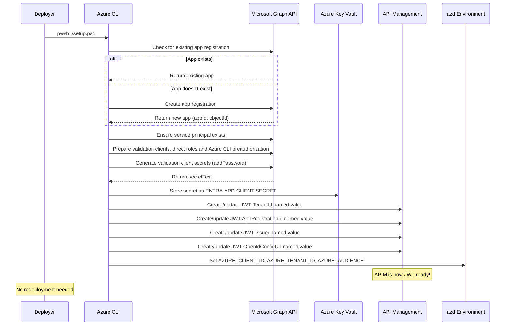

# Entra ID Setup for AI Hub Gateway

## Overview

Independent deployment module that creates a Microsoft Entra ID App Registration and **directly configures APIM JWT named values** for JWT authentication with the Citadel's AI Governance Hub.

This is a **standalone operation** — no redeployment of the main landing zone (`azd up`) is required. After running the setup script, APIM is immediately configured for JWT authentication.

## What Gets Created / Configured

| Resource | Description |
|----------|-------------|
| **Entra ID App Registration** | App with OAuth2 scope (`access_as_user`), app roles (`Model.Invoke`, `MCP.Invoke`, `Agent.Invoke`), sign-in audience `AzureADMyOrg` |
| **Application ID URI** | Set to `api://{appId}` — used as the JWT audience for token validation |
| **Service Principal** | Service principal for the app registration |
| **Positive Validation Client** | Separate `{gateway-app-name}-validation-client` app/service principal with `Model.Invoke` and a fresh 1-year secret, also stored in Key Vault as `ENTRA-APP-CLIENT-SECRET` |
| **Validation Role Assignments** | Direct `Model.Invoke` assignments to the dedicated validation client's service principal and the current Azure CLI user |
| **Negative Validation Client** | Separate `{gateway-app-name}-validation-negative` app/service principal with `MCP.Invoke`, but not `Model.Invoke`, and a fresh 1-year secret in the local azd environment |
| **Azure CLI Delegated Access** | Preauthorizes Azure CLI (`04b07795-8ddb-461a-bbee-02f9e1bf7b46`) for the gateway's `access_as_user` scope |
| **APIM Named Value: JWT-TenantId** | Entra ID tenant ID for JWT validation |
| **APIM Named Value: JWT-AppRegistrationId** | App registration client ID (audience) |
| **APIM Named Value: JWT-Issuer** | Token issuer URL (`https://login.microsoftonline.com/{tenantId}/v2.0`) |
| **APIM Named Value: JWT-OpenIdConfigUrl** | OpenID Connect configuration endpoint |
| **azd Environment Variables** | `AZURE_*` and `ENTRA_*` identity coordinates, both validation client secrets, user object ID, APIM name and resource group |

## Prerequisites

| Requirement | Description |
|-------------|-------------|
| **Azure CLI** | Authenticated as the user who will run the notebook (`az login`), not as a service principal |
| **Entra ID Permissions** | Permission to manage applications, preauthorize the delegated scope, and assign app roles to service principals/users, for example **Cloud Application Administrator**. Application Developer alone is insufficient for these assignments |
| **Key Vault** | Must exist (deployed by `azd up`) |
| **Key Vault Access** | Deployer needs `Key Vault Secrets Officer` role |
| **APIM Instance** | Must exist (deployed by `azd up`) |
| **APIM Access** | Deployer needs `API Management Service Contributor` role |
| **azd** | Azure Developer CLI installed (for environment variable storage) |
| **PowerShell** | Windows PowerShell 5.1 or PowerShell 7 (`pwsh`) |

> NOTE: For Key Vault Access, you can assign the `Key Vault Secrets Officer` role to your user account on the Key Vault. 
>
> - The main deployment does not automatically assign this role. The following command show example execution ```az role assignment create --role "Key Vault Secrets Officer" --assignee "REPLACE@TENANT.onmicrosoft.com" --scope (az keyvault show --name kv-REPLACE --query id --output tsv)```
> - Azure Key Vault public network access is disabled by default. Ensure you can access Key Vault from the machine that will run the setup script. You may need to enable public network access temporarily or run the script from a VM with access to the Key Vault.

## Usage

### Recommended Flow

```bash
# 1. Deploy the gateway infrastructure first (creates Key Vault, APIM, etc.)
azd up

# 2. Run the Entra ID setup (creates app registration + configures APIM directly)
cd bicep/infra/entra-id-setup
pwsh ./setup.ps1

# Done! APIM is now JWT-ready. No redeployment needed.
# Configure access contracts with jwtAuth.enabled=true to enforce JWT per product.
```

### With Explicit Parameters

```bash
pwsh ./setup.ps1 -EnvironmentName "citadel-dev" -KeyVaultName "kv-abc123" -ApimResourceGroup "rg-citadel-dev" -ApimName "apim-abc123"
```

### Using azd Environment (Auto-Detected)

```bash
# All values auto-detected from azd environment
pwsh ./setup.ps1
```

### Run the JWT Notebook Without Manual Inputs

After setup succeeds, open [JWT Authentication Validation](https://github.com/Azure-Samples/ai-hub-gateway-solution-accelerator/blob/main/validation/citadel-jwt-authentication-tests.ipynb)
in the repository validation kernel and **Run All**, using the same selected azd
environment and Azure CLI user. No configuration fields, secrets, or JWTs need
to be entered. The deployed model catalogue supplies the test model.

The notebook automatically acquires:

1. A client-credentials token from the dedicated validation client with `Model.Invoke`.
2. A delegated token for the **current Azure CLI user** via the gateway's `access_as_user` scope.
3. A token from the separate `MCP.Invoke`-only client, proving that a genuine token without `Model.Invoke` receives `403 insufficient_role`.

Both positive identities are tested against Universal `/models/chat/completions`
and Unified OpenAI v1 `/unified-ai/v1/chat/completions` only; the legacy OpenAI
API is neither discovered nor granted by the notebook's test contracts. The negative token
must first pass the JWT-only product control. Decoded headers and selected claims
show audience, issuer, tenant, client/user identity, scope, roles and lifetime, with
explicit scenario checks. Decoding does **not** verify a signature; APIM's live
request tests provide that evidence. Token bytes are never printed or persisted.

Setup stores `ENTRA_CLIENT_ID`, `ENTRA_TENANT_ID`, `ENTRA_AUDIENCE`,
`ENTRA_CLIENT_SECRET`, `ENTRA_VALIDATION_NEGATIVE_CLIENT_ID`,
`ENTRA_VALIDATION_NEGATIVE_CLIENT_SECRET`, and `ENTRA_VALIDATION_USER_ID` in the
selected local azd environment. Azure-prefixed coordinates remain available for
deployment compatibility: `AZURE_CLIENT_ID` is the gateway resource app, while
`ENTRA_CLIENT_ID` is the separate positive validation client. `ENTRA_AUDIENCE`
is the gateway's `api://{resource-app-id}`, not the calling client's ID.
Keep this environment private and out of source control.
Only the primary secret is also copied to Key Vault.

Manual `overrides` still take precedence. `VALIDATION_ENTRA_CLIENT_SECRET`,
`VALIDATION_JWT_NO_ROLE_TOKEN` (an application token without `Model.Invoke`), and
`VALIDATION_JWT_DEVICE_TOKEN` (the current user's delegated token) are optional
fixtures, not prerequisites. Use `token_source="current_user"` to select the user
token for manual inspection; both identities are tested regardless.

Conditional access, MFA, or an expired CLI session can require renewed interactive
sign-in. The notebook reports the required `az login --tenant ... --scope
api://.../access_as_user` command and stops instead of prompting or silently using
a different identity. The user must be the one given `Model.Invoke` by setup.
Directory/credential propagation delays can require rerunning the token cells.

## How It Works



## Integration with Main Deployment

The setup script configures APIM directly — **no redeployment is needed**. After running the script:

1. **APIM named values** are live and used by the unified `security-handler` policy fragment across all three API endpoints (Azure OpenAI API, Universal LLM API, Unified AI API)
2. **Access contracts** can set `jwtRequired: true` in their product policy to enforce JWT per product
3. **azd env vars** are stored for future `azd up` runs (values flow through `main.bicepparam`)

### Subsequent `azd up` Runs

Future redeployments will not overwrite the APIM named values with `'not-configured'` because the azd environment variables (`AZURE_CLIENT_ID`, `AZURE_TENANT_ID`, `AZURE_AUDIENCE`) are now populated. The Bicep deployment reads these and sets the named values to the correct values.

## Idempotency

The script is fully idempotent:

- **App Registration**: Searched by `displayName` — reuses existing if found
- **App Roles**: Adds missing gateway roles and updates their names, values, and descriptions by stable role ID; preserves existing assignments, enabled state, allowed member types, and custom roles
- **Service Principal**: Searched by `appId` — reuses existing if found  
- **Client Secrets**: Generates fresh validation client secrets and updates Key Vault with the positive client's secret
- **azd Variables**: Always overwritten with current values

Re-running the script after a partial failure or for secret rotation is safe.

### App Role Authorization

The gateway defines only three capability-specific app roles: `Model.Invoke`,
`MCP.Invoke`, and `Agent.Invoke`. Assign each client only the roles it needs.
Clients needing all three capabilities should be assigned all three roles;
there is no umbrella role.

Set each access contract's `requiredRoles` to the appropriate role and enable JWT
validation with `jwtRequired=true`. For bring-your-own app registrations, define
the same role values before assigning them to clients.

Setup creates the direct validation assignments described above. For other clients,
assign roles **directly to each application's or managed identity's service
principal**. Security-group app-role assignments apply to signed-in users;
service-principal group membership does not produce those roles in tokens.
See the [client identity and permissions guide](jwt-client-identity.md)
for direct application assignments and user-group assignments.

App roles and exposed delegated permission scopes share Entra ID's default limit
of **700 permission definitions per application or service principal** and also
count toward the separate **1,200-entry application manifest limit**. This setup
defines three roles and one delegated scope (`access_as_user`), using four distinct
definitions. Role assignments to callers are not permission definitions. See
[Microsoft's app role limits](https://learn.microsoft.com/en-us/entra/identity-platform/howto-add-app-roles-in-apps#app-role-limits).

### Offline Regression Tests

```powershell
pwsh .\tests\test-app-roles.ps1
pwsh .\tests\test-azd-command.ps1
pwsh .\tests\test-validation-identities.ps1
```

These tests mock Azure CLI calls and verify new registrations, in-place role
updates, assignment-setting preservation, idempotency, and update failures.
Validation-identity tests verify direct application/user assignments, preservation
of other preauthorized clients, the negative client's restricted role, Graph
pagination, repeated setup and explicit authorization failures.
The azd tests use a local native-process fixture to verify stderr notices,
exit-code failures, environment reads/writes, and parameter resolution without
accessing Azure. On Windows PowerShell 5.1, run the test scripts directly with
`.\tests\test-app-roles.ps1` and `.\tests\test-azd-command.ps1`.

## Bring Your Own App Registration

If you already have an Entra ID App Registration, skip this script and set the values directly:

```bash
azd env set AZURE_CLIENT_ID "your-client-id"
azd env set AZURE_TENANT_ID "your-tenant-id"
azd env set AZURE_AUDIENCE "api://your-client-id"
azd env set ENTRA_CLIENT_SECRET "your-client-secret"
```

Then run `azd up` — the main deployment will use your existing app registration values.

## Files

```
entra-id-setup/
├── setup.ps1          # PowerShell script for Entra ID provisioning
├── main.bicep         # Placeholder Bicep (documentation only)
└── README.md          # This file
```

## Troubleshooting

### "azd: Update available" / "NativeCommandError" in Windows PowerShell

The update message is an azd notice written to stderr, not an authentication or
provisioning failure. Windows PowerShell 5.1 can turn native stderr into a
terminating error when `$ErrorActionPreference = "Stop"`, even with `2>$null`.

The setup script handles azd stderr separately from returned environment values
and checks the native exit code. Notices remain visible as warnings; required
reads and writes with nonzero exit codes still stop setup. Optional APIM lookups
report failures and allow the existing resource-discovery fallback.

Run the current script again; upgrading azd is not required to address this
notice. In Windows PowerShell, use `.\setup.ps1`; in PowerShell 7, use
`pwsh .\setup.ps1`. Do not disable error handling for the entire setup script.

### "Not logged in to Azure CLI"
Run `az login` and ensure you're connected to the correct tenant.

### "Insufficient privileges" when preparing validation identities
Application creation permissions alone are not sufficient. The signed-in user
also needs permission to assign app roles to applications/users and preauthorize
the delegated scope, for example Cloud Application Administrator. Setup stops on
Graph authorization failures rather than reporting validation readiness.

### "Key Vault not found"
Run `azd up` first to create the infrastructure (Key Vault, APIM, etc.), then run this script.

### "Access denied to Key Vault"
Ensure you have `Key Vault Secrets Officer` role on the Key Vault. The main deployment grants this to the APIM managed identity, but you also need it for your user account.

## Related

- [Full Deployment Guide](../deploy/bicep-full-deployment.md) — Complete deployment instructions
- [Entra ID Authentication Guide](entra-id-authentication.md) — JWT validation configuration
- [Access Contracts](../contracts/access-contracts-bicep.md) — Per-product JWT enforcement
- [JWT Authentication Validation Notebook](https://github.com/Azure-Samples/ai-hub-gateway-solution-accelerator/blob/main/validation/citadel-jwt-authentication-tests.ipynb) — JWT testing on Universal and Unified OpenAI v1 APIs
