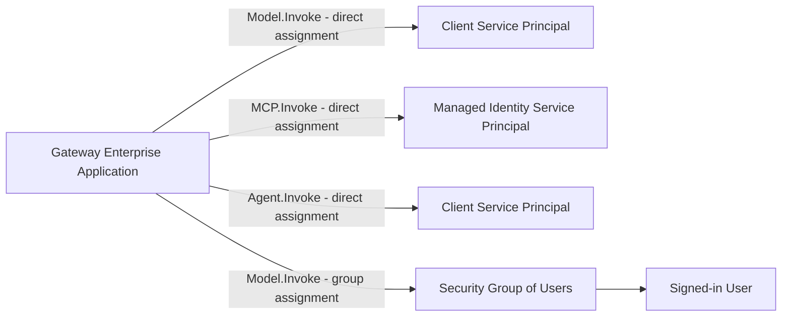

# JWT Client Identity and Permissions Management

This guide covers how to configure **client application identities** and **users** to authenticate with JWT-protected AI Hub Gateway endpoints. Assign app roles directly to application service principals and managed identities; use direct user assignments or Entra ID security groups for users.

> **Prerequisites:** The gateway must already be configured for JWT authentication. See the [JWT Authentication Guide](entra-id-authentication.md) for setup instructions on configuring the gateway's `security-handler` and APIM named values.

For the included validation notebook, [Entra setup](entra-id-setup.md)
prepares direct `Model.Invoke` assignments for a dedicated client and signed-in user,
a separate `MCP.Invoke`-only negative client, and Azure CLI delegated preauthorization.
The notebook acquires all three tokens without manual fields. The instructions
below cover onboarding other application/user identities.

## When Do You Need This Guide?

By default, the gateway's `security-handler` validates JWT tokens by checking the **audience**, **issuer**, **signature**, and **expiry** claims. Access contracts can additionally require app roles through `requiredRoles`. Acquiring a token does not establish that the caller has any app roles.

If you need to:

- **Authorize application and user identities** for specific gateway capabilities
- **Manage access at scale** across many AI agents and services
- **Onboard/offboard clients** without modifying gateway configuration

Then this guide provides the patterns for granting and managing those permissions.

## What the Gateway Validates (Recap)

| Claim | Validated Against | Description |
|-------|-------------------|-------------|
| **Audience (`aud`)** | `JWT-AppRegistrationId` or `jwtAudience` override | Token must target the gateway's audience |
| **Issuer (`iss`)** | `JWT-Issuer` or `jwtIssuer` override | Token must come from expected identity provider |
| **Signature** | Keys from `JWT-OpenIdConfigUrl` or `jwtOpenIdConfigUrl` override | Token signature verified using provider's public keys |
| **Expiry (`exp`)** | Current time | Token must not be expired |
| **Roles (`roles`)** | `requiredRoles` variable (per-product, optional) | If set, token must contain at least one of the required app roles |

Access control beyond token validation is enforced via the **APIM subscription key** (API key), which ties each request to a specific Access Contract (product).

## Assigning App Roles by Identity Type

App roles are defined on the **gateway app registration**, representing the API being called. Assignments reference the gateway's **service principal** (enterprise application) as the resource.

| Caller | Assignment that supplies the JWT `roles` claim |
|--------|-----------------------------------------------|
| Application using client credentials | Assign the role **directly to the client application's service principal**, including through application-permission admin consent |
| Azure managed identity | Assign the role **directly to the managed identity's service principal** |
| Signed-in user using a delegated flow | Assign the role directly to the user, or to a security group containing the user |

**Service principals do not inherit app roles from group membership.** Adding an application's service principal or a managed identity to a group with an app-role assignment does not cause Entra ID to add that role to its tokens. Groups are an assignment mechanism for **users**, not application identities.

This behavior is documented in [Microsoft Entra app roles](https://learn.microsoft.com/en-us/entra/identity-platform/howto-add-app-roles-in-apps).



> **Available App Roles:** The gateway defines `Model.Invoke`, `MCP.Invoke`, and `Agent.Invoke`. Assign only the roles each client needs; clients needing all three capabilities receive all three roles. Products require specific roles via `requiredRoles` in the product policy.

### App Role Limits

Entra ID has a default limit of **700 permission definitions per application or service principal**, shared by app roles and exposed delegated permission scopes. These definitions also count toward the separate **1,200-entry application manifest limit**. These are definition limits, not counts of users, groups, or service principals assigned to a role.

The gateway defines three app roles and one delegated scope (`access_as_user`), consuming four distinct permission definitions. Reuse those roles across callers rather than creating a new role per client. See Microsoft's [App role limits](https://learn.microsoft.com/en-us/entra/identity-platform/howto-add-app-roles-in-apps#app-role-limits) for counting rules and guidance for existing objects.

## Granting User Access via Entra ID Security Groups

This section applies only to **signed-in users** in delegated flows. For application service principals and managed identities, use the direct assignment instructions under [Client Identity Types](#client-identity-types).

### Step 1: Create a Security Group

Create an Entra ID security group containing users authorized to invoke models:

```bash
# Create a security group for gateway users
az ad group create --display-name "Citadel-AI-Gateway-Model-Users" --mail-nickname "citadel-ai-gateway-model-users" --description "Users authorized to invoke models through the Citadel Governance Hub"
```

Note the group's `id` (object ID) from the output.

```bash
az ad group list --filter "displayName eq 'Citadel-AI-Gateway-Model-Users'" --query "[0].id" --output tsv
```

### Step 2: Assign the Gateway's App Role to the Group

Assign `Model.Invoke` to the users' security group:

```powershell
# Get the gateway app's service principal ID (created manually or via the provided script in bicep\infra\entra-id-setup\setup.ps1)
$gatewaySpId = az ad sp list --filter "appId eq '{gateway-app-id}'" --query "[0].id" --output tsv
echo "Gateway Service Principal ID: $gatewaySpId"

# Get the desired app role ID (Model.Invoke, MCP.Invoke, or Agent.Invoke)
$roleId = az ad app show --id '{gateway-app-id}' --query "appRoles[?value=='Model.Invoke'].id" --output tsv
echo "Role ID: $roleId"

# Get the group's object ID
$groupId = az ad group show --group "Citadel-AI-Gateway-Model-Users" --query "id" --output tsv
echo "Group ID: $groupId"

# Assign the app role to the group
@{ principalId = $groupId; resourceId = $gatewaySpId; appRoleId = $roleId } | ConvertTo-Json | Set-Content -Path body.json
az rest --method POST `
  --uri "https://graph.microsoft.com/v1.0/groups/$groupId/appRoleAssignments" `
  --body '@body.json'
Remove-Item body.json
```

> **Prerequisite:** The group must be a **security group** (not Microsoft 365 group). The assigning user needs at least the **Cloud Application Administrator** or **Privileged Role Administrator** Entra ID role.

### Step 3: Add Users to the Group

```powershell
$userId = az ad user show --id "user@example.com" --query "id" --output tsv
az ad group member add --group "Citadel-AI-Gateway-Model-Users" --member-id $userId
```

**Verify membership:**
```bash
az ad group member list --group "Citadel-AI-Gateway-Model-Users" --query "[].{name:displayName, userId:id, user:userPrincipalName}" --output table
```

**Remove a user (offboarding):**
```bash
az ad group member remove --group "Citadel-AI-Gateway-Model-Users" --member-id "{user-object-id}"
```

Acquire a fresh delegated user token after assignments propagate and verify its `roles` claim. The requested resource determines the token audience; group membership does not change it. Application identities still need direct app-role assignments even when they belong to this group.

## Client Identity Types

### Identity Type 1: Entra ID App Registration (Service Principal)

Use this when the client application runs outside Azure (on-premises, other clouds, developer workstations) or when you need explicit credentials (client ID + secret/certificate).

#### Step 1: Create or Use an Existing App Registration

The client application needs its own app registration in the **same Entra ID tenant** as the gateway:

```bash
# Create a new app registration for the client
az ad app create --display-name "my-ai-agent"
```

Note the `appId` from the output — this is the client's identity.

Create its service principal before assigning roles:

```bash
az ad sp create --id "{client-app-id}"
```

#### Step 2: Create a Client Secret

> **Note:** For production scenarios, consider using a certificate credential instead of a client secret for improved security.

```bash
# Get the app's object ID
az ad app list --display-name "my-ai-agent" --query "[0].id" --output tsv

# Generate a credential
az ad app credential reset --id {app-object-id} --display-name "gateway-access" --years 1
```

Store the generated `password` securely (e.g., Azure Key Vault, environment variable).

#### Step 3: Grant Permission to the Gateway

Assign the required roles **directly to the client's service principal**, using application-permission admin consent or Microsoft Graph. Group membership does not supply application roles.

**Option A: Admin consent via Azure Portal**

1. Navigate to **Entra ID** > **App registrations** > Select the **client** app (e.g., "my-ai-agent")
2. Go to **API permissions** > **Add a permission**
3. Select **APIs my organization uses** > Search for the gateway app name (e.g., `ai-citadel-gateway-{env}`)
4. Select **Application permissions** and choose the required roles: `Model.Invoke`, `MCP.Invoke`, and/or `Agent.Invoke`
5. Click **Grant admin consent** for the tenant

**Option B: CLI**

```powershell
# Get the gateway app's service principal ID
$gatewaySpId = az ad sp list --filter "appId eq '{gateway-client-id}'" --query "[0].id" --output tsv

# Get the client service principal's object ID (not its app/client ID)
$clientSpId = az ad sp show --id "{client-app-id}" --query "id" --output tsv

# Get the Model.Invoke role ID (use MCP.Invoke or Agent.Invoke for those capabilities)
$roleId = az ad app show --id {gateway-app-object-id} --query "appRoles[?value=='Model.Invoke'].id" --output tsv

# Assign the app role to the client's service principal
@{ principalId = $clientSpId; resourceId = $gatewaySpId; appRoleId = $roleId } | ConvertTo-Json | Set-Content -Path body.json
az rest --method POST --uri "https://graph.microsoft.com/v1.0/servicePrincipals/$clientSpId/appRoleAssignments" --body '@body.json'
Remove-Item body.json
```

Repeat the assignment for each required role. To audit assignments, run `az rest --method GET --uri "https://graph.microsoft.com/v1.0/servicePrincipals/$clientSpId/appRoleAssignments"` and match `resourceId` and `appRoleId` to the gateway.

> **Note:** Direct assignment or application-permission admin consent supplies the application roles. Entra ID can issue role-less application tokens when assignment is not required. A valid token without a role required by an access contract is rejected with `403 insufficient_role`; consent failures such as `AADSTS65001` are separate from that gateway check.

#### Step 4: Acquire a Token

```python
import requests

token_response = requests.post(
    f"https://login.microsoftonline.com/{tenant_id}/oauth2/v2.0/token",
    data={
        "grant_type": "client_credentials",
        "client_id": "{client-app-id}",
        "client_secret": "{client-secret}",
        "scope": "api://{gateway-app-id}/.default"
    }
)

jwt_token = token_response.json()["access_token"]
```

#### Step 5: Call the Gateway

```python
response = requests.post(
    f"https://{apim-gateway}/openai/deployments/gpt-4o/chat/completions?api-version=2024-12-01-preview",
    headers={
        "api-key": "{subscription-key}",
        "Authorization": f"Bearer {jwt_token}",
        "Content-Type": "application/json"
    },
    json={
        "messages": [{"role": "user", "content": "Hello"}],
        "max_tokens": 50
    }
)
```

### Identity Type 2: Azure Managed Identity

Use this when the client application runs on an Azure compute service (Azure Functions, Container Apps, App Service, Azure VM, AKS). Managed identities eliminate the need to manage credentials — Azure handles certificate rotation automatically.

#### Step 1: Enable Managed Identity on the Compute Resource

**System-assigned identity** (recommended for single-purpose services):
```bash
# Example: Azure Function App
az functionapp identity assign --name my-ai-agent-func --resource-group my-rg
```

**User-assigned identity** (recommended for shared identity across services):
```bash
# Create the identity
az identity create --name my-ai-agent-identity --resource-group my-rg

# Assign to compute
az functionapp identity assign --name my-ai-agent-func --resource-group my-rg --identities /subscriptions/{sub}/resourceGroups/my-rg/providers/Microsoft.ManagedIdentity/userAssignedIdentities/my-ai-agent-identity
```

Note the `principalId` (object ID) and `clientId` from the output.

#### Step 2: Grant Permission to the Gateway

Assign the required roles **directly to the managed identity's service principal**. Its `principalId` is the service principal's object ID; do not use its client ID as `principalId`. Group membership does not supply managed-identity app roles.

```powershell
# For a user-assigned identity; for a system-assigned identity, use the compute resource's identity.principalId
$miPrincipalId = az identity show --name my-ai-agent-identity --resource-group my-rg --query "principalId" --output tsv

# Get the gateway app's service principal
$gatewaySpId = az ad sp list --filter "appId eq '{gateway-client-id}'" --query "[0].id" --output tsv

# Get the Model.Invoke role ID (use MCP.Invoke or Agent.Invoke for those capabilities)
$roleId = az ad app show --id {gateway-app-object-id} --query "appRoles[?value=='Model.Invoke'].id" --output tsv

# Assign the app role to the managed identity
@{ principalId = $miPrincipalId; resourceId = $gatewaySpId; appRoleId = $roleId } | ConvertTo-Json | Set-Content -Path body.json
az rest --method POST --uri "https://graph.microsoft.com/v1.0/servicePrincipals/$miPrincipalId/appRoleAssignments" --body '@body.json'
Remove-Item body.json
```

Repeat the direct assignment for each required capability. See Microsoft's [managed identity app-role assignment guidance](https://learn.microsoft.com/en-us/entra/identity/managed-identities-azure-resources/how-to-assign-app-role-managed-identity).

> **Important:** The requested resource determines `aud`, independently of role assignments. A managed identity can receive a token for the correct audience without the required `roles`. A role-enforced access contract rejects that valid token with `403 insufficient_role`, not an audience-related `401`.

#### Step 3: Acquire a Token Using Azure Identity SDK

```python
from azure.identity import DefaultAzureCredential

credential = DefaultAzureCredential()

# The scope must be the gateway's Application ID URI with /.default
token = credential.get_token("api://{gateway-app-id}/.default")
jwt_token = token.token
```

For user-assigned managed identity, specify the client ID:

```python
from azure.identity import ManagedIdentityCredential

credential = ManagedIdentityCredential(client_id="{managed-identity-client-id}")
token = credential.get_token("api://{gateway-app-id}/.default")
jwt_token = token.token
```

#### Step 4: Call the Gateway

```python
response = requests.post(
    f"https://{apim-gateway}/models/chat/completions?api-version=2024-05-01-preview",
    headers={
        "api-key": "{subscription-key}",
        "Authorization": f"Bearer {jwt_token}",
        "Content-Type": "application/json"
    },
    json={
        "model": "gpt-4o",
        "messages": [{"role": "user", "content": "Hello"}],
        "max_tokens": 50
    }
)
```

### Identity Type 3: External Identity Provider (Non-Entra)

For client applications authenticating via a non-Entra identity provider (Auth0, Okta, AWS Cognito), configure the gateway's APIM named values — or use per-product overrides (`jwtAudience`, `jwtIssuer`, `jwtOpenIdConfigUrl`) — to point to the external provider's OpenID Connect endpoints. The client then acquires a token from that provider using its native SDK.

The key requirement is that the token's `aud` (audience) and `iss` (issuer) claims match the values configured in the gateway.

## Quick Reference: Client Onboarding Checklist

| Step | Service Principal | Managed Identity |
|------|-------------------|------------------|
| 1. Create identity | `az ad app create` + `az ad sp create` | `az identity create` or enable on compute |
| 2. Create credential | `az ad app credential reset` | Not needed (Azure-managed) |
| 3. Assign app roles | Direct `appRoleAssignments` on the client service principal, or application-permission admin consent | Direct `appRoleAssignments` on the managed identity's service principal |
| 4. Verify assignment | Check gateway `resourceId` and required `appRoleId` in the client's assignments; group membership is not sufficient | Same — use the managed identity's principal/object ID |
| 5. Acquire token | `POST /oauth2/v2.0/token` with client credentials | `DefaultAzureCredential().get_token()` |
| 6. Call gateway | `api-key` + `Authorization: Bearer {token}` | `api-key` + `Authorization: Bearer {token}` |

## Troubleshooting

| Error | Cause | Fix |
|-------|-------|-----|
| `AADSTS65001: not consented` | Client app lacks consent for requested gateway API permissions | Grant admin consent for the appropriate application permissions or delegated scope; group membership does not grant application permissions |
| `AADSTS700016: application not found` | Wrong client ID or wrong tenant | Verify client app exists in the same tenant |
| `AADSTS7000215: invalid client secret` | Secret expired or incorrect | Rotate the secret with `az ad app credential reset` |
| `401: invalid or expired JWT` | Token audience doesn't match gateway config | Verify token `aud` matches `JWT-AppRegistrationId` or `jwtAudience` |
| `401: jwt_required` | No Bearer token in request | Add `Authorization: Bearer {token}` header |
| `403: insufficient_role` | Token valid but missing required app role | For applications and managed identities, assign the role directly to their service principal; for users, assign it directly or through a users' security group. Acquire a fresh token |
| Application token lacks `roles` despite group membership | Service principals do not inherit a group's app roles | Assign roles directly to the application's or managed identity's service principal |
| Token works in Postman but not in code | Scope format incorrect | Use `api://{gateway-app-id}/.default` (not just the client ID) |

## Related Resources

- [JWT Authentication Guide](entra-id-authentication.md) — Gateway-side JWT setup and configuration
- [Access Contracts Policy Guide](../contracts/access-contracts-policies.md#jwt-authentication-policy) — Configuring JWT per-product
- [JWT Authentication Validation Notebook](https://github.com/Azure-Samples/ai-hub-gateway-solution-accelerator/blob/main/validation/citadel-jwt-authentication-tests.ipynb) — End-to-end testing
- [Entra ID Setup README](entra-id-setup.md) — Provisioning the gateway's app registration
- [Microsoft Entra app roles](https://learn.microsoft.com/en-us/entra/identity-platform/howto-add-app-roles-in-apps) — Role definitions and supported assignment types
- [Microsoft Entra app role limits](https://learn.microsoft.com/en-us/entra/identity-platform/howto-add-app-roles-in-apps#app-role-limits) — Permission-definition and manifest limits
